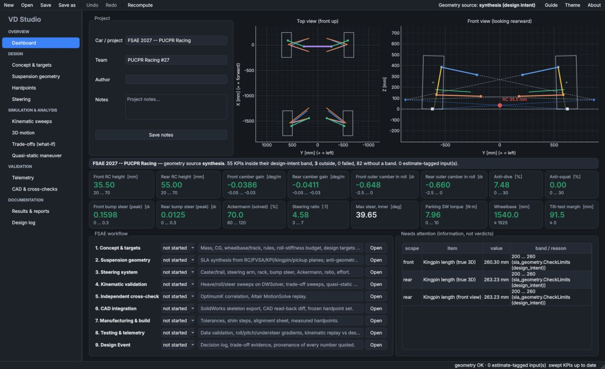
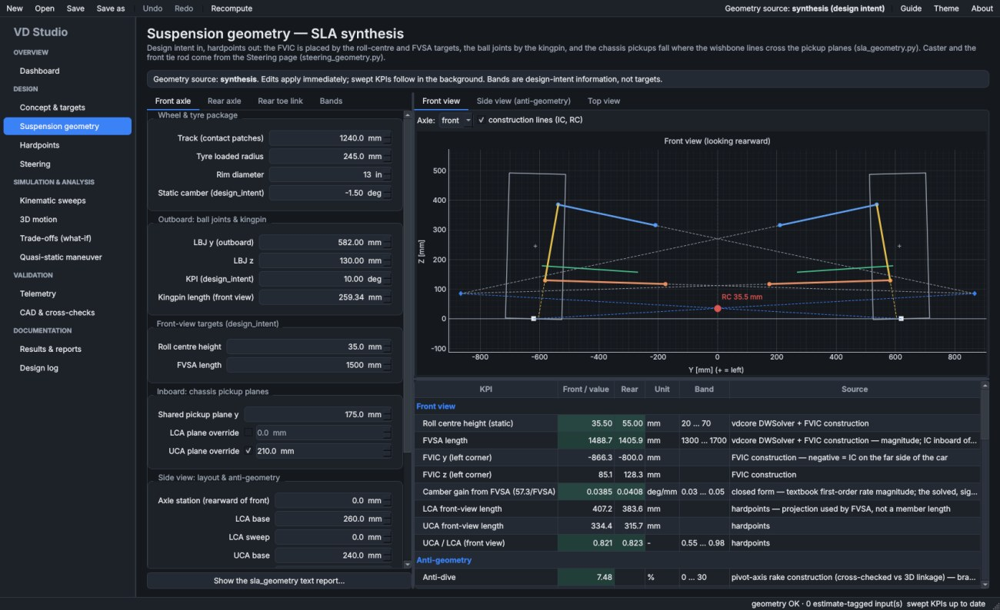
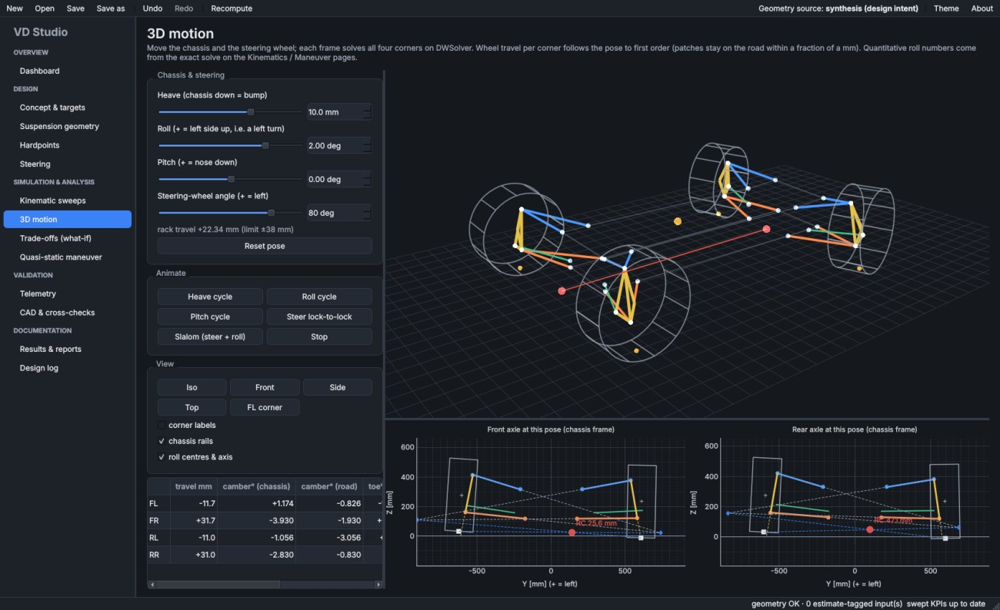
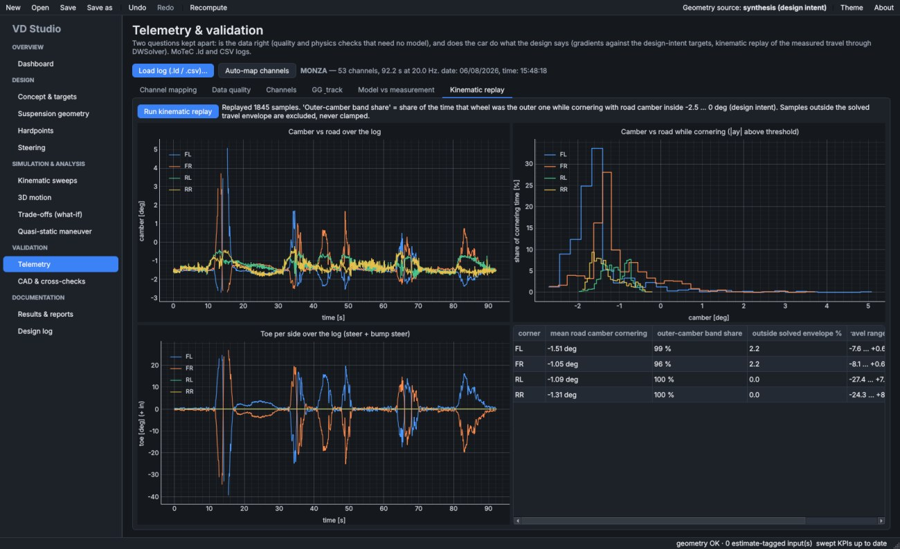
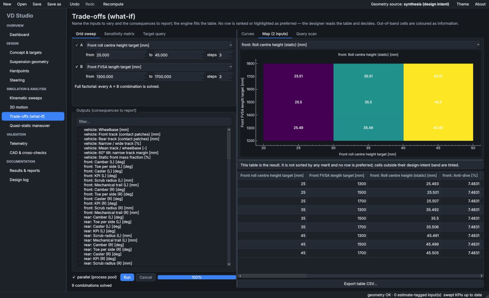

# VD Studio — user guide

VD Studio is the PUCPR Racing desktop workbench for suspension and steering. It
puts every tool in this repository behind one window and follows the car through
the FSAE season: concept numbers, SLA synthesis, steering, kinematic
simulation, trade-off sweeps, quasi-static maneuvers, telemetry validation,
CAD exchange, cross-checks and the Design Event documentation.

> **The tool computes trade-offs; the designer chooses the geometry.** Nothing
> in VD Studio recommends a value. Bands are the design-intent windows recorded
> in `CheckLimits` / `SteeringLimits` and are shown as *information*. A target
> is only ever an argument to a query ("which value of X puts Y at T?"), and a
> query result is applied only when you click to apply it — recorded and
> undoable.



## Install and run

### Windows: desktop shortcut (recommended)

Double-click **`Install VD Studio shortcut.bat`** in the repository root, once.
It installs the desktop dependencies into `.venv` (`uv sync --extra desktop
--inexact`: `--inexact` keeps the packages the legacy Streamlit app needs) and
puts a **VD Studio** icon on the Desktop and in the Start menu (so it is also
found by typing "VD Studio" in the Start search). From then on, open the app
from that icon: it starts `.venv\Scripts\pythonw.exe -m apps.vdstudio` in the
repository folder, with no console window.

- Run the installer again after moving the repository folder, or after a
  `git pull` that changes `pyproject.toml` (new dependencies).
- Without a console, output and tracebacks go to
  `%LOCALAPPDATA%\VD Studio\vdstudio.log`, and an unexpected error is shown
  in a dialog that names that file.
- Remove the shortcuts with `"Install VD Studio shortcut.bat" --remove` from a
  terminal.
- The installer needs [uv](https://docs.astral.sh/uv/) (or an existing
  `.venv` with the desktop extra) and PowerShell, which every Windows 10/11
  has.

### Windows: other ways

```powershell
uv sync --extra desktop --inexact   # once; adds PySide6, pyqtgraph, PyOpenGL
uv run --extra desktop python -m apps.vdstudio
```

or double-click **`VD Studio.bat`** in the repository root (opens with a
console window, useful to see errors live). Open a project directly with
`python -m apps.vdstudio path\to\car.vdproj.json`, or drop the file onto
either launcher.

### Linux / macOS

`./run_vdstudio.sh`, or create a launcher once with
`.venv/bin/python -m apps.vdstudio.shortcut`: a `vdstudio.desktop` entry in
the application menu and on the Desktop (Linux), or `VD Studio.command` on the
Desktop (macOS). `--remove` takes them away. Headless machines without OpenGL
can set `VDSTUDIO_NO_GL=1` (the 3D view is replaced by a notice; everything
else works).

The icon is drawn by `scripts/make_icon.py` into `apps/vdstudio/resources/`.

## Project files

A project is one JSON file, `*.vdproj.json`, holding everything the designer
owns: concept numbers, geometry inputs, hardpoints, targets, stage status, the
design log and the telemetry settings. Derived values are never stored. The
team's shared car is **`projects/FSAE_2027.vdproj.json`**, versioned in git.

**What opens on start:**

1. a file given on the command line, or dropped onto the Desktop icon or
   `VD Studio.bat`;
2. otherwise the **last project you opened or saved**;
3. otherwise the team project, `projects/FSAE_2027.vdproj.json`;
4. otherwise the built-in 2027 car, read from `sla_geometry.py` /
   `steering_geometry.py`.

The status bar says which file was opened and why.

**Saving:**

- **Save** (`Ctrl+S`) writes back to the open file; **Save as…** starts in the
  same folder.
- The write is atomic (a temporary file, then a rename), so a crash mid-save
  leaves the previous version intact.
- Closing, **New** or **Open** with unsaved changes asks **Save / Discard /
  Cancel**.

**Recent** (toolbar) lists the last eight projects and the team project.

Files saved by older versions open with defaults for any field added since.

**New** returns the built-in car from the scripts. Use it to pick up changes
made to `sla_geometry.py` / `steering_geometry.py`. A saved project keeps its
own values and does not follow the scripts.

## The workflow, stage by stage

The Dashboard tracks nine FSAE stages (status + notes, saved in the project).
Each maps onto the pages below.

| Stage | Where | What you do there |
|---|---|---|
| 1. Concept & targets | **Concept & targets**, **Design log › targets** | Mass/CG (subsystem estimator), wheelbase/track rules, tilt margin, roll-stiffness budget from a roll-gradient target, chassis torsion factor, first-order camber recovery. Targets carry rationale + reference. |
| 2. Suspension geometry | **Suspension geometry** | `sla_geometry.py` synthesis: RC + FVSA place the FVIC, the kingpin places the ball joints, pickup planes place the chassis points, base/sweep/rise set the side view and anti-geometry. Live front/side/top construction views. |
| 3. Steering | **Steering** | `steering_geometry.py`: caster/offset, steering arm, rack, hardware. Ackermann and ratio solved on the real linkage. Target queries for zero bump steer and an Ackermann value. |
| 4. Kinematic validation | **Kinematic sweeps**, **3D motion**, **Trade-offs**, **Quasi-static maneuver** | Heave/roll/steer curves, live 3D, full-factorial sweeps, sensitivity matrix, steady-state load transfer and road cambers. |
| 5. Cross-check | **CAD & cross-checks** | OptimumK point table; Altair MotionSolve replay (needs a local Altair install). |
| 6. CAD | **Hardpoints**, **CAD & cross-checks** | Freeze the synthesis, export CSV in ISO / SolidWorks / OptimumK frames, SolidWorks VBA macro or live push/pull (Windows + pywin32), diff a CAD read-back. |
| 7. Manufacturing | **Hardpoints** | Edit measured points directly (provenance `measured`, tolerance per point), symmetric editing. |
| 8. Testing & telemetry | **Telemetry** | MoTeC `.ld` / CSV import, channel mapping, data quality, physics consistency, roll/pitch/understeer gradients vs targets, kinematic replay of the measured travel. |
| 9. Design Event | **Results & reports**, **Design log** | All KPIs with band and provenance, setup sheet, Markdown/PDF report, decision log with KPI snapshots. |





## Geometry sources

* **Synthesis** (default): the design inputs of `sla_geometry.py` and
  `steering_geometry.py` plus the rear toe link. The merge is the same one
  `scripts/geometry_summary.py` performs — a fresh project reproduces
  `Geometry Summary/hardpoints_2027_merged.csv` exactly (pinned by
  `tests/app/test_engine_geometry.py`).
* **Hardpoints**: points given directly — a frozen synthesis, a CAD read-back
  or measured points. Static camber, static toe and the tyre loaded radius are
  entered per axle because a point table cannot carry them.

Every hardpoint carries `source` (`cad` / `measured` / `estimate` /
`design_intent`) and a tolerance. So do the non-point inputs: the tyre loaded
radius (an `estimate` until TTC data exists) and the vehicle mass / CG (set to
`estimate` when the subsystem CG estimate is applied). The status bar counts
every estimate-tagged input.

In synthesis mode the vehicle wheelbase is authoritative: the rear axle sits
at the front axle station plus the wheelbase, the CG station is kept, and the
rear toe link moves with the axle. In hardpoint mode the ISO origin must be on
the ground (every wheel-centre z equal to its loaded radius), the front wheel
centres must be ahead of the rear ones, and degenerate points (zero-length
pivot axis, coincident ball joints) are refused with the corner named.

## Real time

Every edit re-synthesises the car (~3 ms) and recomputes the static KPIs on
`DWSolver` (~10 ms), so views and tables follow the spin boxes. The swept KPIs
(rates, roll, bump steer, Ackermann, rod-end envelope; ~2 s) run on a worker
thread after a short pause; the status bar shows progress, values left from the
previous geometry are greyed until the new ones land, and a failed computation
replaces them with failed entries (the status bar says FAILED) instead of
leaving old numbers on screen. Undo/redo (Ctrl+Z / Ctrl+Y) covers every edit.

## Conventions (same as the library)

* ISO 8855: **X forward, Y LEFT, Z up**; origin at the front axle centreline on
  the ground. Right-hand corners have negative Y.
* Camber negative = top inboard. Toe positive = toe-in, **always per side**
  unless a label says total.
* Wheel travel positive in bump. Rate and roll Z values are
  **chassis-referenced**.
* Synthesis inputs keep the scripts' DESIGN frame (y outboard, x rearward);
  every such field says so in its tooltip.
* Positive roll lifts the LEFT side (a left turn), so the outer wheel is the
  RIGHT one. Every roll KPI, curve and the 3D view use this convention; an
  asymmetric car also gets right-turn rows.
* Positive rack steers left when the steering arms are ahead of the axle; the
  Steering and 3D pages probe the linkage and label the direction accordingly.

## Where every number comes from

| Quantity | Source |
|---|---|
| Static camber/toe/caster/KPI | `vdcore.geometry.solver.DWSolver` |
| Scrub radius, mechanical trail | `vdcore.geometry.derived` on the solved corner |
| Roll centre (static), FVIC, FVSA | `vdcore.analysis.roll_centre.roll_centre_height`: force-based RC (Milliken RCVD Ch. 17, SAE J670); FVIC = the upright's instantaneous front-view pole at the contact-patch station, from the solved UBJ/LBJ/tie rod (`instant_axis_fvic`). Chassis-referenced. |
| Camber gain, RC migration, half-track change | `vdcore.analysis.axle.axle_rates` (same instant-axis FVIC) |
| Roll cambers, RC in roll | `vdcore.analysis.axle.axle_roll` (both patches on the road; same instant-axis FVIC) |
| Bump steer (linear + peak) | linear rate: `vdcore.analysis.toe.bump_steer` over ±min(bump, droop); peak and full bump/droop toe: `toe_sweep` over the real −droop…+bump range |
| Anti-dive / anti-squat / anti-lift | planar pivot-axis-rake construction (as `sla_geometry` / legacy `model_3d`) plus a 3D virtual-work row on `DWSolver`; the reference point (contact patch or wheel centre) follows the brake / drive layout on the Suspension geometry page (default: outboard brakes, inboard drive through a chassis diff) |
| Ackermann | rack sweep on `DWSolver` (reproduces `steering_geometry` to 0.01 %) |
| Steering ratio, effort | on-centre ratio and effort as `steering_geometry`, plus the lock-to-centre ratio, a ratio-vs-rack curve and the maximum steering-wheel torque over the stroke |
| Turning radius, hairpin check | kinematic (no slip) paths about a turn centre on the rear-axle line: the outer front patch (L / sin δo), the outer front tyre's plan-view outline (section width and loaded radius) and an optional body point, against the FSAE hairpin's 4.5 m outside radius. Inputs on the Steering page, `estimate` by default |
| Rod-end misalignment | per joint, front tie rod and rear toe link: asin(|rod · bolt|) over the bump × rack envelope on `DWSolver`, the inner bolt fixed to the chassis, the outer one carried by the upright (bolt axes on the Steering page, `estimate` by default: vertical). The old screening row (swing of the rod from static) stays, from the same solves; it ignores the tilt the rod already has at ride height, so the per-joint rows can be higher |
| Member lengths, e/a | the merged hardpoints (as `geometry_summary.member_lengths`) |
| Roll budget, quasi-static maneuver | `engine.mass`: the SPRUNG CG (unsprung mass split equally, its CG at the wheel-centre height), so the transfer terms close on m·g·ay·h; the elastic term includes the pendulum moment |
| Link forces (4 wishbone legs, tie rod / toe link, pushrod) | six-link equilibrium of the upright, `vdcore.analysis.upright_loads`, on the merged corner at ride height: cornering, braking, combined and rear traction on the outer wheels at the maneuver state's Fz. Fx acts at the wheel centre when its torque reacts on the chassis (brake / drive layout). The pushrod line is an `estimate` input (offsets from the LBJ). Cross-checked against virtual work on `DWSolver` |

## Checking the chassis CAD against the hardpoints

The app does not read `.sldprt` files. Instead it draws the suspension into
SolidWorks, so you see whether the inboard points land on the chassis tabs.
This is **CAD & cross-checks › SolidWorks**:

1. Open the chassis part or assembly in SolidWorks.
2. **Tell the app how that model is placed.** This is saved in the project.
   - **CAD axis to the car's FRONT** and **CAD axis to the car's LEFT**: up
     follows, because CAD is right-handed. Read them off the SolidWorks
     triad.
   - **ISO origin in CAD (X, Y, Z)**: where, in the chassis model's
     coordinates, the point on the ground, on the car centreline, under the
     front axle sits. 0, 0, 0 means the CAD origin is that point.
   - Presets cover ISO (X front, Y left, Z up) and the typical FSAE
     SolidWorks frame (X rear, Y right, Z up).
3. **Draw the skeleton.** Either **Save VBA macro (.bas)…** and run it in
   SolidWorks (*Tools › Macro › New*, *File › Import File…*, F5), or
   **Push skeleton to running SolidWorks**. The live push needs Windows and
   `pywin32`, which the installer now includes. Re-running replaces the
   `SUSP_*` sketches; nothing is saved.
4. **Look.** Each corner's inner wishbone, tie-rod and pushrod ends should sit
   on the chassis pick-up points. Measure any gap in SolidWorks.

**Symptoms of a wrong placement:**

| What you see | What is wrong |
|---|---|
| The wheels of one axle are spread along the chassis length, and the other axle sits a wheelbase off to the side | Forward and left are swapped |
| The car is upside down or lying on its side | The up axis is wrong; fix forward/left |
| The right shape, but shifted | The origin is wrong |

**Not sure of the axes or the origin?** Drag the `.SLDPRT` onto **`Survey
chassis CAD.bat`** (or run `scripts/survey_chassis.py --file ...`). SolidWorks
opens the model read-only and writes `projects/cad/<name>_survey.json` plus an
isometric `.png`. The JSON holds every sketch (a weldment's layout sketch is the
tube centrelines), the reference points and axes, the coordinate systems and the
bounding boxes, in the model's own frame and in mm. Anyone can analyse it
without SolidWorks: the frame's axes, where the front axle sits, and the
distance from each pick-up point to the nearest sketch point.

**Compare the pick-ups with the frame.** Run
`scripts/compare_chassis.py "projects/cad/<name>_survey.json"`. It uses the
project's placement, or `--forward/--left/--origin`, and writes
`<name>_comparison.md`, `.csv` and `.svg` next to the survey.

- **Table:** for every inboard wishbone pick-up, the nearest frame node (an end
  of a frame centreline), Δx/Δy/Δz and |Δ|, and the distance to the nearest
  tube centreline.
- **SVG:** top, side and front views of the frame with the suspension
  overlaid.

The frame nodes are taken as the CAD's intent for the pick-ups. A pick-up on a
tab away from its node reads as a difference; the report says so and does not
say which source is right.

The preview table shows each point exactly as it will land in CAD. If you
move skeleton points in CAD and read them back (**Read skeleton back**),
use the same placement.

## Telemetry

Supported: MoTeC i2 `.ld` (read natively, no extra package) and CSV/TSV
(metadata lines above the header and a units row are handled; a decimal comma
is accepted with any delimiter other than `,`; the time unit is read from the
units row or the header, and time resets are detected). Channels at different
rates are resampled onto the fastest; data-quality checks run on the native
samples.

1. **Channel mapping** — auto-mapped by name, unit conversion guessed from the
   unit string or magnitude (and explained). Flip a sign where the logger uses a
   different convention. Motion ratio (damper per wheel travel) is an input:
   this tool does not model the pushrod, so it stays `estimate` until measured.
2. **Data quality** — per channel: rate, missing samples, flat-lines, spikes,
   saturation. Physics consistency with no model: yaw rate must equal
   `ay·g/V` in cornering (catches unit and sign errors in three channels at
   once, with a diagnosis), steering and roll must rise with `ay`, sensors must
   read zero at standstill, net heading tells the lap direction.
3. **Model vs measurement** — roll gradient per axle from the dampers against
   the design-intent target, pitch gradient (braking and traction apart),
   understeer gradient (`δ_road − L/R` vs `ay`, with the road-wheel angle from
   a solved steer table, not a constant ratio, and the steering zero taken
   from straight running), measured LLTD (slope ratio of per-axle transfer, so
   static cross-weight drops out) if wheel loads are logged.
4. **Kinematic replay** — the measured wheel travel and rack are pushed through
   camber/toe maps solved on `DWSolver` for the current geometry: road camber
   per corner over the lap, its distribution while cornering, and the share of
   cornering time the outer wheel spent inside the outer-camber band (outer and
   inner reported apart; front wheels as inclination, i.e. wheel plane to
   vertical, which differs from the projected camber at large steer).

No tyre data is used anywhere — PUCPR Racing has no TTC data yet.



## Trade-offs

* **Grid sweep** — 1 or 2 inputs, any outputs; the table is the result (not
  sorted by merit). Two inputs also give a map. Runs on a process pool.
* **Sensitivity matrix** — change of each output for one step of each input
  about the current design.
* **Target query** — every crossing of a target inside a range, by scan +
  `brentq`; "no crossing" is reported as such.



## Out of scope (by design)

Wheel/ride rates from the linkage, damping, frequency response, stress and
buckling, lap time, and anything that needs tyre data. The setup sheet derives
wheel rate and natural frequency only from the spring and motion-ratio values
you type (plus ride rate and ride frequency if you give a tyre vertical rate),
and says so.

## For developers

```
apps/vdstudio/engine/   Qt-free logic (testable from a REPL)
  project.py            Project model, JSON (schema_version), dotted-path edits
  geometry.py           synthesis / hardpoint mode -> CarGeometry (vdcore Vehicle)
  kpis.py               every KPI with unit, source, band, failure state
  curves.py, pose.py    sweeps for plots; live 3D pose
  concept.py, maneuver.py, whatif.py, exports.py
  telemetry/            ld.py, session.py, mapping.py, analysis.py
apps/vdstudio/ui/       PySide6 + pyqtgraph presentation
apps/vdstudio/app.py    entry point; log file + error dialog when started without a console
apps/vdstudio/engine/recent.py  start-up file choice, recent list (no Qt)
apps/vdstudio/engine/chassis.py chassis CAD survey vs pick-ups (scripts/compare_chassis.py)
apps/vdstudio/shortcut.py  Desktop / Start-menu / app-menu shortcuts (no Qt)
apps/vdstudio/resources/   icon (.ico for shortcuts, .png for the window), from scripts/make_icon.py
```

* `vdcore/` is untouched and stays pure (the layering test still guards it).
* Tests: `uv run pytest tests/app` (the UI smoke test runs headless and skips
  when PySide6 is absent).
* A new KPI: add it in `engine/kpis.py` with its source and band; it appears in
  every table, the report, the trade-off outputs and the dashboard search.
