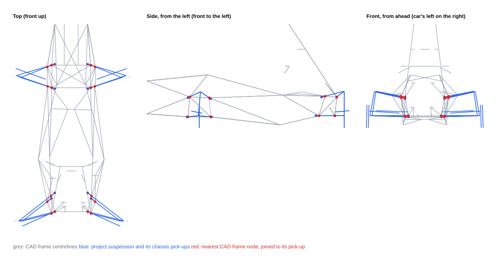

# Chassis CAD vs suspension pick-ups — Xasis 33.3

- Project: FSAE 2027 -- PUCPR Racing
- CAD survey: `C:\Users\trent\Downloads\Xasis 33.3.SLDPRT` (schema 1), 86 frame centrelines; 51 lines from 2D sketches left out (schema 1 mirrored them)
- Placement (CAD → ISO 8855): forward -Y, left -X, up -Z; ISO origin at CAD (0, -120.4, 75) mm
- Coordinates: ISO 8855 (X forward, Y LEFT, Z up), mm. Δ = CAD node − project.
- The CAD node is the nearest end of a frame centreline: taken as the CAD's intent for the pick-up. A pick-up on a tab away from its node shows up as a difference. *Tube* is the distance from the project's point to the nearest tube centreline (a tab has to bridge it).

| corner | point | project (x, y, z) | CAD node (x, y, z) | Δx | Δy | Δz | \|Δ\| | tube | CAD sketch |
|---|---|---|---|---:|---:|---:|---:|---:|---|
| FL | UCA_IN_FRONT | 120.0, 210.0, 321.7 | 101.1, 255.0, 329.5 | -18.9 | +45.0 | +7.8 | **49.4** | 41.1 | PSD |
| FL | UCA_IN_REAR | -120.0, 210.0, 310.4 | -105.9, 251.0, 319.5 | +14.1 | +41.0 | +9.1 | **44.3** | 40.7 | Tri_Meio |
| FL | LCA_IN_FRONT | 130.0, 175.0, 117.4 | 120.4, 205.0, 117.4 | -9.6 | +30.0 | +0.0 | **31.5** | 9.6 | PSD |
| FL | LCA_IN_REAR | -130.0, 175.0, 117.4 | -120.4, 205.0, 117.4 | +9.6 | +30.0 | +0.0 | **31.5** | 9.6 | PSD |
| FR | UCA_IN_FRONT | 120.0, -210.0, 321.7 | 101.1, -255.0, 329.5 | -18.9 | -45.0 | +7.8 | **49.4** | 41.1 | PSD |
| FR | UCA_IN_REAR | -120.0, -210.0, 310.4 | -105.9, -251.0, 319.5 | +14.1 | -41.0 | +9.1 | **44.3** | 40.7 | Tri_Meio |
| FR | LCA_IN_FRONT | 130.0, -175.0, 117.4 | 120.4, -205.0, 117.4 | -9.6 | -30.0 | +0.0 | **31.5** | 9.6 | PSD |
| FR | LCA_IN_REAR | -130.0, -175.0, 117.4 | -120.4, -205.0, 117.4 | +9.6 | -30.0 | +0.0 | **31.5** | 9.6 | PSD |
| RL | UCA_IN_FRONT | -1300.0, 210.0, 328.9 | -1335.6, 255.0, 336.9 | -35.6 | +45.0 | +8.0 | **57.9** | 39.5 | PST |
| RL | UCA_IN_REAR | -1460.0, 210.0, 328.9 | -1460.7, 210.0, 327.9 | -0.7 | +0.0 | -0.9 | **1.2** | 0.2 | PST |
| RL | LCA_IN_FRONT | -1240.0, 175.0, 129.5 | -1272.0, 215.0, 128.6 | -32.0 | +40.0 | -0.9 | **51.2** | 41.9 | PST |
| RL | LCA_IN_REAR | -1440.0, 175.0, 129.5 | -1440.7, 175.0, 128.6 | -0.7 | +0.0 | -0.9 | **1.2** | 0.8 | PST |
| RR | UCA_IN_FRONT | -1300.0, -210.0, 328.9 | -1335.6, -255.0, 336.9 | -35.6 | -45.0 | +8.0 | **57.9** | 46.5 | PST |
| RR | UCA_IN_REAR | -1460.0, -210.0, 328.9 | -1460.7, -210.0, 327.9 | -0.7 | +0.0 | -0.9 | **1.2** | 0.2 | PST |
| RR | LCA_IN_FRONT | -1240.0, -175.0, 129.5 | -1272.0, -215.0, 128.6 | -32.0 | -40.0 | -0.9 | **51.2** | 41.9 | PST |
| RR | LCA_IN_REAR | -1440.0, -175.0, 129.5 | -1440.7, -175.0, 128.6 | -0.7 | +0.0 | -0.9 | **1.2** | 0.6 | PST |
