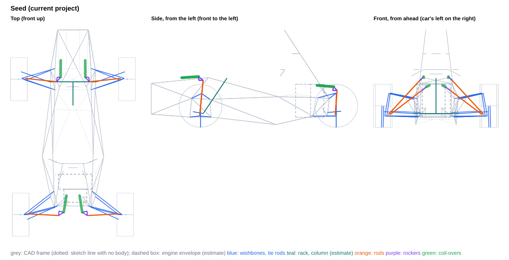
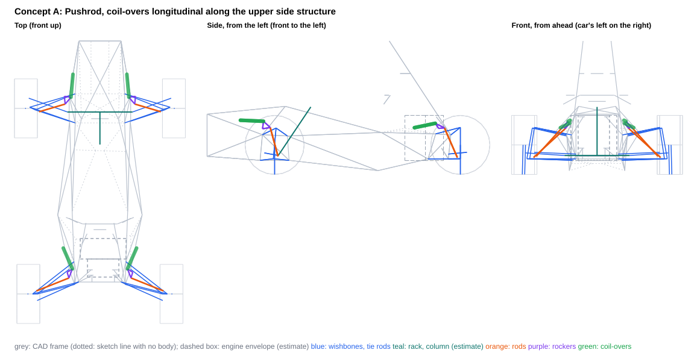
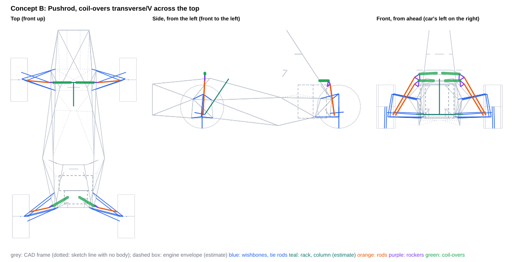
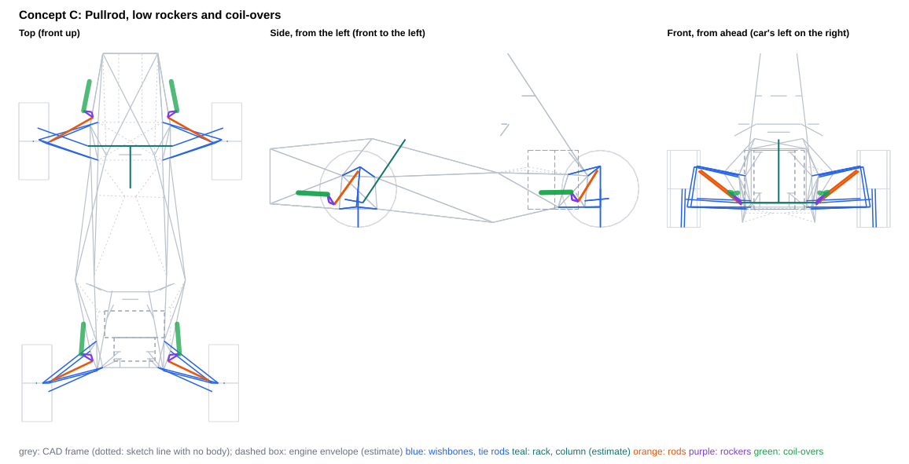

# Rocker and push/pull rod concepts (FSAE 2027)

Generated by `scripts/rocker_concepts.py build` from the `concept_*.json` files in this folder. Each concept is also saved as a project variant, `projects/FSAE_2027_rocker_concept_<id>.vdproj.json`, to open in VD Studio (Rocker page). The team project is unchanged.

**What this is:** the consequences of three layouts, side by side. **What it is not:** a choice -- no concept is recommended. The axles are independent: a front from one concept and a rear from another combine without changing either.

- Frame: ISO 8855 (X forward, Y LEFT, Z up), mm, chassis-fixed; LEFT corner points (the right is the Y-mirror). Kinematics: `DWSolver` + `vdcore.analysis.rocker`.
- Motion ratio 0.80 at ride on every axle is a **query argument** so the concepts compare like for like (the MR target is still an open decision). The coil-over is placed for equal droop/bump margins at ±25 mm; the rocker arms are tangential at ride unless the concept clocks them.
- MR and damper usage are over the ±25 mm design travel. Packaging, transmission angles and rocker rotation are over the **physical** range, to the damper's end stops (no bump rubber in the project), and for the front over the full rack travel (±38 mm).
- **Gaps are air gaps**: centreline distance minus both estimated radii. Both corners are checked against the CAD as built (the frame is not symmetric at the engine mounts).
- Chassis: CAD survey `Xasis 33.3`. 91 members, of which 21 are sketch lines with no weldment body (dotted in the views; they may not be real tubes); 15 solid bodies without a centreline are kept as bounding boxes (a box overstates a diagonal tube, so ⚠ means 'look in CAD', not a clash). Bracket lengths are to bodied members only.
- **Estimates** (no CAD): coil-over OD 60 mm (full OD from 30 mm off each eye), eyes OD 40 mm; rod 16×1 mm steel; rocker envelope ±10 mm, pickup bolts ±20 mm; wishbone OD 20, tie rod OD 16, rack housing OD 40 mm; steering column (-30, 0, 157) → (-300, 0, 560), OD 40; damper stroke 57 mm (estimate); drive shaft from the wheel centre to a joint at |y| = 120 mm on the axle line, OD 60; engine envelope x -1250..-1080, y -217..163 and x -1400..-1250, y -157..103, z 115..490 mm (from the CAD engine-mount tabs, centred about y -27); coil-over 1.3 kg and rocker 0.3 kg per corner (CG effect only).

## Thresholds behind the ✗ flags

Information, not requirements.

| check | limit |
|---|---|
| rod vs frame | ≥ 5 mm |
| rocker (plates, pickup bolts) vs frame | ≥ 5 mm |
| coil-over body vs frame | ≥ 5 mm |
| coil-over eyes vs frame | ≥ 5 mm |
| rod vs wishbones / tie rod / toe link (with steer) | ≥ 5 mm |
| rod vs rim (13", steered) | ≥ 15 mm |
| left vs right linkage (heave and roll) | ≥ 5 mm |
| linkage vs steering rack (front) | ≥ 5 mm |
| linkage vs steering column (estimate) (front) | ≥ 5 mm |
| linkage vs drive shaft (estimate) (rear) | ≥ 10 mm |
| linkage vs engine envelope (estimate) (rear) | ≥ 10 mm |
| rocker pivot to nearest bodied tube | ≤ 60 mm |
| coil-over chassis end to nearest bodied tube | ≤ 60 mm |
| rod transmission angle (to the end stops) | ≤ 30 deg |
| coil-over transmission angle (to the end stops) | ≤ 30 deg |
| rocker rotation (to the end stops) | ≤ 35 deg |

## Front axle

| | Seed | Concept A | Concept B | Concept C |
|---|---|---|---|---|
| Rod type / mounted on | pushrod / LCA | pushrod / LCA | pushrod / LCA | pullrod / UCA |
| Rod in | compression | compression | compression | tension |
| MR droop / ride / bump (±25 mm) | 0.784 / 0.800 / 0.819 | 0.787 / 0.800 / 0.811 | 0.781 / 0.800 / 0.808 | 0.829 / 0.800 / 0.766 |
| MR progression, droop to bump [%] | +4.4 | +3.0 | +3.4 | -7.9 |
| Damper stroke used in ±25 mm [mm] (of 57, estimate) | 40.0 | 40.0 | 39.9 | 40.0 |
| Damper end stops, wheel travel [mm] | -35.8 .. +35.4 | -35.8 .. +35.5 | -36.0 .. +35.6 | -35.2 .. +36.3 |
| Spring unseats at wheel travel [mm] (220 lb/in, no preload) | -23.7 | -23.7 | -23.7 | -23.7 |
| Rocker rotation to the end stops [deg] | -30.1 .. +29.1 | -20.2 .. +19.8 | -23.0 .. +22.6 | -23.3 .. +22.8 |
| Rocker arms rod / damper [mm] | 50 / 58 | 65 / 83 | 70 / 74 | 38 / 73 |
| Transmission angle max, rod / damper [deg] | **29.9 / 32.8** ✗ | 19.9 / 22.0 | 21.6 / 25.1 | 22.1 / 24.8 |
| Rod length [mm] | 530 | 330 | 492 | 377 |
| Rod inclination from horizontal / plan sweep [deg] | 47 / 6 | 47 / 17 | 60 / 5 | 34 / 29 |
| Rod force / wheel load | 1.45 | 1.60 | 1.31 | 2.40 |
| Rod force at ride [N] | 845 | 938 | 768 | 1403 |
| Wheel load to buckle the rod [N] (16×1 steel) | 6639 | 15452 | 8469 | n/a |
| Rocker pivot reaction at ride [N] | 1179 | 1012 | 717 | 1883 |
| Bracket couple at ride, pivot / coil-over end [N·m] (upper bound: force × stand-off) | 77 / 92 | 59 / 36 | 39 / 42 | 110 / 39 |
| Gap: rod vs frame [mm] | **-7.4** ✗ | 27.6 | 92.6 | 9.8 |
| Gap: rocker vs frame [mm] | **-18.9** ✗ | 7.9 | 31.8 | 7.6 |
| Gap: coil-over body vs frame [mm] | **-20.8** ✗ | 15.1 | 9.9 | 12.7 |
| Gap: coil-over eyes vs frame [mm] | **-13.4** ✗ | 13.2 | 24.6 | 20.4 |
| Gap: rod vs wishbones / tie rod / toe link, with steer [mm] | **-0.3** ✗ | 15.3 | 15.9 | 14.6 |
| Gap: rod vs rim, with steer [mm] (to the 13" bead-seat radius) | 54.0 | 40.7 | 51.1 | 37.0 |
| Gap: left vs right, heave and roll [mm] | 218.3 | 391.9 | 65.0 | 408.0 |
| Gap: linkage vs rack [mm] | 153.5 | 137.6 | 178.1 | 124.7 |
| Gap: linkage vs steering column [mm] (estimate) | 232.5 | 292.6 | 215.0 | 254.4 |
| Gap: linkage vs solid bodies' bounding boxes [mm] | **-0.1** ⚠ | 21.0 | 11.1 | 29.0 |
| Rocker pivot to nearest bodied tube [mm] | **65.5** ✗ | 58.8 | 54.8 | 58.3 |
| Coil-over chassis end to nearest bodied tube [mm] | **126.2** ✗ | 49.5 | 57.3 | 53.1 |
| Rocker / coil-over centreline height range z [mm] | 516 .. 577 | 373 .. 450 | 540 .. 624 | 138 .. 220 |
| Coil-over + rocker mass height z [mm] | 564 | 433 | 604 | 205 |

## Rear axle

| | Seed | Concept A | Concept B | Concept C |
|---|---|---|---|---|
| Rod type / mounted on | pushrod / LCA | pushrod / LCA | pushrod / LCA | pullrod / UCA |
| Rod in | compression | compression | compression | tension |
| MR droop / ride / bump (±25 mm) | 0.786 / 0.800 / 0.818 | 0.790 / 0.800 / 0.811 | 0.781 / 0.800 / 0.806 | 0.824 / 0.800 / 0.777 |
| MR progression, droop to bump [%] | +4.1 | +2.6 | +3.1 | -5.8 |
| Damper stroke used in ±25 mm [mm] (of 57, estimate) | 40.0 | 40.0 | 39.9 | 40.0 |
| Damper end stops, wheel travel [mm] | -35.8 .. +35.4 | -35.7 .. +35.5 | -36.0 .. +35.7 | -35.2 .. +36.0 |
| Spring unseats at wheel travel [mm] (220 lb/in, no preload) | -30.0 | -30.0 | -30.0 | -30.0 |
| Rocker rotation to the end stops [deg] | -24.1 .. +23.5 | -25.3 .. +24.8 | -24.7 .. +24.2 | -21.0 .. +20.6 |
| Rocker arms rod / damper [mm] | 50 / 71 | 50 / 67 | 60 / 69 | 42 / 80 |
| Transmission angle max, rod / damper [deg] | 24.3 / 26.3 | 25.3 / 27.6 | 23.0 / 26.9 | 20.6 / 22.5 |
| Rod length [mm] | 454 | 381 | 418 | 348 |
| Rod inclination from horizontal / plan sweep [deg] | 37 / 3 | 40 / 22 | 58 / 13 | 35 / 25 |
| Rod force / wheel load | 1.76 | 1.68 | 1.44 | 2.39 |
| Rod force at ride [N] | 1305 | 1245 | 1063 | 1766 |
| Wheel load to buckle the rod [N] (16×1 steel) | 7417 | 11027 | 10751 | n/a |
| Rocker pivot reaction at ride [N] | 1498 | 1658 | 999 | 2311 |
| Bracket couple at ride, pivot / coil-over end [N·m] (upper bound: force × stand-off) | 137 / 28 | 86 / 44 | 56 / 65 | 113 / 44 |
| Gap: rod vs frame [mm] | 70.3 | 24.4 | 88.6 | 29.0 |
| Gap: rocker vs frame [mm] | 66.6 | 15.1 | 33.1 | 26.0 |
| Gap: coil-over body vs frame [mm] | **-35.2** ✗ | 9.9 | 9.4 | 20.9 |
| Gap: coil-over eyes vs frame [mm] | **-16.3** ✗ | 6.9 | 28.3 | 14.6 |
| Gap: rod vs wishbones / tie rod / toe link, with steer [mm] | 15.2 | 11.7 | 13.7 | 16.2 |
| Gap: rod vs rim, with steer [mm] (to the 13" bead-seat radius) | 56.2 | 48.6 | — | 32.5 |
| Gap: left vs right, heave and roll [mm] | 98.9 | 395.7 | 124.1 | 412.7 |
| Gap: linkage vs drive shaft [mm] (estimate) | **-35.2** ✗ | 26.5 | 24.8 | 39.0 |
| Gap: linkage vs engine envelope [mm] (estimate) | **-30.0** ✗ | 12.9 | 13.7 | 49.4 |
| Gap: linkage vs solid bodies' bounding boxes [mm] | 341.3 | 176.1 | 343.6 | 229.0 |
| Rocker pivot to nearest bodied tube [mm] | **91.4** ✗ | 52.2 | 55.8 | 48.7 |
| Coil-over chassis end to nearest bodied tube [mm] | 30.4 | 48.1 | **69.9** ✗ | 47.3 |
| Rocker / coil-over centreline height range z [mm] | 408 .. 478 | 373 .. 426 | 470 .. 538 | 157 .. 225 |
| Coil-over + rocker mass height z [mm] | 461 | 402 | 525 | 214 |

## Car level

| | Seed | A | B | C |
|---|---|---|---|---|
| Springs-only roll gradient [deg/g] (220 lb/in both) | 1.21 | 1.21 | 1.21 | 1.21 |
| ARB needed for 1.0 deg/g at 50/50, F / R [N·m/deg] | 57 / 78 | 57 / 78 | 57 / 78 | 57 / 78 |
| CG height change vs seed [mm] (estimate) | +0.0 | -1.9 | +1.1 | -6.2 |
| Tilt-table tip angle [deg] (seed 62.13) | 62.13 | 62.28 | 62.05 | 62.59 |

The MR is the same at ride on every axle, so wheel rates, frequencies and the roll budget only move with the MR progression; they are listed to show that, not as a difference between the layouts. The spring unseating row is the same story: with 220 lb/in and no preload the spring comes off its seat before the damper tops out, whatever the layout.

## Seed: the current team project

| point (LEFT corner) | front | rear |
|---|---|---|
| rod outer end (on the mount body) | (9.0, 542.0, 145.0) | (-1530.0, 523.0, 145.0) |
| rocker pivot | (20.0, 180.0, 535.0) | (-1500.0, 160.0, 420.0) |
| rocker axis (unit) | (-0.0508, -0.7327, -0.6787) | (-0.0332, -0.6053, -0.7953) |
| rocker rod pickup | (-29.8, 184.3, 534.0) | (-1549.9, 162.8, 420.0) |
| rocker damper pickup | (22.4, 140.7, 577.3) | (-1512.2, 104.9, 462.4) |
| coil-over chassis end | (213.7, 138.9, 564.9) | (-1323.5, 74.7, 477.5) |
| rod type / mount body | pushrod / lca | pushrod / lca |

**Where the tightest numbers are:**

- front gap rod frame: -7.4 mm — Tri_Frente (560, 175, 500)->(-88, 153, 565) (sketch only), L at +35 mm
- front gap rocker frame: -18.9 mm — Tri_Frente (560, 175, 500)->(-88, 153, 565) (sketch only), L at +35 mm
- front gap coilover frame: -20.8 mm — Tri_Frente (560, 175, 500)->(-88, 153, 565) (sketch only), L at -36 mm
- front gap rod members: -0.3 mm — tie rod at -36 mm, rack +38
- front gap rod rim: 54.0 mm — at +35 mm, rack +38
- front gap solid bodies: -0.1 mm — rocker vs 'Ressalto-extrusão2' box, L at -31 mm
- front pivot bracket: 65.5 mm — Tri_Frente (101, 255, 330)->(-88, 153, 565) (L), foot 95 mm from its nearer end; Tri_Frente at 30.3 mm (no body in the CAD)
- front damper bracket: 126.2 mm — Tri_Frente (-88, 153, 565)->(560, -175, 500) (L), foot 275 mm from its nearer end; Tri_Frente at 38.4 mm (no body in the CAD)
- rear gap rod frame: 70.3 mm — PST (-1336, 255, 337)->(-1461, 210, 328), L at -36 mm
- rear gap rocker frame: 66.6 mm — 3DSketch7 (-1461, 210, 328)->(-1340, 73, 479), L at -36 mm
- rear gap coilover frame: -35.2 mm — 3DSketch7 (-1461, 210, 328)->(-1340, 73, 479), L at +35 mm
- rear gap rod members: 15.2 mm — LCA rear leg at -36 mm, rack +0
- rear gap rod rim: 56.2 mm — at +35 mm, rack +0
- rear gap engine: -30.0 mm — coil-over, L at -36 mm
- rear gap solid bodies: 341.3 mm — eyes vs 'Size_a_1pol_2,65mm SIZE_A_1POL-2,65MM(15)[5]' box, L at -36 mm
- rear pivot bracket: 91.4 mm — 3DSketch7 (-1340, -114, 479)->(-1461, -210, 328) (R), foot 65 mm from its nearer end
- rear damper bracket: 30.4 mm — 3DSketch7 (-1340, -100, 479)->(-1340, -150, 479) (R), foot 0 mm from its nearer end

**Outside the thresholds:** front rod vs frame -7.4 (limit ≥ 5); front rocker (plates, pickup bolts) vs frame -18.9 (limit ≥ 5); front coil-over body vs frame -20.8 (limit ≥ 5); front coil-over eyes vs frame -13.4 (limit ≥ 5); front rod vs wishbones / tie rod / toe link (with steer) -0.3 (limit ≥ 5); front rocker pivot to nearest bodied tube 65.5 (limit ≤ 60); front coil-over chassis end to nearest bodied tube 126.2 (limit ≤ 60); front coil-over transmission angle (to the end stops) 32.8 (limit ≤ 30); rear coil-over body vs frame -35.2 (limit ≥ 5); rear coil-over eyes vs frame -16.3 (limit ≥ 5); rear linkage vs drive shaft (estimate) -35.2 (limit ≥ 10); rear linkage vs engine envelope (estimate) -30.0 (limit ≥ 10); rear rocker pivot to nearest bodied tube 91.4 (limit ≤ 60)

## Concept A: Pushrod, coil-overs longitudinal along the upper side structure

Pushrods from the lower wishbones drive bell-crank rockers on the upper side structure, and the coil-overs lie nearly fore-aft along the frame sides. Front: rod on the LCA rear leg 84.5 mm inboard of the lower ball joint, rocker pivot beside the side-diagonal / UCA-front-pivot node at x = 100 mm, coil-over running forward above the upper side diagonal to a mid-span bracket; rear: rod on the LCA front leg near the ball joint, rocker at the PST / UCA-front-pivot node, coil-over running forward along the Tri_Tras upper rail outboard of the engine. The trade-off: low coil-overs and a front rod clear of the tie rod at full lock, against long pivot stand-offs at crowded nodes, damper brackets at tube mid-spans, wishbone-leg bending at the rod mounts, and only a few millimetres of room for the front rocker before it reaches the side diagonal.

| point (LEFT corner) | front | rear |
|---|---|---|
| rod outer end (on the mount body) | (-28.0, 505.0, 150.0) | (-1515.0, 527.0, 140.0) |
| rocker pivot | (100.0, 295.0, 379.0) | (-1360.0, 272.0, 382.0) |
| rocker axis (unit) | (-0.0345, -0.7461, -0.6649) | (0.1249, -0.6420, -0.7565) |
| rocker rod pickup | (36.3, 288.2, 389.9) | (-1407.6, 257.3, 386.6) |
| rocker damper pickup | (92.4, 240.0, 441.2) | (-1331.6, 227.8, 424.2) |
| coil-over chassis end | (283.1, 223.4, 449.9) | (-1159.5, 303.9, 388.0) |
| rod type / mount body | pushrod / lca | pushrod / lca |

**Where the tightest numbers are:**

- front gap rod frame: 27.6 mm — Tri_Frente (101, 255, 330)->(-88, 153, 565), L at +35 mm
- front gap rocker frame: 7.9 mm — Tri_Frente (101, 255, 330)->(-88, 153, 565), L at -36 mm
- front gap coilover frame: 15.1 mm — Tri_Frente (101, 255, 330)->(560, 175, 500), L at +35 mm
- front gap rod members: 15.3 mm — tie rod at -36 mm, rack +38
- front gap rod rim: 40.7 mm — at +35 mm, rack +38
- front gap solid bodies: 21.0 mm — coil-over vs 'Ressalto-extrusão2' box, L at -0 mm
- front pivot bracket: 58.8 mm — Tri_Frente (101, 255, 330)->(-88, 153, 565) (L), foot 24 mm from its nearer end
- front damper bracket: 49.5 mm — Tri_Frente (101, 255, 330)->(560, 175, 500) (L), foot 215 mm from its nearer end
- rear gap rod frame: 24.4 mm — Tri_Tras (-951, -116, 1108)->(-1461, -210, 328), R at +36 mm
- rear gap rocker frame: 15.1 mm — Tri_Tras (-951, -116, 1108)->(-1461, -210, 328), R at +36 mm
- rear gap coilover frame: 9.9 mm — Tri_Tras (-1336, 255, 337)->(-884, 350, 348), L at +36 mm
- rear gap rod members: 11.7 mm — LCA front leg at -36 mm, rack +0
- rear gap rod rim: 48.6 mm — at +36 mm, rack +0
- rear gap engine: 12.9 mm — coil-over, R at -0 mm
- rear gap solid bodies: 176.1 mm — eyes vs 'Size_a_1pol_2,65mm SIZE_A_1POL-2,65MM(15)[5]' box, L at -36 mm
- rear pivot bracket: 52.2 mm — PST (-1336, 255, 337)->(-1461, 210, 328) (L), foot 14 mm from its nearer end
- rear damper bracket: 48.1 mm — Tri_Tras (-1336, 255, 337)->(-884, 350, 348) (L), foot 184 mm from its nearer end

**Outside the thresholds:** none

**Pros**

- Zero evaluator fails on both axles and both corners, swept to the damper end stops (front -35.8 / +35.5 mm, rear -35.7 / +35.5 mm) and, at the front, over the full rack travel of +-38 mm. All gaps are air gaps with the evaluator's estimated part sizes. Front: rod to tie rod 15.3 mm at full lock on the inside wheel (rack +38; round 1 was 0.4 mm), rocker to frame 7.9, coil-over body 15.1, coil-over eyes 13.2, rod to frame 27.6, rod to rim 40.7 mm. Rear (unchanged from round 1): rocker 15.1, coil-over body 9.9, eyes 6.9, rod to frame 24.4, rod to wishbones 11.7, rod to rim 48.6 mm.
- Moderate linkage angles at the end stops. Front rod and coil-over transmission angles 19.9 / 22.0 deg (round 1: 30.2 / 32.5), rocker rotation -20.2 / +19.8 deg, with a 65 mm rod arm and an 83.4 mm damper arm. Rear: 25.3 / 27.6 deg and -25.3 / +24.8 deg. Over the +-25 mm design travel (not to the end stops), MR 0.787 / 0.800 / 0.811 front (+3.0 %) and 0.790 / 0.800 / 0.811 rear (+2.6 %), with equal 8.5 mm damper margins at -25 and +25 mm on both axles.
- A shorter front rod in compression: 329.7 mm long, Euler buckling load 24.8 kN on the 16x1 steel reference tube, which is 15.5 kN of wheel load to buckle it (round 1: 9.9 kN). Rear: 380.9 mm, 18.6 kN, 11.0 kN of wheel load.
- Coil-overs and rockers sit low: moving-mass height 433 mm front (round 1: 496 mm, seed: 564 mm) and 402 mm rear (seed: 461 mm). With the estimated masses (1.3 kg coil-over and 0.3 kg rocker per corner) the CG drops 1.9 mm relative to the seed layout, and the tilt-table angle goes from 62.13 deg (seed) to 62.28 deg.
- All four brackets reach bodied tubes within the 60 mm limit: front pivot 58.8 mm to the side diagonal, foot 24 mm from its node; front damper end 49.5 mm to the upper side diagonal (round 1: 121.4 mm to the nearest bodied tube); rear pivot 52.2 mm to the PST rail, foot 14 mm from a node; rear damper end 48.1 mm to the Tri_Tras upper rail. The front rocker axis is a single tilt (41.7 deg from horizontal, within 2 deg of the transverse plane), simpler to jig than the rear's compound axis.
- Clear of the steering and of the 'Ressalto-extrusão2' solid (what that solid represents is not confirmed): front linkage 137.6 mm from the rack and 292.6 mm from the estimated steering column, front coil-over 21.0 mm from the 'Ressalto-extrusão2' box (round 1: 1.4 mm), left-to-right 391.9 mm front and 395.7 mm rear. The front coil-over runs almost straight fore-aft (yaw 5.0 deg inboard, pitch 2.6 deg up) along the side of the front box at z 441-450 mm, its axis 23-32 mm outboard of the box's side plane (the 60 mm body crosses up to about 5 mm inside that plane toward its chassis end), so its adjusters sit on the side of the car, reachable once the nose or side panel is off (adjuster orientation not modelled).

**Cons**

- The front rod mount bends the lower wishbone. To keep the rocker off the side diagonal, the mount sits on the LCA rear leg 84.5 mm inboard of the ball joint, 23 mm above and 10 mm aft of the leg centreline. At 3x the static ride load the rod pushes 2.4 kN normal to the leg. Treating the leg as pinned at both ends, that is about 158 Nm, or about 300 MPa nominal on a 25.4x1.2 mm tube (hand estimate). Whether the leg carries that as drawn depends on the tube material and weld allowables, which were not checked; if it does not, reinforcement (a plate tying the bracket to the front leg and the ball-joint housing, or a larger leg) is part of this layout's cost. Moving the mount 15 mm outboard dropped the rocker-to-frame gap from 7.9 to 5.4 mm, and (-20, 535, 150) failed at 3.1 mm. The inboard mount also raises rod/wheel to 1.604 (round 1: 1.45): rod force 938 N at ride, 2.8 kN at 3x.
- The front rocker has little positional tolerance. The pivot is 58.8 mm from the side diagonal's centreline (limit 60; about 46 mm beyond the tube surface), and the stand-off lands 24 mm along that tube from the node (101.1, 255, 329.5), where six bodied frame tubes and the UCA front pivot already meet; the rocker pivot is 63.6 mm from UCA_IN_FRONT. In my sweeps, moving the pivot 4-15 mm to shorten the bracket to 54.7-57.1 mm brought the rocker to 2.1-5.5 mm from the frame. A few millimetres of CAD change on that node can break either threshold, and the node is crowded for welding, the UCA clevis and the rocker bracket.
- Front bracket loads. The pivot reaction is 1.01 kN at ride (3.0 kN at 3x), 54 % of it fore-aft because the coil-over is longitudinal. It is carried on the 58.8 mm stand-off: 59.5 Nm at ride, about 178 Nm at 3x, at the bracket root. The coil-over chassis end sits 49.5 mm off the upper side diagonal, with its foot 215 mm from the nearer end of that 496 mm tube (mid-span): 36.2 Nm at ride, about 109 Nm at 3x. Neither bracket nor the tube it lands on was sized; at these couples gussets or an added member are likely to be part of the bracket design. The rod also puts 183 N fore-aft (0.55 kN at 3x) into the LCA bracket (rod plan angle 16.5 deg).
- Bodywork and leg protection. At x = 200 the front coil-over axis sits about 28 mm outboard of the front box's side plane (through the upper side diagonal and the sketch-only top line), so its 60 mm body reaches about y = 261 mm, while toward its chassis end the body's inner face crosses up to about 5 mm inside that plane. The rocker pickup centres reach y = 303 mm, and with the estimated 20 mm pickup bolts y = 318 mm at the droop end stop, over x 35-122 mm and z 373-441 mm. The nose or side panels have to cover roughly +-320 mm there, or the rockers run in the airflow. The coil-over is 21.0 mm from the 'Ressalto-extrusão2' box. If that solid is the cockpit/leg template and the side window counts as inside the cockpit, the FSAE leg-protection shield for moving suspension parts has to fit in that gap. This is an open rules question and was not checked.
- Anti-roll bar integration is awkward at both ends. The front rocker and coil-over centrelines stay at |y| >= 223 mm with the driver's leg volume between them, and the rear rockers have the engine envelope between them, so a straight bar between rockers does not fit. It needs drop links: to a bar across the front bulkhead or over the top of the front box at the front, and behind the engine or over the differential at the rear. For reference, the roll budget asks for 56.7 Nm/deg front and 77.7 Nm/deg rear at the 1.0 deg/g query target.
- The rear margins (unchanged from round 1) are thin and partly estimates. The 12.9 mm engine gap (limit 10) is the RIGHT rear coil-over at ride against the estimated engine boxes centred on the mount tabs at y = -27 mm; the CAD has no engine. The 26.5 mm drive-shaft gap is to an assumed straight shaft from the wheel centre to a joint at |y| = 120 mm. The coil-over's rocker-end eye is 6.9 mm (droop end stop) from the Tri_Tras main-hoop brace (-1460.7, 210, 327.9)->(-950.8, 116, 1107.7), the same tube the rear rocker (15.1 mm) and rod (24.4 mm) come closest to, and the coil-over body is 9.9 mm (bump end stop) from the Tri_Tras upper rail; the transmission angles reach 25.3 / 27.6 deg. A longer rear rod arm (55-65 mm) cut the angles to 23.0-19.5 / 25.0-21.0 deg but broke the eye gap (4.5 to 0.9 mm) and the engine gap (7.8 to -2.3 mm), so the round-1 rear was kept.
- Rear packaging around the UCA, and rear loads. The rear rod passes through the UCA triangle and runs 11.7 mm from its own LCA front leg at the droop stop. My check puts the rocker plate 17.3 mm from the UCA front leg at the bump stop. The pivot is 54.1 mm from the UCA front pivot, so the rocker bracket and the UCA clevis share the node (-1335.6, 255, 336.9). Loads at 3x static are 3.7 kN rod, 5.0 kN pivot and 2.8 kN damper. The damper bracket foot is 184 mm from the nearer end of the 461 mm Tri_Tras rail (mid-span, about 133 Nm at 3x). The rod is swept 21.7 deg in plan, which puts 351 N fore-aft into the LCA front-leg bracket at ride (1.05 kN at 3x) and about 93 Nm of leg bending at 3x (mount 40 mm from the ball joint, pinned-pinned hand estimate). The rear coil-over is yawed 23.8 deg outboard and pitched 10.9 deg down, on a compound rocker axis (0.125, -0.642, -0.757). The rear pivot stand-off carries the concept's largest bracket couple: 86.5 Nm at ride (about 259 Nm at 3x), landing on the PST rail 14 mm from the node it shares with the UCA front pivot.
- Both rocker pivots are single-shear cantilevers as drawn. The direction from the pivot to its bracket foot runs almost along the rocker axis (direction cosine 0.971 front, 0.963 rear), so each rocker sits on a pin about 46 mm (front) or 39 mm (rear) beyond the tube surface, and the whole pivot reaction (perpendicular to the axis) is bending at the root. Supporting the rocker on both sides (double shear) would take an extra member on the far side of the rocker, which this layout does not have.

**Not checked**

- Real part envelopes: rocker plates, bearings and bracket bodies, rod ends, the UCA clevis at the shared front node, reservoir and adjuster orientation, and spring OD. The evaluator uses estimated sizes: frame tube 25.4, rod 16, coil-over 60 starting 30 mm from each eye, eye bearing 40, rocker plate half-envelope 10, pickup bolts 20 each side, wishbone 20 and tie rod 16 mm.
- Rocker and coil-over against the wishbones are not evaluator thresholds. My own sweep to the end stops, with the same estimated sizes, puts the front rocker 19.4 mm and the rear rocker 17.3 mm from the UCA front leg at the bump stop. Both coil-overs stay 44 mm or more from every leg.
- Upright, hub, brake caliper and steering arm against the rod near its LCA mount. Only the 13-inch rim (steered) is checked: front 40.7 mm, rear 48.6 mm.
- Powertrain parts are not in the CAD: engine, differential, drive shafts and CV joints, chain, exhaust, intake, fuel tank, radiator, battery, seat and firewall. The rear engine boxes and the drive shaft are evaluator estimates. The 3DSketch8 engine-mount lines have no solid body, and no bracket in this layout relies on them.
- Bodywork, nose and side-panel surfaces, what 'Ressalto-extrusão2' actually is, leg-protection shields, and FSAE rule compliance in general.
- Structure: no load cases, stress, fatigue, or bracket, tube or wishbone sizing. The bending figures are hand estimates at 3x the static ride load. Bracket compliance, which changes the effective MR, is not modelled. Buckling is pinned-pinned Euler on the 16x1 steel reference tube only.
- Travel limits. Bump rubbers are zero, so the linkage runs to the damper's own end stops (front -35.8 / +35.5 mm, rear -35.7 / +35.5 mm). Droop limiters, bump rubbers and the ARB linkage are not designed or packaged. With the 220 lb/in springs and no preload the springs unseat at -23.7 mm (front, inside the +-25 mm design travel) and -30.0 mm (rear) of droop, the same for every concept at MR 0.80.
- The MR 0.80 target, the 1.0 deg/g roll-gradient query, the 50 % front roll share and the springs are design_intent / query arguments, not derived targets. The steering column is an estimated line.

## Concept B: Pushrod, coil-overs transverse/V across the top

Pushrods from the lower wishbones drive rockers mounted high on the frame, and the coil-overs lie across the top of the car. Front: rockers beside the side diagonals just ahead of the front-hoop top node, coil-overs running straight across the top of the front box about 55 mm ahead of the front hoop's top crossbar (centreline to centreline), with both chassis ends 65 mm apart on a bracket to that crossbar; rear: rockers on the main-hoop braces, coil-overs lying level in a forward-pointing shallow V (30.5 deg from transverse) over the estimated engine envelope, with the chassis ends 132 mm apart above the engine. The trade-off: steep, shorter pushrods with lower rod loads than the seed and front coil-over forces that can cancel in a shared bracket, against the highest moving-mass height (604 mm front, 525 mm rear; CG +1.06 mm), a raised and widened nose, a rear rocker on the main-hoop brace, and rear chassis ends that no existing tube carries (69.9 mm, the one evaluator fail).

| point (LEFT corner) | front | rear |
|---|---|---|
| rod outer end (on the mount body) | (-10.0, 525.0, 148.0) | (-1490.0, 495.0, 145.0) |
| rocker pivot | (-28.0, 220.0, 540.0) | (-1411.0, 238.0, 470.0) |
| rocker axis (unit) | (-0.9986, -0.0079, -0.0520) | (-0.8465, -0.4981, -0.1881) |
| rocker rod pickup | (-30.3, 280.8, 574.7) | (-1442.2, 279.8, 499.6) |
| rocker damper pickup | (-31.8, 224.0, 613.4) | (-1422.2, 231.4, 537.8) |
| coil-over chassis end | (-30.9, 32.6, 623.9) | (-1325.0, 66.2, 537.8) |
| rod type / mount body | pushrod / lca | pushrod / lca |

**Where the tightest numbers are:**

- front gap rod frame: 92.6 mm — Tri_Frente (560, 175, 500)->(-88, 153, 565) (sketch only), L at +36 mm
- front gap rocker frame: 31.8 mm — Tri_Frente (560, 175, 500)->(-88, 153, 565) (sketch only), L at +36 mm
- front gap coilover frame: 9.9 mm — Tri_Frente (560, 175, 500)->(-88, 153, 565) (sketch only), L at +36 mm
- front gap rod members: 15.9 mm — UCA rear leg at -16 mm, rack +19
- front gap rod rim: 51.1 mm — at +36 mm, rack +38
- front gap solid bodies: 11.1 mm — coil-over vs 'Size_a_1pol_2,65mm SIZE_A_1POL-2,65MM(16)[4]' box, L at -0 mm
- front pivot bracket: 54.8 mm — Tri_Frente (101, 255, 330)->(-88, 153, 565) (L), foot 76 mm from its nearer end
- front damper bracket: 57.3 mm — body Size_a_1pol_2,65mm SIZE_A_1POL-2,65MM(16)[5] (-85, -72, 606)->(-85, 72, 606) (L), foot 40 mm from its nearer end
- rear gap rod frame: 88.6 mm — Tri_Tras (-1461, 210, 328)->(-951, 116, 1108), L at +36 mm
- rear gap rocker frame: 33.1 mm — Tri_Tras (-1461, 210, 328)->(-951, 116, 1108), L at -36 mm
- rear gap coilover frame: 9.4 mm — Tri_Tras (-951, -116, 1108)->(-1461, -210, 328), R at +36 mm
- rear gap rod members: 13.7 mm — UCA front leg at +36 mm, rack +0
- rear gap engine: 13.7 mm — coil-over, R at +36 mm
- rear gap solid bodies: 343.6 mm — eyes vs 'Size_a_1pol_2,65mm SIZE_A_1POL-2,65MM(15)[5]' box, L at -36 mm
- rear pivot bracket: 55.8 mm — Tri_Tras (-1461, 210, 328)->(-951, 116, 1108) (L), foot 143 mm from its nearer end
- rear damper bracket: 69.9 mm — 3DSketch7 (-1340, -100, 479)->(-1340, -150, 479) (R), foot 0 mm from its nearer end

**Outside the thresholds:** rear coil-over chassis end to nearest bodied tube 69.9 (limit ≤ 60)

**Pros**

- Front: zero evaluator fails, swept to the damper end stops (-36.0 / +35.6 mm) and over the full rack travel of +-38 mm. The three round-1 front fails are gone. Rod to wishbones and tie rod: 15.9 mm air gap (round 1: 0.7 mm to the tie rod at rack +38), with the rod mount moved onto the LCA rear leg. Rocker pivot: 54.8 mm from a bodied tube, the side diagonal running down from the front-hoop top node, foot 76 mm from that node (round 1: 100.2 mm, because its 55.7 mm tube is a sketch line with no body). Coil-over transmission angle: 25.1 deg (round 1: 33.2) with a 70 mm rod arm. Other front air gaps, with the evaluator's estimated part sizes: rocker 31.8, coil-over body 9.9, eyes 24.6, rod to frame 92.6, rod to 13-inch rim (steered) 51.1, rack 178.1, steering column (estimate) 215.0, left to right 65.0 mm.
- Rear: the coil-over now clears the estimated engine envelope with a 13.7 mm air gap (limit 10; round 1: -9.7 mm, inside it). The tightest point is the right rear at the bump stop. The gap comes from raising the rockers so that the coil-overs lie level at z = 538 mm. Every other rear threshold except the chassis-end bracket passes: drive shaft (estimate) 24.8, rod to wishbones and toe link 13.7, rocker 33.1, coil-over body 9.4, eyes 28.3, rod to frame 88.6, left to right 124.1 mm.
- Steep, shorter rods with lower loads than the seed, both in compression. Front: 492.0 mm long at 60.1 deg from horizontal, rod force 1.314 times the wheel load (768 N at ride; seed 1.445, 845 N), and it takes 8.47 kN of wheel load to buckle the 16x1 steel reference tube (round 1: 7.38 kN). Rear: 417.5 mm at 58.1 deg, 1.437 times the wheel load (1063 N; seed 1.765, 1305 N), 10.75 kN of wheel load to buckle.
- Moderate linkage angles out to the end stops. Rod and coil-over transmission angles are 21.6 / 25.1 deg front and 23.0 / 26.9 deg rear. Rocker rotation is -23.0 / +22.6 deg front and -24.7 / +24.2 deg rear. Over the +-25 mm design travel (not to the end stops), MR is 0.781 / 0.800 / 0.808 front (+3.4 %) and 0.781 / 0.800 / 0.806 rear (+3.1 %), with equal 8.5 mm damper margins at -25 and +25 mm on both axles.
- Front load path. The front coil-overs lie straight across the car (0.3 deg from transverse, rising 3.2 deg toward the centre), so at ride each one pushes its chassis end inboard with 730 N and vertically with only 40 N. If both eyes share one bracket (their centres are 65 mm apart), the two transverse forces cancel inside that bracket in heave, and the front-hoop top crossbar carries only about 80 N vertical at ride. In roll, the difference between the two spring forces reaches the crossbar. The front rocker axis runs fore-aft (-0.999, -0.008, -0.052), so its bracket is a simple stand-off from the side diagonal.
- Front service access. Both front coil-overs sit under the nose top just ahead of the front hoop (centreline z 613-624 mm), with their chassis ends side by side at the centreline. Both can be reached through one opening in the nose top, away from the pedal box, the rack (178.1 mm) and the estimated steering column (215.0 mm). Which end carries the clickers depends on the damper model.

**Cons**

- The one evaluator fail is 'coil-over chassis end to nearest bodied tube: 69.9 (limit <= 60)' at the right rear. The rear chassis ends sit above the engine, 132 mm apart. The nearest tubes are the engine-mount stubs, which are not symmetric in the CAD (left 3DSketch7 stub at y +59.7..+109.7, right at -100.3..-150.3): 61.0 mm away on the left, 69.9 mm on the right. This concept therefore needs an added frame member above the engine to carry the chassis ends, for example tubes from the two main-hoop braces. That member is not in the CAD and was not evaluated, and it has to clear the coil-over bodies, the real engine top and the intake. Tabbing the ends to the stubs instead (61-70 mm brackets) would run the spring load (469 N forward and 797 N inboard per side at ride) through the cantilevered engine mounts, making the engine part of the suspension load path. With one shared bracket, the inboard components cancel in heave and the forward ones add up to 938 N at ride.
- Moving the rear chassis ends closer to the stubs costs engine clearance. One version had the chassis ends above the stubs (y = 84 mm): the bracket was 60.4 mm, but the coil-over went 3.6 mm into the estimated engine envelope (air gap -3.6 mm, limit 10) and the rod 3.3 mm into the UCA rear leg. Moving this version's rear rod mount about 30 mm toward the ball joint, to (-1510, 520, 145), shortens the bracket to 67.2 mm but leaves only 10.2 mm to the estimated drive shaft and 10.4 mm to the engine envelope. In my searches, no chassis-end position kept the coil-over 10 mm off the estimated engine envelope and within 60 mm of a bodied tube on both corners.
- The rear rocker stays on the main-hoop brace, now higher: the pivot is 55.8 mm off the brace, with its foot 143 mm above the brace's lower node (round 1: 111 mm). Moving it down to the upper-rail node (pivot at z = 390 mm, 47.4 mm from the brace) put the coil-over 24.5 mm into the estimated engine envelope and the rod 14.3 mm into the UCA rear leg, because the coil-over has to climb over the engine. The pivot reaction is 999 N at ride, 841 N of it normal to the brace. At 3x the static load that is about 260-305 Nm of bending in the 936 mm brace (hand estimate, fixed-fixed to pinned-pinned), or about 340-400 MPa nominal on its 25.4 x 1.9 mm section (the CAD part material is AISI 1020). On top of that comes the 55.7 Nm bracket couple (167 Nm at 3x). That is at or above yield, so added bracing at the brace is likely to be part of this layout, and the FSAE rule on items attached to main-hoop braces needs a rulebook check.
- Height, CG and bodywork. Moving-mass height is 604 mm front and 525 mm rear (seed 564 / 461 mm). With the estimated masses (1.3 kg coil-over and 0.3 kg rocker per corner), the CG rises 1.06 mm and the tilt-table angle drops from 62.13 to 62.05 deg. The front coil-over bodies reach about z = 654 mm, about 35 mm above the front hoop's top surface (z 619) and about 55 mm ahead of its top crossbar (centreline to centreline). The front rocker's rod pickup sits at y = 281 mm, about 24 mm outboard of the front hoop's outer surface (y 257) at z = 575 mm. The nose top has to rise and widen there; drag and the driver's forward view are not checked. The rear coil-overs (centreline z = 538, top about 568 mm) sit directly over the estimated engine envelope, where an intake or airbox usually goes, so lifting the engine out means removing them and the added member.
- The front brackets are close to their limits and carry offset loads. The pivot bracket is 54.8 mm and the chassis-end bracket 57.3 mm (limit 60), so a few millimetres of CAD change at the front-hoop node can break either one. The pivot reaction is 717 N at ride, 613 N of it normal to the 319 mm side diagonal. That gives a 39.3 Nm bracket couple (118 Nm at 3x) and about 80-105 Nm of tube bending at 3x (hand estimate; about 150-200 MPa if it is a 25.4 x 1.2 mm tube, the size is not named in the CAD). With separate chassis-end tabs, each one puts a 41.9 Nm couple into the front-hoop top crossbar at ride. The coil-over body is 9.9 mm from the sketch-only top side line and 11.1 mm from the front hoop's upper bend (a solid body, not an evaluator threshold).
- Wishbone bending at the rod mounts. The front rod sits on the LCA rear leg 63 mm in from the ball joint and 20 mm off the leg centreline, the position that clears the tie rod at full lock. The rear rod sits on the LCA front leg 82 mm in from the ball joint and 15 mm off the leg, kept there for the estimated drive shaft. At ride the rod pushes 684 N (front) and 936 N (rear) normal to the leg. At 3x the static load that is about 104 Nm and 185 Nm of leg bending (pinned-pinned hand estimate). Whether the legs carry that as drawn depends on their size, material and weld allowables, which were not checked; if not, a plate to the other leg or the ball-joint housing is part of this layout's cost.
- Anti-roll bar integration. The front rocker axes run fore-aft at y = +-220 mm and the rear axes are compound (-0.847, -0.498, -0.188), so no bar can be coaxial with the rockers; each rocker needs a third arm and a drop link. The space between the rockers is already taken by the coil-overs (across the top of the front box, and above the engine at the rear), so a bar has to go ahead of or behind them. None is packaged. The roll budget asks for 56.7 Nm/deg front and 77.7 Nm/deg rear of ARB at the 1.0 deg/g query target.

**Not checked**

- Real part envelopes. The evaluator uses estimated sizes: frame tube 25.4 mm, rod 16 mm (16x1 steel), coil-over 60 mm starting 30 mm from each eye, eye bearing 40 mm, rocker plate half-envelope 10 mm, pickup bolts 20 mm each side, wishbones 20 mm, tie rod 16 mm. Rocker plates, bearings, rod ends, clevises, bracket bodies, spring collars, reservoirs and adjusters are not modelled. The 9.4-9.9 mm coil-over gaps and the 54.8 / 57.3 mm front brackets depend on them.
- Powertrain and other parts that are not in the CAD. The engine envelope (two estimated boxes centred on the mount tabs at y = -27 mm, top at z = 490 mm) and the drive shafts (straight, to joints at |y| = 120 mm) are evaluator estimates. The intake, airbox, throttle body and fuel tank, which would sit near the rear coil-overs above the engine, are not modelled, and neither are the exhaust, chain, differential, radiator and battery.
- The added rear member that the chassis ends need was not designed or evaluated: its layout, size, and fit against the coil-over bodies, the engine and the intake. The search for an existing tube within 60 mm was my own static proxy at ride height (pivot grid 5-10 mm, coil-over direction 5-10 deg, plus local optimisation), followed by full evaluator runs. It is not exhaustive.
- Bodywork, the nose height and width over the front coil-overs and rockers, the driver's forward view and aerodynamics. FSAE rules: items attached to the main-hoop braces (rear rockers), brackets on the front-hoop top crossbar and on the side diagonal at the front-hoop node (and whether that diagonal counts as front-hoop bracing), and leg protection.
- Structure: no load cases, stress, fatigue, or sizing of brackets, tubes, rockers, rods or wishbones. The bending figures are hand estimates at 3x the static ride load, and the side-diagonal and wishbone tube sizes are not named in the CAD. Bracket compliance, which changes the effective motion ratio, is not modelled. Buckling is pinned-pinned Euler on the 16x1 steel reference tube only.
- The upright, hub, brake caliper and steering arm against the front rod near its LCA mount. Only the 13-inch rim (steered) is checked: 51.1 mm at the front. The evaluator gives no rear value because the rear rod never passes within the tyre width of the wheel plane.
- Travel limits. Bump rubbers are zero, so the linkage runs to the damper's own end stops (front -36.0 / +35.6 mm, rear -36.0 / +35.7 mm). Droop limiters, bump rubbers, the ARB and drop links are not designed or packaged. With the 220 lb/in spring and no preload, the springs unseat at -23.7 mm (front) and -30.0 mm (rear) of droop, the same for every concept at MR 0.80.
- The MR 0.80 target, the 1.0 deg/g roll-gradient query, the 50 % front roll share and the 220 lb/in springs are design_intent / query arguments, not derived targets. The coil-over and rocker masses (1.3 / 0.3 kg) are estimates used for the CG effect only, and the steering column is an estimated line.

## Concept C: Pullrod, low rockers and coil-overs

Pullrods hang from the upper wishbones just inboard of the upper ball joints and pull bell-crank rockers that sit low, just outboard of the frame's lower side rails, and the coil-overs lie almost horizontal at z = 210-225 mm, outboard of the frame sides. Front: rocker pivot at (186, 245, 160) on a 58.3 mm stand-off from the Tri_Frente lower rail, coil-over running forward to a bracket on the Tri_Frente side diagonal; rear: pivot at (-1360, 250, 175) off the Tri_Tras diagonal, coil-over running forward along the Tri_Tras side diagonal outboard of the engine. The trade-off: coil-overs and rockers mounted low (mass height z = 205-214 mm) and rods in tension, against rod forces of about 2.4 times the wheel load, a regressive motion ratio, bracket couples on mid-span tubes, coil-overs outside the frame sides and no anti-roll-bar location found.

| point (LEFT corner) | front | rear |
|---|---|---|
| rod outer end (on the mount body) | (-1.0, 509.0, 358.0) | (-1522.0, 497.0, 364.0) |
| rocker pivot | (186.0, 245.0, 160.0) | (-1360.0, 250.0, 175.0) |
| rocker axis (unit) | (0.1724, 0.6663, -0.7255) | (0.0327, 0.6208, -0.7833) |
| rocker rod pickup | (151.9, 237.5, 145.0) | (-1399.3, 239.2, 164.8) |
| rocker damper pickup | (193.8, 297.5, 210.0) | (-1354.2, 312.6, 224.9) |
| coil-over chassis end | (381.0, 259.9, 220.0) | (-1163.6, 298.0, 221.2) |
| rod type / mount body | pullrod / uca | pullrod / uca |

**Where the tightest numbers are:**

- front gap rod frame: 9.8 mm — Tri_Frente (120, 205, 117)->(560, 175, 150), L at -35 mm
- front gap rocker frame: 7.6 mm — Tri_Frente (120, -205, 117)->(560, -175, 150), R at -35 mm
- front gap coilover frame: 12.7 mm — Tri_Frente (560, 175, 150)->(101, 255, 330), L at +36 mm
- front gap rod members: 14.6 mm — UCA front leg at +36 mm, rack +38
- front gap rod rim: 37.0 mm — at -15 mm, rack -38
- front gap solid bodies: 29.0 mm — rocker vs 'Ressalto-extrusão2' box, L at -35 mm
- front pivot bracket: 58.3 mm — Tri_Frente (120, 205, 117)->(560, 175, 150) (L), foot 66 mm from its nearer end
- front damper bracket: 53.1 mm — Tri_Frente (560, 175, 150)->(101, 255, 330) (L), foot 203 mm from its nearer end
- rear gap rod frame: 29.0 mm — PST (-1272, 215, 129)->(-1441, 175, 129), L at -35 mm
- rear gap rocker frame: 26.0 mm — Tri_Tras (-1272, 215, 129)->(-1461, 210, 328), L at -35 mm
- rear gap coilover frame: 20.9 mm — Tri_Tras (-884, 350, 348)->(-1272, 215, 129), L at +36 mm
- rear gap rod members: 16.2 mm — UCA front leg at +36 mm, rack +0
- rear gap rod rim: 32.5 mm — at -25 mm, rack +0
- rear gap engine: 49.4 mm — rocker, R at -35 mm
- rear gap solid bodies: 229.0 mm — eyes vs 'Size_a_1pol_2,65mm SIZE_A_1POL-2,65MM(15)[5]' box, L at -35 mm
- rear pivot bracket: 48.7 mm — Tri_Tras (-1272, 215, 129)->(-1461, 210, 328) (L), foot 94 mm from its nearer end
- rear damper bracket: 47.3 mm — Tri_Tras (-884, 350, 348)->(-1272, 215, 129) (L), foot 158 mm from its nearer end

**Outside the thresholds:** none

**Pros**

- Zero evaluator fails on both axles and both corners, swept to the damper end stops (front -35.2 / +36.3 mm, rear -35.2 / +36.0 mm) and, at the front, over the full rack travel of +-38 mm. All gaps are air gaps with the evaluator's estimated part sizes. Front: rocker to frame 7.6 mm (round 1: -4.5 mm, into the lower rail at the droop stop), rod to frame 9.8, coil-over body 12.7, coil-over eyes 20.4, rod to wishbones and tie rod 14.6, rod to 13-inch rim (steered) 37.0, linkage to the 'Ressalto-extrusão2' box 29.0 mm. Rear (unchanged from round 1): rocker 26.0, rod 29.0, coil-over body 20.9, eyes 14.6, rod to wishbones and toe link 16.2, rim 32.5, drive shaft 39.0 and engine envelope 49.4 mm (both estimates).
- Low linkage height: the coil-over and rocker mass sits at z = 204.7 mm (front) and 214.0 mm (rear), against 564.3 / 460.6 mm on the seed. With the estimated masses (1.3 kg coil-over + 0.3 kg rocker per corner) the CG drops 6.2 mm and the tilt-table angle goes from 62.13 to 62.59 deg. No rocker or coil-over centreline point is above z = 220.0 mm (front) or 224.9 mm (rear). With the evaluator's estimated part sizes (60 mm coil-over body, 40 mm eye bearings, pickup bolts) the parts reach about z = 249 mm (front) and 254 mm (rear), so the top of the front box (nose top, dash, steering column, master cylinders) and the space above the engine stay free. The front linkage is 124.7 mm from the rack and 254.4 mm from the estimated steering column (air gaps). Only the rod's outer end is high: z = 358 mm (front) and 364 mm (rear) at the UCA at ride, rising in bump.
- Both rods are in tension at ride (rod force +2.40 / +2.39 times the wheel load), so Euler buckling does not size them in normal loading; the seed's 16x1 pushrods buckle at wheel loads of 6.6 kN (front) and 7.4 kN (rear). The rods are also short: 377.4 mm front and 348.2 mm rear, against 530 / 454 mm on the seed. The tension holds only while the spring is seated: with the 220 lb/in spring and no preload the front spring unseats at -23.7 mm of droop and the rear at -30.0 mm (the same for every concept), and from there to the -35.2 mm droop stop the rod carries only rebound damping (and any ARB) force and can go into compression. The 16x1 reference tube would still take 18.9 kN (front) / 22.2 kN (rear) Euler load at these lengths; a rod slimmed for tension only might not.
- Moderate linkage angles to the end stops: rod and coil-over transmission angles 22.1 / 24.8 deg (front) and 20.6 / 22.5 deg (rear), rocker rotation -23.3 / +22.8 deg and -21.0 / +20.6 deg. At +-25 mm of wheel travel the damper margins are equal on both axles, 8.5 mm at both ends (zero at the end stops by definition). The motion ratio is 0.80 at ride on both axles (the comparison query), so with the fitted 220 lb/in spring the ride rates match the seed: wheel rate 24.66 N/mm, 3.24 Hz front and 2.88 Hz rear. The concept changes packaging and loads, not the ride-height rates.
- Service access: the coil-overs sit low and outboard of the frame sides (front from x = 194 to 381 mm at z 210-220 mm, rear from x = -1354 to -1164 mm at z 221-225 mm), so the adjusters can be reached from the side of the car once the panels are off (adjuster and reservoir orientation not modelled). The rear rocker and coil-over stay 49.4 mm outside the estimated engine envelope at the closest point (right rear rocker at the droop stop), so a rear spring or damper change would not need the engine out, if the real engine matches the estimate.

**Cons**

- The motion ratio is regressive. Front MR goes from 0.829 at -25 mm to 0.766 at +25 mm (-7.9 %), rear from 0.824 to 0.777 (-5.8 %), so with a fixed spring the wheel rate falls by about 15 % (front) and 11 % (rear) from droop to bump. The cause is the shallow, UCA-mounted pullrod, not the rocker: the rocker's damper-per-rod ratio is nearly flat (front 1.916 / 1.919 / 1.905, rear 1.912 / 1.911 / 1.903 at -25 / 0 / +25 mm), while the rod moves 0.432 / 0.417 / 0.402 mm per mm of wheel travel at the front (-7.3 %) and 0.431 / 0.419 / 0.409 at the rear (-5.3 %) as the UCA rises (my decomposition). Turning the damper arm off tangent (damper_clock_deg, same evaluator, MR retuned to 0.80) trades this against the coil-over transmission angle: front -8 deg gives -0.2 % at 28.9 deg, -9 deg +0.7 % at 29.8 deg, -10 deg +1.6 % but 30.7 deg (fails the 30 deg limit); rear -10 deg gives +2.8 % at 28.5 deg, with the rear damper bracket at 55.1 mm. The version here is built tangent on both axles (the evaluator's default construction).
- Rod loads are high. Rod force is 2.40 (front) and 2.39 (rear) times the wheel load, 1403 / 1766 N at ride, against 1.445 / 1.765 (845 / 1305 N) on the seed: 66 % / 35 % more load on the rods, rod ends, rocker bearings and brackets. The cause is the low rocker: the rod is shallow (34.4 / 34.9 deg from horizontal), it moves only about 0.42 mm per mm of wheel travel, and the damper arm has to be about 1.9 times the rod arm (72.9 / 38 mm front, 80.3 / 42 mm rear). Raising the front pivot to clear the lower rail made the front rod shallower and raised its force by 9 % over round 1 (2.20, 1287 N). The pivot reaction at ride is 1883 N (front) and 2311 N (rear), about 5.6 / 6.9 kN at 3x the static load.
- The UCA becomes the main vertical load path. The rod hangs from a bracket under the UCA (21.3 mm below the UCA plane, almost directly under the front leg), 21.5 mm from the front-leg centreline, 29.3 mm from the rear-leg centreline and 40.7 mm from the upper ball joint (rear: 21.4 / 23.9 / 39.1 mm). So the UCA and that bracket carry the full spring and damper load in bending, and the UCA gets heavier while the LCA gets lighter. The evaluator does not check the rod end against its own UCA legs at the mount. With an M8 rod-end housing (about 25 mm OD) and a 16-19 mm leg, the 21.5 mm centre distance leaves about -0.5 to +1 mm, i.e. touching: a plain tab under the leg does not fit with these sizes, and the mount detail at the ball joint is an open item. The rod is also swept 29.4 deg (front) and 25.5 deg (rear) in plan view, which puts 568 / 622 N of fore-aft force at ride (about 1.7 / 1.9 kN at 3x) on the UCA bracket and on the rocker axis.
- All four brackets land on single tubes away from the nodes. Front pivot: 58.3 mm off the Tri_Frente lower rail, foot 66 mm from its node. Front damper end: 53.1 mm off the Tri_Frente side diagonal, foot 203 mm from its nearer end (near mid-span of a 499 mm tube). Rear pivot and damper end: 48.7 and 47.3 mm off Tri_Tras diagonals, feet 94 and 158 mm from their nearer ends. The evaluator's couples at ride (109.9 / 112.6 Nm at the pivots, 38.8 / 43.8 Nm at the damper ends) take the whole reaction as perpendicular to the stand-off. Taking moments about the foot point instead (r x F, independent of the bracket's shape), 1361 N (front) and 1336 N (rear) of the pivot reaction act along the stand-off. The moment into the tube at ride is then 75.9 / 91.9 Nm at the pivots and 38.8 / 36.4 Nm at the damper ends: about 228 / 276 Nm and 116 / 109 Nm at 3x the static load. As a hand estimate, 228 Nm (front pivot) on one 25.4 x 1.2 tube section (Z = 527 mm^3) is about 430 MPa, and 276 Nm (rear pivot) about 520 MPa. If both sides of the tube share the moment, that falls to about 215 / 260 MPa. On a single section this is near or above yield for typical chassis steel, so a plain tab on the tube wall is unlikely to carry it. Triangulating each bracket to a node or adding a tube adds mass that is not in the CG estimate. The rocker axes are compound (front tilted 43.5 deg from vertical and yawed 14.5 deg out of the transverse plane, rear 38.4 deg and 3.0 deg), which makes fixtures fiddly.
- The coil-overs stick out past the frame sides. At the front the coil-over centreline sits 54-78 mm outboard of the side plane (lower rail to side diagonal) at z 210-220 mm, so the 60 mm body reaches about 84-108 mm past it; at the rear it sits 37-100 mm outboard at z 221-225 mm. In this geometry the damper pickup ends up above and outboard of the pivot, so the coil-overs cannot lie inside the front box or between the engine and the frame. The lower nose and the sidepods have to widen there, or the coil-overs run exposed to airflow and debris; a sidepod or radiator clash is possible (neither is in the CAD). The rockers sit near floor-rail height (lowest centreline point z = 137.8 mm front, 156.9 mm rear), exposed to debris and cone strikes. In side view, with the wheel straight, the front coil-over's rocker-end eye (x = 194 mm) and the first ~32 mm of its body sit behind the front tyre, so that end is reached through the wheel opening; only the chassis end (x = 381 mm) is clear ahead of the tyre.
- The front rocker has almost no positional tolerance. Round 1's pivot (195, 250, 140) put the rocker 4.5 mm into the lower rail at the droop stop. Raising it to (186, 245, 160) with a 38 mm rod arm gives 7.6 mm (limit 5), but the pivot bracket to the same rail grows to 58.3 mm (limit 60): both are set by the pivot's distance from that rail. In about 50 front variants (x 170-205, y 244-262, z 140-161 mm, rod arm 34-45 mm) the two margins were never both above 2 mm: with a 40 mm rod arm, (195, 250, 158) gives 8.1 mm but a 61.1 mm bracket and (195, 262, 140) 6.4 mm but 64.3 / 65.1 mm brackets, and aft of about x = 183 mm the PSD tubes at the LCA front-pivot node (120, 205, 117) become the limit (0.9 mm at x = 175, -3.1 mm at x = 170). A few mm of CAD change on the lower rail, or a bigger rocker plate or rod end than estimated, breaks one of the two. The front pivot stand-off also lies in the rocker's plane of rotation (axial component -0.04): at the droop stop the rod-pickup bolt passes 25.7 mm (centreline) from it, about 6 mm of air with the estimated sizes, so the stand-off has to be a fork straddling the plate. The rear stand-off runs mostly along the axis and has no such conflict (48.5 mm).
- No anti-roll bar location was found at either axle (my straight-bar checks, not evaluator thresholds). The roll budget asks for 56.7 Nm/deg (front) and 77.7 Nm/deg (rear) of ARB at the 1.0 deg/g query target; springs alone give 1.21 deg/g. Front: a straight bar between the rockers (x 140-200 mm) has no slot: at z 125-135 mm its centreline is 1.7-16.1 mm from the floor tubes and the lower rail, and from z = 145 mm up it is within 5 mm of, or inside, the 'Ressalto-extrusão2' box. It would need links of about 370 mm to a bar at the front bulkhead (x = 560 mm) or a bar above the footwell. Rear: a straight bar at rocker height (x -1390 to -1430, z 150-225 mm) comes within 0.1-30.2 mm (centreline) of the 3DSketch6 engine-mount tubes and the PST rail. After the 12.7 mm tube radius and the radius of an assumed 20 mm bar, most stations have no air at all and the roomiest one tried (x = -1420, z = 225 mm) has about 7 mm. A station behind or above the differential and chain is not evaluated.

**Not checked**

- Real part envelopes. The evaluator uses estimated sizes: frame tube 25.4 mm, rod 16 mm (16x1 steel), coil-over 60 mm starting 30 mm from each eye, eye bearing 40 mm, rocker plate half-envelope 10 mm, pickup bolts 20 mm each side of the plate, wishbones 20 mm, tie rod 16 mm. Rocker plates, bearings, rod ends and clevises, spring collars, reservoirs and adjusters are not modelled; with the front rocker 7.6 mm from the lower rail, the real plate and bolt sizes decide whether it clears.
- The steered wheel beyond the rim. The evaluator checks the rod against the 13-inch rim (front 37.0 mm, rear 32.5 mm). My own check, with the wheel as an annulus (tyre and rim barrel, r 150-258 mm, 190 mm wide) placed on the DWSolver upright over +-38 mm of rack, gives 28.9 mm from the front rod centreline over +-25 mm of travel (28.0 mm at the droop stop and full lock), against 47.7 mm for the seed pushrod. Caliper clocking, the upright and the rim-well profile near the rod's outer end are open checks. The rear rod also passes inside the wheel: 24.6 mm (centreline) from the same annulus at the droop stop, about 16.6 mm of air with the 16 mm rod, closer than the front; the evaluator's 32.5 mm rear rim gap is to the 13-inch bead-seat radius.
- Powertrain and other parts that are not in the CAD: engine (two estimated boxes centred on the mount tabs at y = -27 mm), differential, drive shafts (estimated straight shafts to joints at |y| = 120 mm, OD 60 mm), chain, exhaust heat near the rear coil-overs, intake, radiator, fuel tank, seat and firewall. The steering column is an estimated line.
- Bodywork, nose, sidepods, undertray and floor, pedal box, leg-protection shields, what the 'Ressalto-extrusão2' solid actually is, and FSAE rule compliance in general.
- Structure: no load cases, stress, fatigue or sizing of brackets, tubes, rockers, rods or the UCA. vdcore.analysis.upright_loads was not run for this layout (rod on the UCA). The 3x figures are the evaluator's ride values scaled by hand. Bracket compliance, which changes the effective motion ratio, is not modelled.
- Travel limits and ride height. Bump rubbers are zero, so the linkage runs to the damper's own end stops; droop limiters and bump rubbers are not designed. The ride length gives equal damper margins and ignores the spring's static compression. Setting ride height by rod length moves the operating point along the regressive MR curve; this is not quantified.
- Anti-roll bars: none designed or packaged. The station checks in the cons are straight-bar centreline distances only; drop-link routes, bar sizing and bearing mounts are not evaluated.
- The MR 0.80 target, the 1.0 deg/g roll-gradient query, the 50 % front roll share and the 220 lb/in springs are design_intent / query arguments, not derived targets. The coil-over and rocker masses (1.3 / 0.3 kg) are estimates used for the CG effect only.
