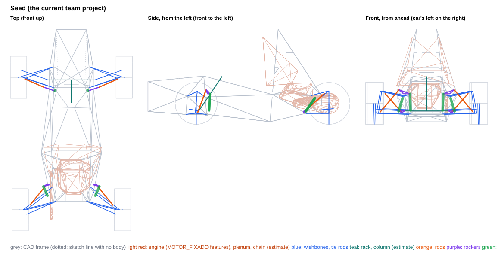
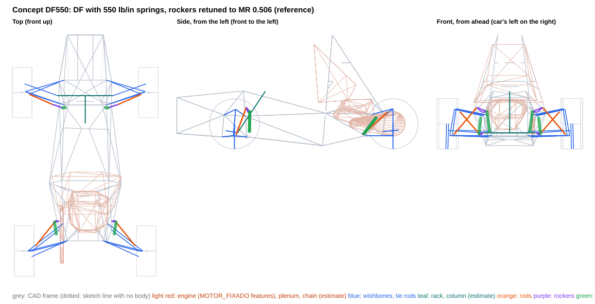
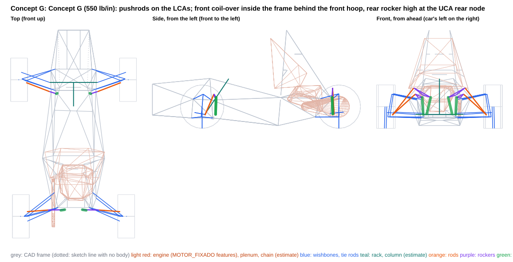
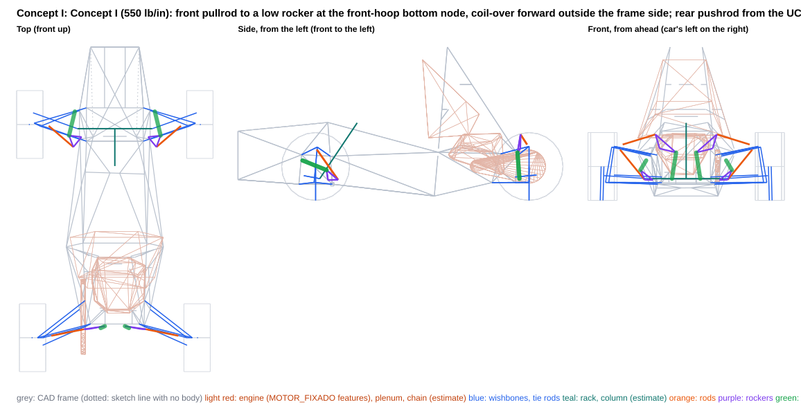

# Rocker layouts for 550 lb/in springs at MR 0.506 (same wheel rate as 220 lb/in at 0.80)

Generated by `scripts/rocker_concepts.py build` from the `concept_*.json` files in this folder. Each concept is also saved as a project variant, `projects/FSAE_2027_rocker_concept_<id>.vdproj.json`, to open in VD Studio (Rocker page). The team project is unchanged.

**What this is:** the consequences of these layouts, side by side. **What it is not:** a choice -- the report recommends nothing. The axles are independent: a front from one concept and a rear from another combine without changing either.

- Frame: ISO 8855 (X forward, Y LEFT, Z up), mm, chassis-fixed; LEFT corner points (the right is the Y-mirror). Kinematics: `DWSolver` + `vdcore.analysis.rocker`.
- Motion ratio 0.506 at ride on every concept axle is a **query argument** so the concepts compare like for like (the MR target is still an open decision; the Seed column keeps its own layout). The coil-over is placed for equal droop/bump margins at ±25 mm; the rocker arms are tangential at ride unless the concept clocks them.
- Springs fitted (front / rear, lb/in): 220 / 220 (seed); 550 / 550 (DF550, G, H, I). Wheel rate = k·MR² at ride.
- MR and damper usage are over the ±25 mm design travel. Packaging, transmission angles and rocker rotation are over the **physical** range, to the damper's end stops (no bump rubber in the project) or to the concept's travel limit (a bump stop and droop limiter the concept adds) when it sets one, and for the front over the full rack travel (±38 mm).
- **Gaps are air gaps**: centreline distance minus both estimated radii. Both corners are checked against the CAD as built (the frame is not symmetric at the engine mounts).
- Engine: `MOTOR_FIXADO` placed on the car by a fit of its four mounts to the chassis tabs (worst residual 0.004 mm), modelled as convex hulls of its features (crankcase features, intake plenum); its scanned mesh is not in the survey, so parts of the engine outside those features are not represented.
- Chassis: CAD survey `Xasis 33.3`. 155 members, of which 4 are 3D-sketch lines with no weldment body (dotted in the views; they may not be real tubes, and are kept in the checks); 43 2D layout-sketch lines with no body (templates, ground and profile lines) are references, left out of the checks; 8 solid bodies without a centreline are kept as bounding boxes (a box overstates a diagonal tube, so ⚠ means 'look in CAD', not a clash). Bracket lengths are to bodied members only.
- **Estimates** (no CAD): coil-over OD 60 mm (full OD from 30 mm off each eye), eyes OD 40 mm; rod 16×1 mm steel; rocker envelope ±10 mm, pickup bolts ±20 mm; wishbone OD 20, tie rod OD 16, rack housing OD 40 mm, inner tie-rod joint and boot 50 mm OD from 60 mm inboard of the joint to 20 mm past it at full rack travel; steering column (-30, 0, 157) → (-300, 0, 560), OD 40; damper stroke 57 mm (estimate); drive shaft from the wheel centre to a joint at |y| = 120 mm on the axle line, OD 60; chain and sprockets on the engine's chain line (radii 45 / 120 mm); coil-over 1.3 kg and rocker 0.3 kg per corner (CG effect only).

## Thresholds behind the ✗ flags

Information, not requirements.

| check | limit |
|---|---|
| rod vs frame | ≥ 5 mm |
| rocker (plates, pickup bolts) vs frame | ≥ 5 mm |
| coil-over body vs frame | ≥ 5 mm |
| coil-over eyes vs frame | ≥ 5 mm |
| rod vs wishbones / tie rod / toe link (with steer) | ≥ 5 mm |
| rod vs rim (13", steered) | ≥ 15 mm |
| left vs right linkage (heave and roll) | ≥ 5 mm |
| linkage vs steering rack (housing, inner tie-rod joint and boot) (front) | ≥ 5 mm |
| linkage vs steering column (estimate) (front) | ≥ 5 mm |
| linkage vs drive shaft (estimate) (rear) | ≥ 10 mm |
| linkage vs engine (MOTOR_FIXADO features, placed) (rear) | ≥ 10 mm |
| linkage vs chain and sprockets (estimate) (rear) | ≥ 10 mm |
| rocker / coil-over vs wishbones, tie rod / toe link (with steer) | ≥ 5 mm |
| rod vs its own rocker (away from its pickup) and coil-over | ≥ 5 mm |
| rocker pivot to nearest bodied tube | ≤ 60 mm |
| coil-over chassis end to nearest bodied tube | ≤ 60 mm |
| rocker pivot to the nearest frame node (3+ tubes) | ≤ 60 mm |
| coil-over chassis end to the nearest frame node (3+ tubes) | ≤ 60 mm |
| rod transmission angle (over the packaging range) | ≤ 30 deg |
| coil-over transmission angle (over the packaging range) | ≤ 30 deg |
| rocker rotation (over the packaging range) | ≤ 35 deg |

## Front axle

| | Seed | Concept DF550 | Concept G | Concept H | Concept I |
|---|---|---|---|---|---|
| Rod type / mounted on | pushrod / LCA | pushrod / LCA | pushrod / LCA | pullrod / UCA | pullrod / UCA |
| Rod in | compression | compression | compression | tension | tension |
| MR droop / ride / bump (±25 mm) | 0.785 / 0.800 / 0.795 | 0.496 / 0.506 / 0.504 | 0.487 / 0.506 / 0.512 | 0.528 / 0.506 / 0.485 | 0.524 / 0.506 / 0.490 |
| MR progression, droop to bump [%] | +1.2 | +1.5 | +4.9 | -8.4 | -6.7 |
| Damper stroke used in ±25 mm [mm] (of 57, estimate) | 39.8 | 25.2 | 25.2 | 25.3 | 25.3 |
| Spring [lb/in] / wheel rate at ride [N/mm] / ride frequency [Hz] | 220.0 / 24.7 / 3.2 | 550.0 / 24.7 / 3.2 | 550.0 / 24.7 / 3.2 | 550.0 / 24.7 / 3.2 | 550.0 / 24.7 / 3.2 |
| Damper end stops, wheel travel [mm] | -36.0 .. +35.9 | -57.6 .. +57.7 | -58.7 .. +57.0 | -54.2 .. +58.7 | -54.5 .. +58.0 |
| Packaging range, wheel travel [mm] (end stops, or the concept's travel limit) | -36.0 .. +35.9 | -36.0 .. +36.0 | -36.0 .. +36.0 | -36.0 .. +36.0 | -36.0 .. +36.0 |
| Spring unseats at wheel travel [mm] (fitted spring, no preload) | -23.7 | -23.7 | -23.7 | -23.7 | -23.7 |
| Rocker rotation over the packaging range [deg] | -20.5 .. +20.1 | -20.6 .. +20.1 | -23.7 .. +23.1 | -11.5 .. +11.0 | -9.2 .. +9.0 |
| Rocker arms rod / damper [mm] | 70 / 82 | 70 / 52 | 55 / 45 | 86 / 94 | 94 / 116 |
| Transmission angle max, rod / damper [deg] | 17.4 / 24.1 | 17.4 / 23.3 | 20.3 / 23.8 | 10.9 / 18.2 | 9.7 / 18.2 |
| Rod length [mm] | 361 | 361 | 369 | 329 | 319 |
| Rod inclination from horizontal / plan sweep [deg] | 47 / 24 | 47 / 24 | 40 / 21 | 41 / 31 | 43 / 41 |
| Rod force / wheel load | 1.47 | 1.47 | 1.64 | 2.15 | 2.43 |
| Rod force at ride [N] | 858 | 858 | 959 | 1255 | 1420 |
| Wheel load to buckle the rod [N] (16×1 steel) | 14046 | 14046 | 12037 | n/a | n/a |
| Rocker pivot reaction at ride [N] | 1480 | 1834 | 1902 | 1126 | 1234 |
| Bracket couple at ride, pivot / coil-over end [N·m] (upper bound: force × stand-off) | 57 / 31 | 70 / 42 | 60 / 51 | 41 / 52 | 34 / 50 |
| Gap: rod vs frame [mm] | 62.0 | 62.0 | 26.7 | 42.5 | 67.6 |
| Gap: rocker vs frame [mm] | 5.3 | 7.0 | 6.7 | 6.3 | 5.1 |
| Gap: coil-over body vs frame [mm] | 5.5 | **-9.3** ✗ | 8.5 | 17.1 | 8.1 |
| Gap: coil-over eyes vs frame [mm] | 9.0 | **4.0** ✗ | 7.5 | 12.4 | 10.4 |
| Gap: rod vs wishbones / tie rod / toe link, with steer [mm] | 5.5 | 5.5 | 9.9 | 20.0 | 7.2 |
| Gap: rod vs rim, with steer [mm] (to the 13" bead-seat radius) | 46.3 | 46.3 | 34.8 | — | — |
| Gap: left vs right, heave and roll [mm] | 316.3 | 339.3 | 309.3 | 433.8 | 460.1 |
| Gap: linkage vs rack, inner tie-rod joint and boot [mm] | 72.2 | 69.9 | 73.5 | 34.5 | 18.1 |
| Gap: linkage vs steering column [mm] (estimate) | 141.8 | 161.0 | 142.5 | 223.6 | 216.4 |
| Gap: linkage vs solid bodies' bounding boxes [mm] | 2.5 | 6.0 | 3.6 | 41.9 | 4.3 |
| Rocker pivot to nearest bodied tube [mm] | 38.2 | 38.2 | 31.4 | 36.8 | 27.8 |
| Coil-over chassis end to nearest bodied tube [mm] | 42.1 | 36.7 | 43.8 | 45.2 | 43.1 |
| Rocker pivot to the nearest frame node (3+ tubes) [mm] | 49.0 | 49.0 | 47.4 | 53.8 | 55.1 |
| Coil-over chassis end to the nearest frame node (3+ tubes) [mm] | 57.5 | **61.2** ✗ | 55.6 | 56.2 | 53.4 |
| Gap: rocker / coil-over vs wishbones, tie rod / toe link, with steer [mm] | 22.0 | 15.6 | 25.6 | 6.2 | 5.1 |
| Gap: rod vs its own rocker (away from its pickup) and coil-over [mm] | 11.8 | 11.8 | 10.5 | 7.8 | 8.3 |
| Damper length change over the rack travel at fixed wheel-centre height [mm] (steering jacking + any mount coupling; information) | 4.19 | 2.66 | 2.70 | 2.56 | 2.58 |
| Rocker / coil-over centreline height range z [mm] | 164 .. 420 | 172 .. 420 | 158 .. 398 | 130 .. 286 | 139 .. 289 |
| Coil-over + rocker mass height z [mm] | 278 | 284 | 271 | 225 | 234 |

## Rear axle

| | Seed | Concept DF550 | Concept G | Concept H | Concept I |
|---|---|---|---|---|---|
| Rod type / mounted on | pullrod / UCA | pullrod / UCA | pushrod / LCA | pushrod / UCA | pushrod / UCA |
| Rod in | tension | tension | compression | compression | compression |
| MR droop / ride / bump (±25 mm) | 0.789 / 0.800 / 0.800 | 0.497 / 0.506 / 0.506 | 0.498 / 0.506 / 0.509 | 0.496 / 0.506 / 0.512 | 0.497 / 0.506 / 0.511 |
| MR progression, droop to bump [%] | +1.3 | +1.7 | +2.1 | +3.1 | +2.6 |
| Damper stroke used in ±25 mm [mm] (of 57, estimate) | 39.9 | 25.2 | 25.3 | 25.3 | 25.3 |
| Spring [lb/in] / wheel rate at ride [N/mm] / ride frequency [Hz] | 220.0 / 24.7 / 2.9 | 550.0 / 24.7 / 2.9 | 550.0 / 24.7 / 2.9 | 550.0 / 24.7 / 2.9 | 550.0 / 24.7 / 2.9 |
| Damper end stops, wheel travel [mm] | -35.9 .. +35.7 | -57.7 .. +56.9 | -57.3 .. +56.4 | -57.5 .. +56.0 | -57.3 .. +56.1 |
| Packaging range, wheel travel [mm] (end stops, or the concept's travel limit) | -35.9 .. +35.7 | -36.0 .. +36.0 | -36.0 .. +36.0 | -36.0 .. +36.0 | -36.0 .. +36.0 |
| Spring unseats at wheel travel [mm] (fitted spring, no preload) | -30.0 | -30.0 | -30.0 | -30.0 | -30.0 |
| Rocker rotation over the packaging range [deg] | -23.7 .. +22.6 | -23.8 .. +22.8 | -11.6 .. +11.3 | -9.2 .. +9.0 | -8.6 .. +8.3 |
| Rocker arms rod / damper [mm] | 38 / 73 | 38 / 46 | 130 / 92 | 94 / 115 | 106 / 124 |
| Transmission angle max, rod / damper [deg] | 20.7 / 28.8 | 20.8 / 29.8 | 8.9 / 15.9 | 3.5 / 11.3 | 3.1 / 13.6 |
| Rod length [mm] | 388 | 388 | 383 | 261 | 252 |
| Rod inclination from horizontal / plan sweep [deg] | 35 / 51 | 35 / 51 | 52 / 4 | 14 / 11 | 17 / 11 |
| Rod force / wheel load | 2.36 | 2.36 | 1.39 | 2.41 | 2.29 |
| Rod force at ride [N] | 1748 | 1748 | 1028 | 1780 | 1694 |
| Wheel load to buckle the rod [N] (16×1 steel) | n/a | n/a | 13172 | 16398 | 18547 |
| Rocker pivot reaction at ride [N] | 1296 | 1059 | 2433 | 2818 | 2684 |
| Bracket couple at ride, pivot / coil-over end [N·m] (upper bound: force × stand-off) | 41 / 42 | 34 / 75 | 92 / 68 | 116 / 58 | 115 / 60 |
| Gap: rod vs frame [mm] | 30.3 | 30.3 | 91.6 | 71.5 | 75.3 |
| Gap: rocker vs frame [mm] | 9.1 | 9.1 | 13.6 | 16.2 | 19.2 |
| Gap: coil-over body vs frame [mm] | 10.9 | 8.6 | 11.7 | 11.6 | 21.4 |
| Gap: coil-over eyes vs frame [mm] | 13.2 | 18.4 | 14.1 | 6.9 | 8.4 |
| Gap: rod vs wishbones / tie rod / toe link, with steer [mm] | 20.3 | 20.3 | 6.1 | 19.4 | 21.3 |
| Gap: rod vs rim, with steer [mm] (to the 13" bead-seat radius) | — | — | 52.0 | — | — |
| Gap: left vs right, heave and roll [mm] | 488.7 | 488.7 | 143.5 | 125.0 | 88.3 |
| Gap: linkage vs drive shaft [mm] (estimate) | 80.9 | 80.9 | 11.0 | 18.0 | 21.1 |
| Gap: linkage vs engine (MOTOR_FIXADO features, on its mounts) [mm] | 84.2 | 85.0 | 79.3 | 73.0 | 75.6 |
| Gap: linkage vs solid bodies' bounding boxes [mm] | 419.6 | 419.6 | 548.0 | 542.6 | 537.4 |
| Rocker pivot to nearest bodied tube [mm] | 31.8 | 31.8 | 37.8 | 41.1 | 42.8 |
| Coil-over chassis end to nearest bodied tube [mm] | 45.9 | 51.1 | 46.8 | 39.6 | 41.1 |
| Rocker pivot to the nearest frame node (3+ tubes) [mm] | 53.7 | 53.7 | 54.0 | 53.5 | 53.2 |
| Coil-over chassis end to the nearest frame node (3+ tubes) [mm] | 56.4 | 59.0 | 56.9 | 52.1 | 51.9 |
| Gap: rocker / coil-over vs wishbones, tie rod / toe link, with steer [mm] | 8.4 | 10.9 | 17.0 | 14.1 | 33.3 |
| Gap: rod vs its own rocker (away from its pickup) and coil-over [mm] | **-37.2** ✗ | **-29.0** ✗ | 14.5 | 16.3 | 16.4 |
| Gap: linkage vs chain and sprockets [mm] (estimate) | 11.2 | 11.3 | 14.2 | 11.4 | 11.8 |
| Rocker / coil-over centreline height range z [mm] | 130 .. 306 | 130 .. 301 | 163 .. 475 | 158 .. 471 | 157 .. 480 |
| Coil-over + rocker mass height z [mm] | 216 | 213 | 279 | 274 | 274 |

## Car level

| | Seed | DF550 | G | H | I |
|---|---|---|---|---|---|
| Springs-only roll gradient [deg/g] (each column's springs) | 1.21 | 1.21 | 1.21 | 1.21 | 1.21 |
| ARB needed for 1.0 deg/g at 50/50, F / R [N·m/deg] | 57 / 78 | 57 / 78 | 57 / 78 | 57 / 78 | 57 / 78 |
| CG height change vs seed [mm] (estimate) | +0.0 | +0.0 | +0.6 | +0.0 | +0.1 |
| Tilt-table tip angle [deg] (seed 62.13) | 62.13 | 62.13 | 62.09 | 62.13 | 62.12 |

Wheel rates, frequencies and the roll budget follow from each column's springs and ride MR; where those match, they only move with the MR progression and are listed to show that, not as a difference between the layouts. The spring unseating row is the same story: with no preload the spring comes off its seat at its static compression divided by the MR, whatever the layout.

## Seed: the current team project

| point (LEFT corner) | front | rear |
|---|---|---|
| rod outer end (on the mount body) | (-17.0, 543.4, 138.6) | (-1490.5, 484.2, 362.2) |
| rocker pivot | (-130.5, 269.6, 357.1) | (-1250.5, 254.4, 158.2) |
| rocker axis (unit) | (-0.9376, 0.3430, -0.0573) | (0.7556, 0.2523, 0.6045) |
| rocker rod pickup | (-115.3, 319.0, 404.5) | (-1244.3, 285.8, 137.3) |
| rocker damper pickup | (-158.7, 192.2, 355.4) | (-1270.1, 324.5, 153.4) |
| coil-over chassis end | (-148.8, 187.4, 164.2) | (-1376.6, 278.2, 305.8) |
| rod type / mount body | pushrod / lca | pullrod / uca |

**Where the tightest numbers are:**

- front gap rod frame: 62.0 mm — FRONTO HO (-104, 245, 344)->(-89, 159, 556), L at +36 mm
- front gap rocker frame: 5.3 mm — Tri_Meio (-106, 251, 319)->(-884, 350, 348), L at +36 mm
- front gap coilover frame: 5.5 mm — PSD (-106, 255, 320)->(-120, 205, 117), L at +36 mm
- front gap rod members: 5.5 mm — UCA rear leg at -36 mm, rack -38
- front gap rod linkage: 11.8 mm — rocker arm to the rod pickup at +36 mm
- front gap rod rim: 46.3 mm — at +36 mm, rack +38
- front gap solid bodies: 2.5 mm — rocker vs 'Ressalto-extrusão1' box, L at -21 mm
- front pivot bracket: 38.2 mm — FRONTO HO (-104, 245, 344)->(-89, 159, 556) (L), foot 2 mm from its nearer end
- front damper bracket: 42.1 mm — FRONTO HO (-108, -249, 295)->(-120, -205, 117) (R), foot 39 mm from its nearer end
- front pivot node: 49.0 mm — node (-106, -250, 319) (R), 5 tube ends: FRONTO HO, PSD, Tri_Meio
- front damper node: 57.5 mm — node (-120, 205, 117) (L), 7 tube ends: 3DSketch3, PSD, Tri_Frente, Tri_Meio, assoalho frontal
- rear gap rod frame: 30.3 mm — Tri_Tras (-884, 350, 348)->(-1272, 215, 129), L at -36 mm
- rear gap rocker frame: 9.1 mm — Tri_Tras (-884, 350, 348)->(-1272, 215, 129), L at -36 mm
- rear gap coilover frame: 10.9 mm — PST (-1336, 255, 337)->(-1272, 215, 129), L at -36 mm
- rear gap rod members: 20.3 mm — UCA front leg at +36 mm, rack +0
- rear gap rod linkage: -37.2 mm — coil-over body at -10 mm
- rear gap engine: 84.2 mm — coil-over vs engine (features), R at -36 mm
- rear gap solid bodies: 419.6 mm — rocker vs 'Ressalto-extrusão1' box, L at -36 mm
- rear pivot bracket: 31.8 mm — Tri_Tras (-884, 350, 348)->(-1272, 215, 129) (L), foot 43 mm from its nearer end
- rear damper bracket: 45.9 mm — PST (-1336, 255, 337)->(-1461, 210, 328) (L), foot 33 mm from its nearer end
- rear pivot node: 53.7 mm — node (-1272, 215, 129) (L), 5 tube ends: PST, Tri_Tras
- rear damper node: 56.4 mm — node (-1336, 255, 337) (L), 4 tube ends: 3DSketch8, PST, Tri_Tras

**Outside the thresholds:** rear rod vs its own rocker (away from its pickup) and coil-over -37.2 (limit ≥ 5)

## Concept DF550: DF with 550 lb/in springs, rockers retuned to MR 0.506 (reference)

Reference, not a new layout: the team project's DF positions (rod mounts, pivots, coil-over lines) with 550 lb/in springs and the rockers' damper arms shortened to reach MR 0.506 (front 82 -> 52 mm, rear 73 -> 46 mm), packaging checked to +-36 mm. It shows that DF cannot be carried over by changing only the rockers: at the front the shorter arm turns the coil-over line into the Tri_Meio rail (-9.3 mm at +36 mm) and moves the eye 61.2 mm from its node; the rear rod still runs through its own coil-over (-29.0 mm), as in DF.

| point (LEFT corner) | front | rear |
|---|---|---|
| rod outer end (on the mount body) | (-17.0, 543.4, 138.6) | (-1490.5, 484.2, 362.2) |
| rocker pivot | (-130.5, 269.6, 357.1) | (-1250.5, 254.4, 158.2) |
| rocker axis (unit) | (-0.9376, 0.3430, -0.0573) | (0.7556, 0.2523, 0.6045) |
| rocker rod pickup | (-115.3, 319.0, 404.5) | (-1244.3, 285.8, 137.3) |
| rocker damper pickup | (-148.6, 221.0, 362.0) | (-1258.4, 299.0, 149.4) |
| coil-over chassis end | (-146.2, 195.7, 172.1) | (-1374.0, 281.9, 301.1) |
| rod type / mount body | pushrod / lca | pullrod / uca |

**Where the tightest numbers are:**

- front gap rod frame: 62.0 mm — FRONTO HO (-104, 245, 344)->(-89, 159, 556), L at +36 mm
- front gap rocker frame: 7.0 mm — FRONTO HO (-104, 245, 344)->(-89, 159, 556), L at -36 mm
- front gap coilover frame: -9.3 mm — Tri_Meio (-106, 251, 319)->(-857, 230, 32), L at +36 mm
- front gap rod members: 5.5 mm — UCA rear leg at -36 mm, rack -38
- front gap rod linkage: 11.8 mm — rocker arm to the rod pickup at +36 mm
- front gap rod rim: 46.3 mm — at +36 mm, rack +38
- front gap solid bodies: 6.0 mm — coil-over vs 'Ressalto-extrusão2' box, L at -5 mm
- front pivot bracket: 38.2 mm — FRONTO HO (-104, 245, 344)->(-89, 159, 556) (L), foot 2 mm from its nearer end
- front damper bracket: 36.7 mm — FRONTO HO (-108, -249, 295)->(-120, -205, 117) (R), foot 49 mm from its nearer end
- front pivot node: 49.0 mm — node (-106, -250, 319) (R), 5 tube ends: FRONTO HO, PSD, Tri_Meio
- front damper node: 61.2 mm — node (-120, 205, 117) (L), 7 tube ends: 3DSketch3, PSD, Tri_Frente, Tri_Meio, assoalho frontal
- rear gap rod frame: 30.3 mm — Tri_Tras (-884, 350, 348)->(-1272, 215, 129), L at -36 mm
- rear gap rocker frame: 9.1 mm — Tri_Tras (-884, 350, 348)->(-1272, 215, 129), L at -36 mm
- rear gap coilover frame: 8.6 mm — PST (-1336, 255, 337)->(-1272, 215, 129), L at -36 mm
- rear gap rod members: 20.3 mm — UCA front leg at +36 mm, rack +0
- rear gap rod linkage: -29.0 mm — coil-over body at -36 mm
- rear gap engine: 85.0 mm — coil-over vs engine (features), R at -36 mm
- rear gap solid bodies: 419.6 mm — rocker vs 'Ressalto-extrusão1' box, L at -36 mm
- rear pivot bracket: 31.8 mm — Tri_Tras (-884, 350, 348)->(-1272, 215, 129) (L), foot 43 mm from its nearer end
- rear damper bracket: 51.1 mm — PST (-1336, 255, 337)->(-1461, 210, 328) (L), foot 29 mm from its nearer end
- rear pivot node: 53.7 mm — node (-1272, 215, 129) (L), 5 tube ends: PST, Tri_Tras
- rear damper node: 59.0 mm — node (-1336, 255, 337) (L), 4 tube ends: 3DSketch8, PST, Tri_Tras

**Outside the thresholds:** front coil-over body vs frame -9.3 (limit ≥ 5); front coil-over eyes vs frame 4.0 (limit ≥ 5); front coil-over chassis end to the nearest frame node (3+ tubes) 61.2 (limit ≤ 60); rear rod vs its own rocker (away from its pickup) and coil-over -29.0 (limit ≥ 5)

**Pros**

- Same rod mounts, pivots and frame brackets as the team project; front rod self-clearance 11.8 mm, rack, inner joint and boot 69.9 mm away, rear rod, rocker and drive-shaft clearances unchanged (30.3, 9.1 and 80.9 mm).

**Cons**

- Front: coil-over body into the Tri_Meio rail (-9.3 mm at +36 mm), eye 4.0 mm from the hoop's lower leg and 61.2 mm from the front-hoop bottom node (limit 60).
- Rear: the pullrod still crosses its own coil-over next to the rocker (-29.0 mm at -36 mm), the clash seen in SolidWorks on DF.

**Not checked**

- The +-36 mm travel limit is a design input (design_intent, the designer's choice of 2026-10-21): a bump stop and a droop limiter that are not in the project. With them the damper keeps about 10 mm at each end (it uses about 36 of its 57 mm, an estimate); without them the wheel could reach the damper's own end stops (about -54..-59 / +56..+59 mm), a range these layouts were not checked over.
- Damping: the damper moves 0.506 mm per mm of wheel instead of 0.80, so the same valving gives (0.506/0.80)^2 = 40 % of today's damping at the wheel. Damping is outside this tool.
- The 550 lb/in spring's free length, OD and coil-bind length are not in the project (the coil-over is a 60 mm OD envelope, an estimate). Static compression 12.0 mm front / 15.2 mm rear; with no preload the spring comes off its seat at -23.7 / -30.0 mm of wheel travel, inside the +-36 mm range, as it does today with 220 lb/in at 0.80.
- Structure: no load cases, stress, fatigue or sizing of rockers, brackets, clevises, rods or wishbones; the spring force at ride is 58 % higher than today's (1156 / 1461 N against 731 / 924 N), which raises the rocker and bracket loads; leg-bending figures are hand estimates (simply supported leg, rod force at ride).
- Real part envelopes are estimates (rod 16, coil-over 60, eyes 40, rocker +-10 mm plates and +-20 mm bolts, frame 25.4, wishbones 20, rack boot 50 mm). The differential, bodywork, the driver's legs and hands beyond the template boxes, and the steering wheel are not modelled.

## Concept G: Concept G (550 lb/in): pushrods on the LCAs; front coil-over inside the frame behind the front hoop, rear rocker high at the UCA rear node

Pushrods on the LCAs at both axles. Front: the DF/D layout redrawn for MR 0.506, a smaller rocker (arms 55 / 45 mm) 47.4 mm from the front-hoop side node with the coil-over nearly vertical behind the hoop's lower leg, inside the frame, to an eye 55.6 mm from the front-hoop bottom node. Rear: a long bellcrank (arms 130 / 92 mm, 218 mm between pickups) 54.0 mm from the UCA rear pivot node, high on the rear structure, with the coil-over nearly vertical down to an eye 56.9 mm from the LCA rear pivot node. Zero evaluator fails; no part-to-part interference in the solids. Fits are thin at the front and the rear rocker is large; CG +0.6 mm against the team project.

| point (LEFT corner) | front | rear |
|---|---|---|
| rod outer end (on the mount body) | (-31.7, 533.6, 148.6) | (-1487.3, 525.1, 155.5) |
| rocker pivot | (-143.0, 236.4, 345.7) | (-1467.5, 186.0, 376.0) |
| rocker axis (unit) | (-0.9455, 0.3222, -0.0480) | (-0.9988, -0.0392, 0.0298) |
| rocker rod pickup | (-133.4, 270.6, 387.4) | (-1469.1, 288.1, 456.5) |
| rocker damper pickup | (-157.7, 193.6, 349.0) | (-1464.8, 98.3, 349.6) |
| coil-over chassis end | (-151.7, 183.0, 157.8) | (-1472.1, 142.7, 163.4) |
| rod type / mount body | pushrod / lca | pushrod / lca |

**Where the tightest numbers are:**

- front gap rod frame: 26.7 mm — FRONTO HO (-104, 245, 344)->(-89, 159, 556), L at +36 mm
- front gap rocker frame: 6.7 mm — FRONTO HO (-104, 245, 344)->(-89, 159, 556), L at +36 mm
- front gap coilover frame: 8.5 mm — PSD (-106, 255, 320)->(-120, 205, 117), L at -36 mm
- front gap rod members: 9.9 mm — UCA rear leg at +36 mm, rack +38
- front gap rod linkage: 10.5 mm — rocker arm to the rod pickup at +36 mm
- front gap rod rim: 34.8 mm — at -26 mm, rack +38
- front gap solid bodies: 3.6 mm — coil-over vs 'Ressalto-extrusão1' box, L at -5 mm
- front pivot bracket: 31.4 mm — Tri_Meio (-106, 251, 319)->(-884, 350, 348) (L), foot 36 mm from its nearer end
- front damper bracket: 43.8 mm — 3DSketch3 (-120, -205, 117)->(-352, -35, 91) (R), foot 34 mm from its nearer end
- front pivot node: 47.4 mm — node (-106, -250, 319) (R), 5 tube ends: FRONTO HO, PSD, Tri_Meio
- front damper node: 55.6 mm — node (-120, 205, 117) (L), 7 tube ends: 3DSketch3, PSD, Tri_Frente, Tri_Meio, assoalho frontal
- rear gap rod frame: 91.6 mm — Tri_Tras (-951, -116, 1108)->(-1461, -210, 328), R at +36 mm
- rear gap rocker frame: 13.6 mm — Tri_Tras (-1461, 210, 328)->(-951, 116, 1108), L at -36 mm
- rear gap coilover frame: 11.7 mm — PST (-1441, 175, 129)->(-1464, 209, 328), L at +36 mm
- rear gap rod members: 6.1 mm — UCA rear leg at +36 mm, rack +0
- rear gap rod linkage: 14.5 mm — rocker arm to the rod pickup at +36 mm
- rear gap rod rim: 52.0 mm — at +36 mm, rack +0
- rear gap engine: 79.3 mm — coil-over vs engine (features), R at -10 mm
- rear gap solid bodies: 548.0 mm — rocker vs '2027 SIZE_X_19,1X1,2MM(1)[4]' box, L at +36 mm
- rear pivot bracket: 37.8 mm — Tri_Tras (-1461, 210, 328)->(-951, 116, 1108) (L), foot 39 mm from its nearer end
- rear damper bracket: 46.8 mm — PST (-1441, 175, 129)->(-1441, -175, 129) (L), foot 32 mm from its nearer end
- rear pivot node: 54.0 mm — node (-1461, 210, 328) (L), 6 tube ends: 3DSketch7, PST, Tri_Tras
- rear damper node: 56.9 mm — node (-1441, 175, 129) (L), 5 tube ends: 3DSketch6, PST

**Outside the thresholds:** none

**Pros**

- Front: zero fails; MR 0.487 / 0.506 / 0.512 over +-25 mm (+4.9 %); rocker rotation -23.7 / +23.1 deg; transmission angles at most 20.3 deg (rod) and 23.8 deg (coil-over). Pushrod 369 mm at 1.64x the wheel load (959 N at ride), buckling at 12.0 kN of wheel load. Clevis 31.3 mm off the LCA rear leg, 59 mm from the ball joint along it (32 N·m of leg bending at ride, 61 MPa on 25.4x1.2, hand estimate). Rack, inner joint and boot 73.5 mm away; coil-over / rocker to wishbones 25.6 mm; rod to its own rocker and coil-over 10.5 mm.
- Rear: zero fails; MR 0.498 / 0.506 / 0.509 (+2.1 %); rocker rotation -11.6 / +11.3 deg; transmission angles at most 8.9 / 15.9 deg. Pushrod 383 mm, 52 deg from horizontal and 4 deg off transverse in plan, 1.39x the wheel load (1028 N), buckling at 13.2 kN. Clevis 33.1 mm off the LCA front leg, 59 mm from the ball joint (45 N·m, 85 MPa, hand estimate). Rocker to frame 13.6 mm, coil-over 11.7, eyes 14.1, chain 14.2 (estimate), engine features 79.3 mm.
- One rod type on both axles (pushrods in compression), and the front keeps the team project's arrangement and frame nodes.

**Cons**

- Front fits thinly: rocker 6.7 mm from the front hoop's upper leg, coil-over 8.5 mm from its lower leg, eyes 7.5 mm, against 5 mm limits; the coil-over hangs beside the driver's knee between the two template boxes (3.6 mm to each); moving the pivot 5 mm broke a threshold in 3 of 6 directions. The pivot bolt (+-20 mm) clears the frame by 1.5 mm and the solids' rocker hub touches the Tri_Meio rail by 1.1 mm: a one-sided stub or a shaped yoke.
- Rear rocker is large and high: arms 130 / 92 mm, 158 deg apart (218 mm between pickups), hardware up to z = 485 mm; pivot reaction 2433 N and bracket couples up to 92 / 68 N·m at ride (upper bound). Rod to the UCA rear leg 6.1 mm at +36 mm and the coil-over 11.0 mm from the drive-shaft envelope (estimate); moving the pivot 5 mm broke a threshold in 2 of 6 directions, the eye in 3 of 6.
- Front pivot reaction 1902 N against 1480 N in the team project (the spring force is 58 % higher at MR 0.506).

**Not checked**

- The +-36 mm travel limit is a design input (design_intent, the designer's choice of 2026-10-21): a bump stop and a droop limiter that are not in the project. With them the damper keeps about 10 mm at each end (it uses about 36 of its 57 mm, an estimate); without them the wheel could reach the damper's own end stops (about -54..-59 / +56..+59 mm), a range these layouts were not checked over.
- Damping: the damper moves 0.506 mm per mm of wheel instead of 0.80, so the same valving gives (0.506/0.80)^2 = 40 % of today's damping at the wheel. Damping is outside this tool.
- The 550 lb/in spring's free length, OD and coil-bind length are not in the project (the coil-over is a 60 mm OD envelope, an estimate). Static compression 12.0 mm front / 15.2 mm rear; with no preload the spring comes off its seat at -23.7 / -30.0 mm of wheel travel, inside the +-36 mm range, as it does today with 220 lb/in at 0.80.
- Structure: no load cases, stress, fatigue or sizing of rockers, brackets, clevises, rods or wishbones; the spring force at ride is 58 % higher than today's (1156 / 1461 N against 731 / 924 N), which raises the rocker and bracket loads; leg-bending figures are hand estimates (simply supported leg, rod force at ride).
- Real part envelopes are estimates (rod 16, coil-over 60, eyes 40, rocker +-10 mm plates and +-20 mm bolts, frame 25.4, wishbones 20, rack boot 50 mm). The differential, bodywork, the driver's legs and hands beyond the template boxes, and the steering wheel are not modelled.

## Concept H: Concept H (550 lb/in): front pullrod to a low rocker at the LCA front node, coil-over outside the frame side; rear pushrod from the UCA to a rocker at the UCA rear node

Front: a pullrod in tension from a clevis on the UCA front leg down to a low rocker 53.8 mm from the LCA front pivot node, ahead of the front hoop; the coil-over runs rearward and up along the OUTSIDE of the frame's side to an eye 56.2 mm from the front-hoop side node. Rear: a pushrod in compression from a clevis on the UCA rear leg up to a rocker 53.5 mm from the UCA rear pivot node, the coil-over down to an eye 52.1 mm from the LCA rear pivot node. Zero evaluator fails; no part-to-part interference in the solids. The front has the lowest rocker loads of the set and the lowest front linkage, with a falling MR (-8.4 %) and the coil-over outside the frame; CG +0.05 mm.

| point (LEFT corner) | front | rear |
|---|---|---|
| rod outer end (on the mount body) | (25.1, 490.1, 356.2) | (-1526.2, 467.7, 405.2) |
| rocker pivot | (83.1, 226.9, 149.3) | (-1475.8, 196.0, 377.4) |
| rocker axis (unit) | (0.4487, -0.4891, 0.7480) | (-0.9831, -0.1827, 0.0051) |
| rocker rod pickup | (152.4, 277.1, 140.6) | (-1479.6, 218.7, 468.9) |
| rocker damper pickup | (87.3, 306.6, 198.9) | (-1456.0, 88.4, 342.3) |
| coil-over chassis end | (-81.6, 284.6, 285.9) | (-1466.8, 141.2, 158.5) |
| rod type / mount body | pullrod / uca | pushrod / uca |

**Where the tightest numbers are:**

- front gap rod frame: 42.5 mm — Tri_Frente (120, 205, 117)->(560, 175, 150), L at -36 mm
- front gap rocker frame: 6.3 mm — PSD (120, 205, 117)->(101, 255, 330), L at -36 mm
- front gap coilover frame: 17.1 mm — PSD (101, 255, 330)->(-106, 255, 320), L at +36 mm
- front gap rod members: 20.0 mm — UCA front leg at +36 mm, rack +38
- front gap rod linkage: 7.8 mm — damper pickup bolt at -36 mm
- front gap solid bodies: 41.9 mm — rocker vs 'Ressalto-extrusão2' box, L at -36 mm
- front pivot bracket: 36.8 mm — PSD (120, 205, 117)->(101, 255, 330) (L), foot 39 mm from its nearer end
- front damper bracket: 45.2 mm — FRONTO HO (-108, -249, 295)->(-120, -205, 117) (R), foot 0 mm from its nearer end
- front pivot node: 53.8 mm — node (120, 205, 117) (L), 5 tube ends: PSD, Tri_Frente, assoalho frontal
- front damper node: 56.2 mm — node (-106, 251, 324) (L), 5 tube ends: FRONTO HO, PSD, Tri_Meio
- rear gap rod frame: 71.5 mm — Tri_Tras (-951, -116, 1108)->(-1461, -210, 328), R at +36 mm
- rear gap rocker frame: 16.2 mm — 3DSketch7 (-1461, 210, 328)->(-1326, 73, 467), L at +36 mm
- rear gap coilover frame: 11.6 mm — PST (-1441, 175, 129)->(-1464, 209, 328), L at +36 mm
- rear gap rod members: 19.4 mm — UCA rear leg at -36 mm, rack +0
- rear gap rod linkage: 16.3 mm — rocker arm to the rod pickup at +36 mm
- rear gap engine: 73.0 mm — coil-over vs engine (features), R at -5 mm
- rear gap solid bodies: 542.6 mm — rocker vs 'Ressalto-extrusão3' box, L at +36 mm
- rear pivot bracket: 41.1 mm — Tri_Tras (-1461, 210, 328)->(-951, 116, 1108) (L), foot 34 mm from its nearer end
- rear damper bracket: 39.6 mm — PST (-1441, 175, 129)->(-1441, -175, 129) (L), foot 34 mm from its nearer end
- rear pivot node: 53.5 mm — node (-1461, 210, 328) (L), 6 tube ends: 3DSketch7, PST, Tri_Tras
- rear damper node: 52.1 mm — node (-1441, 175, 129) (L), 5 tube ends: 3DSketch6, PST

**Outside the thresholds:** none

**Pros**

- Front: zero fails; pivot reaction 1126 N, the lowest front value of the set (team project 1480 N); rocker rotation -11.5 / +11.0 deg; transmission angles at most 10.9 / 18.2 deg; coil-over + rocker mass height 225 mm (team project 278 mm). Pullrod 329 mm in tension (no buckling), 2.15x the wheel load (1255 N). Clevis 25.1 mm off the UCA front leg, 62 mm from the ball joint along it (32 N·m, 62 MPa on 25.4x1.2, hand estimate). Coil-over 17.1 mm from the frame, rod 20.0 mm from the wishbones, 41.9 mm from the template boxes, rack and boot 34.5 mm.
- Rear: zero fails; MR 0.496 / 0.506 / 0.512 (+3.1 %); rocker rotation -9.2 / +9.0 deg; transmission angles at most 3.5 / 11.3 deg. Pushrod 261 mm, nearly horizontal (14 deg) and 11 deg off transverse in plan, 2.41x the wheel load (1780 N), buckling at 16.4 kN. Clevis 24.9 mm off the UCA rear leg, 50 mm from the ball joint (32 N·m, 61 MPa, hand estimate). Rocker 16.2 mm from the frame, coil-over 11.6, rod 19.4 from the wishbones, drive shaft 18.0 (estimate).

**Cons**

- Front MR falls in bump: 0.528 / 0.506 / 0.485 over +-25 mm (-8.4 %), so the wheel rate drops about 16 % from droop to bump.
- Front coil-over outside the frame: it runs along the side of the front box at y = 285-307 mm (the side tubes are at y = 205-255 mm), where bodywork has to cover it; bodywork is not modelled. Rocker 6.3 mm from the frame and 6.2 mm from the LCA front leg (droop, full steer); rod to its own rocker and coil-over 7.8 mm; moving the pivot 5 mm broke a threshold in 5 of 6 directions. The pivot bolt clears the frame by 1.3 mm and the solids' rocker hub touches the PSD tube by 2.7 mm.
- Rear rocker is large and high: arms 94 / 115 mm (183 mm between pickups), hardware up to z = 481 mm; pivot reaction 2818 N and bracket couples up to 116 / 58 N·m at ride (upper bound). Eyes 6.9 mm from the frame, chain 11.4 mm (estimate).
- Mixed rod types: a pullrod in tension at the front, a pushrod in compression at the rear.

**Not checked**

- The +-36 mm travel limit is a design input (design_intent, the designer's choice of 2026-10-21): a bump stop and a droop limiter that are not in the project. With them the damper keeps about 10 mm at each end (it uses about 36 of its 57 mm, an estimate); without them the wheel could reach the damper's own end stops (about -54..-59 / +56..+59 mm), a range these layouts were not checked over.
- Damping: the damper moves 0.506 mm per mm of wheel instead of 0.80, so the same valving gives (0.506/0.80)^2 = 40 % of today's damping at the wheel. Damping is outside this tool.
- The 550 lb/in spring's free length, OD and coil-bind length are not in the project (the coil-over is a 60 mm OD envelope, an estimate). Static compression 12.0 mm front / 15.2 mm rear; with no preload the spring comes off its seat at -23.7 / -30.0 mm of wheel travel, inside the +-36 mm range, as it does today with 220 lb/in at 0.80.
- Structure: no load cases, stress, fatigue or sizing of rockers, brackets, clevises, rods or wishbones; the spring force at ride is 58 % higher than today's (1156 / 1461 N against 731 / 924 N), which raises the rocker and bracket loads; leg-bending figures are hand estimates (simply supported leg, rod force at ride).
- Real part envelopes are estimates (rod 16, coil-over 60, eyes 40, rocker +-10 mm plates and +-20 mm bolts, frame 25.4, wishbones 20, rack boot 50 mm). The differential, bodywork, the driver's legs and hands beyond the template boxes, and the steering wheel are not modelled.

## Concept I: Concept I (550 lb/in): front pullrod to a low rocker at the front-hoop bottom node, coil-over forward outside the frame side; rear pushrod from the UCA, coil-over down and inboard

Front: a pullrod in tension from a clevis on the UCA front leg down to a low rocker 55.1 mm from the front-hoop bottom node; the coil-over runs FORWARD and up along the outside of the frame's side to an eye 53.4 mm from the UCA front pivot node. Rear: a pushrod in compression from a clevis on the UCA rear leg up to a rocker 53.2 mm from the UCA rear pivot node, the coil-over down and inboard to an eye 51.9 mm from the inner lower rear node. Zero evaluator fails; no part-to-part interference in the solids. It is the thinnest fit of the set at the front (every 5 mm pivot move breaks a limit) and its rear coil-overs sit nearest the centreline, where the differential would be; CG +0.14 mm.

| point (LEFT corner) | front | rear |
|---|---|---|
| rod outer end (on the mount body) | (-9.9, 477.1, 366.7) | (-1525.8, 458.0, 404.0) |
| rocker pivot | (-90.0, 240.1, 147.0) | (-1477.3, 190.6, 374.9) |
| rocker axis (unit) | (0.4218, 0.5357, -0.7315) | (-0.9821, -0.1831, 0.0437) |
| rocker rod pickup | (-162.3, 299.8, 149.0) | (-1478.5, 221.6, 476.6) |
| rocker damper pickup | (-79.3, 330.5, 219.4) | (-1456.5, 72.3, 345.6) |
| coil-over chassis end | (94.0, 288.5, 288.6) | (-1470.5, 102.1, 156.9) |
| rod type / mount body | pullrod / uca | pushrod / uca |

**Where the tightest numbers are:**

- front gap rod frame: 67.6 mm — Tri_Meio (-120, 205, 117)->(-857, 230, 32), L at -36 mm
- front gap rocker frame: 5.1 mm — Tri_Frente (101, 255, 330)->(-120, 205, 117), L at -36 mm
- front gap coilover frame: 8.1 mm — Tri_Frente (101, 255, 330)->(-120, 205, 117), L at +36 mm
- front gap rod members: 7.2 mm — UCA rear leg at +5 mm, rack +0
- front gap rod linkage: 8.3 mm — damper pickup bolt at -36 mm
- front gap solid bodies: 4.3 mm — rocker vs 'Ressalto-extrusão1' box, L at -36 mm
- front pivot bracket: 27.8 mm — Tri_Frente (101, 255, 330)->(-120, 205, 117) (L), foot 48 mm from its nearer end
- front damper bracket: 43.1 mm — PSD (120, 205, 117)->(101, 255, 330) (L), foot 31 mm from its nearer end
- front pivot node: 55.1 mm — node (-120, 205, 117) (L), 7 tube ends: 3DSketch3, PSD, Tri_Frente, Tri_Meio, assoalho frontal
- front damper node: 53.4 mm — node (101, 255, 330) (L), 6 tube ends: PSD, Tri_Frente
- rear gap rod frame: 75.3 mm — Tri_Tras (-951, -116, 1108)->(-1461, -210, 328), R at +36 mm
- rear gap rocker frame: 19.2 mm — 3DSketch7 (-1461, 210, 328)->(-1326, 73, 467), L at +36 mm
- rear gap coilover frame: 21.4 mm — PST (-1441, 175, 129)->(-1441, -175, 129), L at -15 mm
- rear gap rod members: 21.3 mm — UCA rear leg at -36 mm, rack +0
- rear gap rod linkage: 16.4 mm — rocker arm to the rod pickup at +36 mm
- rear gap engine: 75.6 mm — coil-over vs engine (features), L at -26 mm
- rear gap solid bodies: 537.4 mm — rocker vs '2027 SIZE_X_19,1X1,2MM(1)[4]' box, L at +36 mm
- rear pivot bracket: 42.8 mm — Tri_Tras (-1461, 210, 328)->(-951, 116, 1108) (L), foot 32 mm from its nearer end
- rear damper bracket: 41.1 mm — PST (-1441, 175, 129)->(-1441, -175, 129) (L), foot 73 mm from its nearer end
- rear pivot node: 53.2 mm — node (-1461, 210, 328) (L), 6 tube ends: 3DSketch7, PST, Tri_Tras
- rear damper node: 51.9 mm — node (-1441, 70, 129) (L), 3 tube ends: 3DSketch6, PST

**Outside the thresholds:** none

**Pros**

- Front: zero fails; pivot reaction 1234 N; rocker rotation -9.2 / +9.0 deg; transmission angles at most 9.7 / 18.2 deg; coil-over + rocker mass height 234 mm. Pullrod 319 mm in tension, 2.43x the wheel load (1420 N).
- Rear: zero fails; MR 0.497 / 0.506 / 0.511 (+2.6 %); rocker rotation -8.6 / +8.3 deg; transmission angles at most 3.1 / 13.6 deg. Pushrod 252 mm, 17 deg from horizontal, 2.29x the wheel load (1694 N), buckling at 18.5 kN. Coil-over 21.4 mm from the frame, rocker 19.2 mm, coil-over / rocker to the wishbones 33.3 mm, drive shaft 21.1 mm (estimate). Moving the pivot 5 mm broke a threshold in 2 of 6 directions, the eye in none.

**Cons**

- Front fits at the limits: rocker 5.1 mm from the Tri_Frente tube and 5.1 mm from the LCA rear leg (bump, full steer), coil-over 8.1 mm from the frame, rod 7.2 mm from the wishbones, rack and boot 18.1 mm, template box 4.3 mm; every 5 mm move of the pivot broke a threshold (6 of 6), of the rod mount 4 of 6, of the eye 3 of 6. The pivot bolt touches the frame (0.0 mm) and clears the moving wishbones by 3.1 mm; the solids' rocker hub overlaps the Tri_Frente tube by 5.6 mm: a one-sided stub or a shaped yoke.
- Front MR falls in bump: 0.524 / 0.506 / 0.490 (-6.7 %). The rod sweeps 41 deg in plan, and its clevis on the UCA front leg (21.7 mm off the centreline, 59 mm from the ball joint) bends the leg about 60 N·m at ride (114 MPa on 25.4x1.2, hand estimate), the highest of the set. The coil-over runs outside the frame's side (y = 287-330 mm), where bodywork has to cover it.
- Rear coil-over 72-102 mm from the centreline and about 70-85 mm ahead of the axle line, where a differential housing would sit (not modelled); 88 mm of air between the left and right coil-overs; the eye's node has 3 tube ends. Rear rocker large and high: arms 106 / 124 mm (200 mm between pickups), hardware up to z = 490 mm, pivot reaction 2684 N, bracket couples up to 115 / 60 N·m (upper bound).
- Mixed rod types: a pullrod in tension at the front, a pushrod in compression at the rear.

**Not checked**

- The +-36 mm travel limit is a design input (design_intent, the designer's choice of 2026-10-21): a bump stop and a droop limiter that are not in the project. With them the damper keeps about 10 mm at each end (it uses about 36 of its 57 mm, an estimate); without them the wheel could reach the damper's own end stops (about -54..-59 / +56..+59 mm), a range these layouts were not checked over.
- Damping: the damper moves 0.506 mm per mm of wheel instead of 0.80, so the same valving gives (0.506/0.80)^2 = 40 % of today's damping at the wheel. Damping is outside this tool.
- The 550 lb/in spring's free length, OD and coil-bind length are not in the project (the coil-over is a 60 mm OD envelope, an estimate). Static compression 12.0 mm front / 15.2 mm rear; with no preload the spring comes off its seat at -23.7 / -30.0 mm of wheel travel, inside the +-36 mm range, as it does today with 220 lb/in at 0.80.
- Structure: no load cases, stress, fatigue or sizing of rockers, brackets, clevises, rods or wishbones; the spring force at ride is 58 % higher than today's (1156 / 1461 N against 731 / 924 N), which raises the rocker and bracket loads; leg-bending figures are hand estimates (simply supported leg, rod force at ride).
- Real part envelopes are estimates (rod 16, coil-over 60, eyes 40, rocker +-10 mm plates and +-20 mm bolts, frame 25.4, wishbones 20, rack boot 50 mm). The differential, bodywork, the driver's legs and hands beyond the template boxes, and the steering wheel are not modelled.
