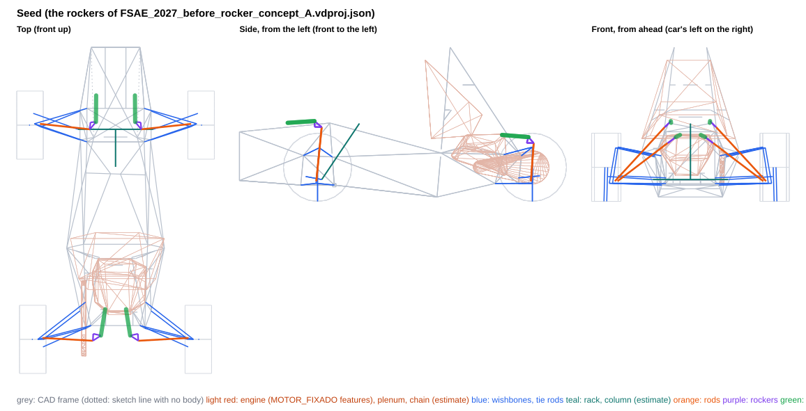
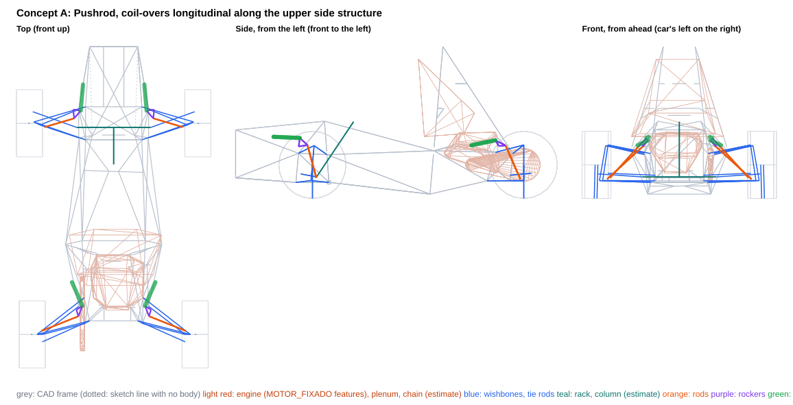
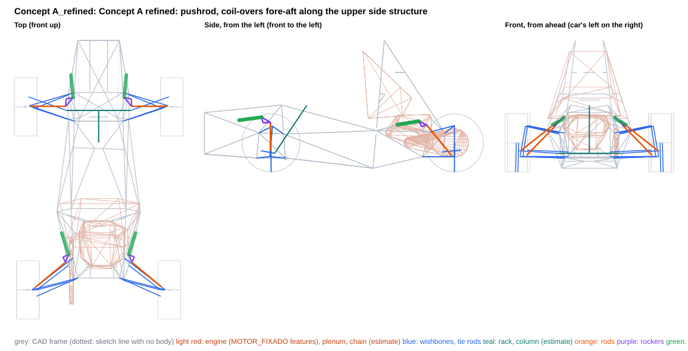

# Concept A and its refinement (FSAE 2027)

Generated by `scripts/rocker_concepts.py build` from the `concept_*.json` files in this folder. Each concept is also saved as a project variant, `projects/FSAE_2027_rocker_concept_<id>.vdproj.json`, to open in VD Studio (Rocker page). The team project is unchanged.

**What this is:** the consequences of these layouts, side by side. **What it is not:** a choice -- the report recommends nothing. The axles are independent: a front from one concept and a rear from another combine without changing either.

- Frame: ISO 8855 (X forward, Y LEFT, Z up), mm, chassis-fixed; LEFT corner points (the right is the Y-mirror). Kinematics: `DWSolver` + `vdcore.analysis.rocker`.
- Motion ratio 0.80 at ride on every axle is a **query argument** so the concepts compare like for like (the MR target is still an open decision). The coil-over is placed for equal droop/bump margins at ±25 mm; the rocker arms are tangential at ride unless the concept clocks them.
- MR and damper usage are over the ±25 mm design travel. Packaging, transmission angles and rocker rotation are over the **physical** range, to the damper's end stops (no bump rubber in the project), and for the front over the full rack travel (±38 mm).
- **Gaps are air gaps**: centreline distance minus both estimated radii. Both corners are checked against the CAD as built (the frame is not symmetric at the engine mounts).
- Engine: `MOTOR_FIXADO` placed on the car by a fit of its four mounts to the chassis tabs (worst residual 0.004 mm), modelled as convex hulls of its features (crankcase features, intake plenum); its scanned mesh is not in the survey, so parts of the engine outside those features are not represented.
- Chassis: CAD survey `Xasis 33.3`. 155 members, of which 4 are 3D-sketch lines with no weldment body (dotted in the views; they may not be real tubes, and are kept in the checks); 43 2D layout-sketch lines with no body (templates, ground and profile lines) are references, left out of the checks; 8 solid bodies without a centreline are kept as bounding boxes (a box overstates a diagonal tube, so ⚠ means 'look in CAD', not a clash). Bracket lengths are to bodied members only.
- **Estimates** (no CAD): coil-over OD 60 mm (full OD from 30 mm off each eye), eyes OD 40 mm; rod 16×1 mm steel; rocker envelope ±10 mm, pickup bolts ±20 mm; wishbone OD 20, tie rod OD 16, rack housing OD 40 mm; steering column (-30, 0, 157) → (-300, 0, 560), OD 40; damper stroke 57 mm (estimate); drive shaft from the wheel centre to a joint at |y| = 120 mm on the axle line, OD 60; chain and sprockets on the engine's chain line (radii 45 / 120 mm); coil-over 1.3 kg and rocker 0.3 kg per corner (CG effect only).

## Thresholds behind the ✗ flags

Information, not requirements.

| check | limit |
|---|---|
| rod vs frame | ≥ 5 mm |
| rocker (plates, pickup bolts) vs frame | ≥ 5 mm |
| coil-over body vs frame | ≥ 5 mm |
| coil-over eyes vs frame | ≥ 5 mm |
| rod vs wishbones / tie rod / toe link (with steer) | ≥ 5 mm |
| rod vs rim (13", steered) | ≥ 15 mm |
| left vs right linkage (heave and roll) | ≥ 5 mm |
| linkage vs steering rack (front) | ≥ 5 mm |
| linkage vs steering column (estimate) (front) | ≥ 5 mm |
| linkage vs drive shaft (estimate) (rear) | ≥ 10 mm |
| linkage vs engine (MOTOR_FIXADO features, placed) (rear) | ≥ 10 mm |
| linkage vs chain and sprockets (estimate) (rear) | ≥ 10 mm |
| rocker / coil-over vs wishbones, tie rod / toe link (with steer) | ≥ 5 mm |
| rocker pivot to nearest bodied tube | ≤ 60 mm |
| coil-over chassis end to nearest bodied tube | ≤ 60 mm |
| rod transmission angle (to the end stops) | ≤ 30 deg |
| coil-over transmission angle (to the end stops) | ≤ 30 deg |
| rocker rotation (to the end stops) | ≤ 35 deg |

## Front axle

| | Seed | Concept A | Concept A_refined |
|---|---|---|---|
| Rod type / mounted on | pushrod / LCA | pushrod / LCA | pushrod / UPRIGHT |
| Rod in | compression | compression | compression |
| MR droop / ride / bump (±25 mm) | 0.784 / 0.800 / 0.819 | 0.787 / 0.800 / 0.811 | 0.786 / 0.800 / 0.819 |
| MR progression, droop to bump [%] | +4.4 | +3.0 | +4.0 |
| Damper stroke used in ±25 mm [mm] (of 57, estimate) | 40.0 | 40.0 | 40.0 |
| Damper end stops, wheel travel [mm] | -35.8 .. +35.4 | -35.8 .. +35.5 | -35.8 .. +35.3 |
| Spring unseats at wheel travel [mm] (220 lb/in, no preload) | -23.7 | -23.7 | -23.7 |
| Rocker rotation to the end stops [deg] | -30.1 .. +29.1 | -20.2 .. +19.8 | -22.2 .. +21.7 |
| Rocker arms rod / damper [mm] | 50 / 58 | 65 / 83 | 63 / 76 |
| Transmission angle max, rod / damper [deg] | **29.9 / 32.8** ✗ | 19.9 / 22.0 | 22.5 / 24.1 |
| Rod length [mm] | 530 | 330 | 378 |
| Rod inclination from horizontal / plan sweep [deg] | 47 / 6 | 47 / 17 | 38 / 0 |
| Rod force / wheel load | 1.45 | 1.60 | 1.52 |
| Rod force at ride [N] | 845 | 938 | 890 |
| Wheel load to buckle the rod [N] (16×1 steel) | 6639 | 15452 | 12391 |
| Rocker pivot reaction at ride [N] | 1179 | 1012 | 1238 |
| Bracket couple at ride, pivot / coil-over end [N·m] (upper bound: force × stand-off) | 79 / 91 | 59 / 36 | 66 / 31 |
| Gap: rod vs frame [mm] | **-10.8** ✗ | 27.0 | 25.1 |
| Gap: rocker vs frame [mm] | **-19.4** ✗ | 7.9 | 11.8 |
| Gap: coil-over body vs frame [mm] | **-17.8** ✗ | 15.1 | 12.3 |
| Gap: coil-over eyes vs frame [mm] | **-10.2** ✗ | 13.2 | 9.8 |
| Gap: rod vs wishbones / tie rod / toe link, with steer [mm] | **-0.3** ✗ | 15.3 | 15.7 |
| Gap: rod vs rim, with steer [mm] (to the 13" bead-seat radius) | 54.0 | 40.7 | 95.4 |
| Gap: left vs right, heave and roll [mm] | 218.3 | 391.9 | 374.1 |
| Gap: linkage vs rack [mm] | 153.5 | 137.6 | 172.9 |
| Gap: linkage vs steering column [mm] (estimate) | 232.5 | 292.6 | 271.6 |
| Gap: linkage vs solid bodies' bounding boxes [mm] | **-0.1** ⚠ | 21.0 | 12.1 |
| Rocker pivot to nearest bodied tube [mm] | **66.8** ✗ | 58.7 | 53.3 |
| Coil-over chassis end to nearest bodied tube [mm] | **124.9** ✗ | 49.5 | 42.5 |
| Gap: rocker / coil-over vs wishbones, tie rod / toe link, with steer [mm] | 192.2 | 18.7 | 55.6 |
| Damper length change over the rack travel at fixed wheel-centre height [mm] (steering jacking + any mount coupling; information) | 4.33 | 4.31 | 4.36 |
| Rocker / coil-over centreline height range z [mm] | 516 .. 577 | 373 .. 450 | 402 .. 462 |
| Coil-over + rocker mass height z [mm] | 564 | 433 | 442 |

## Rear axle

| | Seed | Concept A | Concept A_refined |
|---|---|---|---|
| Rod type / mounted on | pushrod / LCA | pushrod / LCA | pushrod / LCA |
| Rod in | compression | compression | compression |
| MR droop / ride / bump (±25 mm) | 0.786 / 0.800 / 0.818 | 0.790 / 0.800 / 0.811 | 0.788 / 0.800 / 0.805 |
| MR progression, droop to bump [%] | +4.1 | +2.6 | +2.0 |
| Damper stroke used in ±25 mm [mm] (of 57, estimate) | 40.0 | 40.0 | 39.9 |
| Damper end stops, wheel travel [mm] | -35.8 .. +35.4 | -35.7 .. +35.5 | -35.8 .. +35.7 |
| Spring unseats at wheel travel [mm] (220 lb/in, no preload) | -30.0 | -30.0 | -30.0 |
| Rocker rotation to the end stops [deg] | -24.1 .. +23.5 | -25.3 .. +24.8 | -24.1 .. +23.7 |
| Rocker arms rod / damper [mm] | 50 / 71 | 50 / 67 | 50 / 70 |
| Transmission angle max, rod / damper [deg] | 24.3 / 26.3 | 25.3 / 27.6 | 23.2 / 26.2 |
| Rod length [mm] | 454 | 381 | 412 |
| Rod inclination from horizontal / plan sweep [deg] | 37 / 3 | 40 / 22 | 38 / 40 |
| Rod force / wheel load | 1.76 | 1.68 | 1.76 |
| Rod force at ride [N] | 1305 | 1245 | 1302 |
| Wheel load to buckle the rod [N] (16×1 steel) | 7417 | 11027 | 9017 |
| Rocker pivot reaction at ride [N] | 1498 | 1658 | 1441 |
| Bracket couple at ride, pivot / coil-over end [N·m] (upper bound: force × stand-off) | 141 / 26 | 86 / 44 | 74 / 50 |
| Gap: rod vs frame [mm] | 68.2 | 24.4 | 33.3 |
| Gap: rocker vs frame [mm] | 71.4 | 15.1 | 12.1 |
| Gap: coil-over body vs frame [mm] | **-18.1** ✗ | 9.9 | 15.7 |
| Gap: coil-over eyes vs frame [mm] | **-21.6** ✗ | 6.9 | 20.4 |
| Gap: rod vs wishbones / tie rod / toe link, with steer [mm] | 15.2 | 11.7 | 10.3 |
| Gap: rod vs rim, with steer [mm] (to the 13" bead-seat radius) | 56.2 | 48.6 | 48.6 |
| Gap: left vs right, heave and roll [mm] | 98.9 | 395.7 | 449.0 |
| Gap: linkage vs drive shaft [mm] (estimate) | **-35.2** ✗ | 26.5 | 46.9 |
| Gap: linkage vs engine (MOTOR_FIXADO features, on its mounts) [mm] | **-25.6** ✗ | 38.0 | 33.3 |
| Gap: linkage vs solid bodies' bounding boxes [mm] | 403.2 | 350.2 | 253.6 |
| Rocker pivot to nearest bodied tube [mm] | **94.3** ✗ | 52.2 | 51.5 |
| Coil-over chassis end to nearest bodied tube [mm] | 27.9 | 48.1 | 54.4 |
| Gap: rocker / coil-over vs wishbones, tie rod / toe link, with steer [mm] | 91.8 | 17.3 | 24.3 |
| Gap: linkage vs chain and sprockets [mm] (estimate) | **-13.4** ✗ | **8.2** ✗ | 33.5 |
| Rocker / coil-over centreline height range z [mm] | 408 .. 478 | 373 .. 426 | 381 .. 429 |
| Coil-over + rocker mass height z [mm] | 461 | 402 | 407 |

## Car level

| | Seed | A | A_refined |
|---|---|---|---|
| Springs-only roll gradient [deg/g] (220 lb/in both) | 1.21 | 1.21 | 1.21 |
| ARB needed for 1.0 deg/g at 50/50, F / R [N·m/deg] | 57 / 78 | 57 / 78 | 57 / 78 |
| CG height change vs seed [mm] (estimate) | +0.0 | -1.9 | -1.8 |
| Tilt-table tip angle [deg] (seed 62.13) | 62.13 | 62.28 | 62.27 |

The MR is the same at ride on every axle, so wheel rates, frequencies and the roll budget only move with the MR progression; they are listed to show that, not as a difference between the layouts. The spring unseating row is the same story: with 220 lb/in and no preload the spring comes off its seat before the damper tops out, whatever the layout.

## Seed: the rockers of FSAE_2027_before_rocker_concept_A.vdproj.json

| point (LEFT corner) | front | rear |
|---|---|---|
| rod outer end (on the mount body) | (9.0, 542.0, 145.0) | (-1530.0, 523.0, 145.0) |
| rocker pivot | (20.0, 180.0, 535.0) | (-1500.0, 160.0, 420.0) |
| rocker axis (unit) | (-0.0508, -0.7327, -0.6787) | (-0.0332, -0.6053, -0.7953) |
| rocker rod pickup | (-29.8, 184.3, 534.0) | (-1549.9, 162.8, 420.0) |
| rocker damper pickup | (22.4, 140.7, 577.3) | (-1512.2, 104.9, 462.4) |
| coil-over chassis end | (213.7, 138.9, 564.9) | (-1323.5, 74.7, 477.5) |
| rod type / mount body | pushrod / lca | pushrod / lca |

**Where the tightest numbers are:**

- front gap rod frame: -10.8 mm — Tri_Frente (560, 175, 500)->(-88, 156, 563) (sketch only), L at +35 mm
- front gap rocker frame: -19.4 mm — Tri_Frente (560, 175, 500)->(-88, 156, 563) (sketch only), L at +35 mm
- front gap coilover frame: -17.8 mm — Tri_Frente (560, 175, 500)->(-88, 156, 563) (sketch only), L at -36 mm
- front gap rod members: -0.3 mm — tie rod at -36 mm, rack +38
- front gap rod rim: 54.0 mm — at +35 mm, rack +38
- front gap solid bodies: -0.1 mm — rocker vs 'Ressalto-extrusão2' box, L at -31 mm
- front pivot bracket: 66.8 mm — Tri_Frente (101, 255, 330)->(-88, 156, 563) (L), foot 93 mm from its nearer end; Tri_Frente at 27.1 mm (no body in the CAD)
- front damper bracket: 124.9 mm — Tri_Frente (-88, 156, 563)->(560, -175, 500) (L), foot 276 mm from its nearer end; Tri_Frente at 40.5 mm (no body in the CAD)
- rear gap rod frame: 68.2 mm — PST (-1441, 175, 129)->(-1464, 209, 328), L at -36 mm
- rear gap rocker frame: 71.4 mm — 3DSketch7 (-1461, 210, 328)->(-1326, 73, 467), L at -36 mm
- rear gap coilover frame: -18.1 mm — 3DSketch7 (-1461, 210, 328)->(-1326, 73, 467), L at +35 mm
- rear gap rod members: 15.2 mm — LCA rear leg at -36 mm, rack +0
- rear gap rod rim: 56.2 mm — at +35 mm, rack +0
- rear gap engine: -25.6 mm — eyes vs engine (features), R at -36 mm
- rear gap solid bodies: 403.2 mm — eyes vs 'Ressalto-extrusão3' box, L at -36 mm
- rear pivot bracket: 94.3 mm — Tri_Tras (-951, -116, 1108)->(-1461, -210, 328) (R), foot 60 mm from its nearer end
- rear damper bracket: 27.9 mm — 3DSketch7 (-1326, -100, 467)->(-1326, -150, 467) (R), foot 0 mm from its nearer end

**Outside the thresholds:** front rod vs frame -10.8 (limit ≥ 5); front rocker (plates, pickup bolts) vs frame -19.4 (limit ≥ 5); front coil-over body vs frame -17.8 (limit ≥ 5); front coil-over eyes vs frame -10.2 (limit ≥ 5); front rod vs wishbones / tie rod / toe link (with steer) -0.3 (limit ≥ 5); front rocker pivot to nearest bodied tube 66.8 (limit ≤ 60); front coil-over chassis end to nearest bodied tube 124.9 (limit ≤ 60); front coil-over transmission angle (to the end stops) 32.8 (limit ≤ 30); rear coil-over body vs frame -18.1 (limit ≥ 5); rear coil-over eyes vs frame -21.6 (limit ≥ 5); rear linkage vs drive shaft (estimate) -35.2 (limit ≥ 10); rear linkage vs engine (MOTOR_FIXADO features, placed) -25.6 (limit ≥ 10); rear linkage vs chain and sprockets (estimate) -13.4 (limit ≥ 10); rear rocker pivot to nearest bodied tube 94.3 (limit ≤ 60)

## Concept A: Pushrod, coil-overs longitudinal along the upper side structure

| point (LEFT corner) | front | rear |
|---|---|---|
| rod outer end (on the mount body) | (-28.0, 505.0, 150.0) | (-1515.0, 527.0, 140.0) |
| rocker pivot | (100.0, 295.0, 379.0) | (-1360.0, 272.0, 382.0) |
| rocker axis (unit) | (-0.0345, -0.7461, -0.6649) | (0.1249, -0.6420, -0.7565) |
| rocker rod pickup | (36.3, 288.2, 389.9) | (-1407.6, 257.3, 386.6) |
| rocker damper pickup | (92.4, 240.0, 441.2) | (-1331.6, 227.8, 424.2) |
| coil-over chassis end | (283.1, 223.4, 449.9) | (-1159.5, 303.9, 388.0) |
| rod type / mount body | pushrod / lca | pushrod / lca |

**Where the tightest numbers are:**

- front gap rod frame: 27.0 mm — Tri_Frente (101, 255, 330)->(-88, 156, 563), L at +35 mm
- front gap rocker frame: 7.9 mm — Tri_Frente (101, 255, 330)->(-88, 156, 563), L at +35 mm
- front gap coilover frame: 15.1 mm — Tri_Frente (101, 255, 330)->(560, 175, 500), L at +35 mm
- front gap rod members: 15.3 mm — tie rod at -36 mm, rack +38
- front gap rod rim: 40.7 mm — at +35 mm, rack +38
- front gap solid bodies: 21.0 mm — coil-over vs 'Ressalto-extrusão2' box, L at -0 mm
- front pivot bracket: 58.7 mm — Tri_Frente (101, 255, 330)->(-88, 156, 563) (L), foot 25 mm from its nearer end
- front damper bracket: 49.5 mm — Tri_Frente (101, 255, 330)->(560, 175, 500) (L), foot 215 mm from its nearer end
- rear gap rod frame: 24.4 mm — Tri_Tras (-951, -116, 1108)->(-1461, -210, 328), R at +36 mm
- rear gap rocker frame: 15.1 mm — Tri_Tras (-951, -116, 1108)->(-1461, -210, 328), R at +36 mm
- rear gap coilover frame: 9.9 mm — Tri_Tras (-1336, 255, 337)->(-884, 350, 348), L at +36 mm
- rear gap rod members: 11.7 mm — LCA front leg at -36 mm, rack +0
- rear gap rod rim: 48.6 mm — at +36 mm, rack +0
- rear gap engine: 38.0 mm — coil-over vs engine (features), R at -10 mm
- rear gap solid bodies: 350.2 mm — eyes vs 'Ressalto-extrusão1' box, L at -36 mm
- rear pivot bracket: 52.2 mm — PST (-1336, 255, 337)->(-1461, 210, 328) (L), foot 14 mm from its nearer end
- rear damper bracket: 48.1 mm — Tri_Tras (-1336, 255, 337)->(-884, 350, 348) (L), foot 184 mm from its nearer end

**Outside the thresholds:** rear linkage vs chain and sprockets (estimate) 8.2 (limit ≥ 10)

## Concept A_refined: Concept A refined: pushrod, coil-overs fore-aft along the upper side structure

Concept A refined against the chassis team's update of 2026-10-15 and the engine placed on its mounts. Front: the pushrod's outer end moves from the lower wishbone to a clevis on the upright, on the kingpin axis 53.5 mm above the lower ball joint, so the spring load no longer bends the LCA and steering moves the damper only by the steering jacking any mount has (4.36 mm over the full rack travel, against 4.31 mm with an LCA mount); the rocker sits beside the side diagonal, 77 mm up from the UCA-front node, and the coil-over runs forward along the side of the front box. Rear: the rocker moves 95 mm forward onto the Tri_Tras upper rail, off the node it shared with the UCA front pivot, which takes it 33.5 mm clear of the estimated chain line, and the coil-over runs forward along the rail, 33.3 mm from the intake plenum. No evaluator threshold is missed on either axle; MR 0.80 at ride is the comparison query, not a choice.

| point (LEFT corner) | front | rear |
|---|---|---|
| rod outer end (on the mount body) | (5.5, 572.8, 182.5) | (-1515.0, 527.0, 140.0) |
| rocker pivot | (67.2, 274.3, 414.8) | (-1265.0, 300.0, 381.0) |
| rocker axis (unit) | (-0.0459, -0.6195, -0.7837) | (0.0940, -0.6742, -0.7325) |
| rocker rod pickup | (4.5, 276.2, 417.0) | (-1308.0, 278.7, 395.1) |
| rocker damper pickup | (79.0, 214.7, 461.2) | (-1242.2, 252.4, 427.7) |
| coil-over chassis end | (268.2, 232.7, 435.9) | (-1061.8, 309.8, 398.1) |
| rod type / mount body | pushrod / upright | pushrod / lca |

**Where the tightest numbers are:**

- front gap rod frame: 25.1 mm — Tri_Frente (101, 255, 330)->(-88, 156, 563), L at +35 mm
- front gap rocker frame: 11.8 mm — Tri_Frente (101, 255, 330)->(-88, 156, 563), L at -36 mm
- front gap coilover frame: 12.3 mm — Tri_Frente (101, 255, 330)->(560, 175, 500), L at +35 mm
- front gap rod members: 15.7 mm — tie rod at -36 mm, rack +38
- front gap rod rim: 95.4 mm — at -26 mm, rack +38
- front gap solid bodies: 12.1 mm — coil-over vs 'Ressalto-extrusão2' box, L at -15 mm
- front pivot bracket: 53.3 mm — Tri_Frente (101, 255, 330)->(-88, 156, 563) (L), foot 77 mm from its nearer end
- front damper bracket: 42.5 mm — Tri_Frente (101, 255, 330)->(560, 175, 500) (L), foot 195 mm from its nearer end
- rear gap rod frame: 33.3 mm — Tri_Tras (-1336, 255, 337)->(-884, 350, 348), L at -31 mm
- rear gap rocker frame: 12.1 mm — Tri_Tras (-1336, 255, 337)->(-884, 350, 348), L at -36 mm
- rear gap coilover frame: 15.7 mm — 3DSketch8 (-1034, -243, 382)->(-1336, -255, 337), R at +36 mm
- rear gap rod members: 10.3 mm — LCA front leg at -36 mm, rack +0
- rear gap rod rim: 48.6 mm — at +36 mm, rack +0
- rear gap engine: 33.3 mm — coil-over vs intake plenum, L at -0 mm
- rear gap solid bodies: 253.6 mm — eyes vs 'Ressalto-extrusão1' box, L at -36 mm
- rear pivot bracket: 51.5 mm — Tri_Tras (-1336, 255, 337)->(-884, 350, 348) (L), foot 79 mm from its nearer end
- rear damper bracket: 54.4 mm — Tri_Tras (-1336, 255, 337)->(-884, 350, 348) (L), foot 181 mm from its nearer end

**Outside the thresholds:** none

**Pros**

- Zero evaluator fails on both axles and both corners, against the chassis as updated and the engine on its mounts, swept to the damper end stops (front -35.8 / +35.3 mm, rear -35.8 / +35.7 mm) and, at the front, over the full rack travel of +-38 mm. Tightest air gaps: front coil-over eye 9.8 mm (upper side diagonal), rocker 11.8 mm, coil-over 12.3 mm; rear rod to its own LCA front leg 10.3 mm, rocker 12.1 mm, coil-over 15.7 mm.
- Front: the spring load no longer bends the lower wishbone (concept A: about 158 N·m, ~300 MPa nominal at 3x static on a 25.4x1.2 leg, hand estimate). The rod stands transverse (0.2 deg in plan), 378 mm long, rod force 1.52x the wheel load (890 N at ride); it takes 12.4 kN of wheel load to buckle the 16x1 steel reference tube. Rod to rim 95.4 mm (A: 40.7), rod to tie rod at full lock 15.7 mm.
- Front rocker margins up: rocker to frame 7.9 -> 11.8 mm, pivot stand-off 58.7 -> 53.3 mm, with its foot moved from 25 to 77 mm away from the six-tube UCA-front node; the coil-over's chassis end is 42.5 mm from the upper side diagonal.
- Rear: chain line 8.2 -> 33.5 mm (estimate), coil-over eye 6.9 -> 20.4 mm, coil-over 9.9 -> 15.7 mm, drive shaft 26.5 -> 46.9 mm (estimate). The rocker no longer shares the UCA front-pivot node (94.6 mm away); pivot reaction 1658 -> 1441 N and bracket couple 86.5 -> 74.2 N·m at ride (upper bound).
- Kinematics over +-25 mm: MR 0.787 / 0.800 / 0.819 front (+4.0 %) and 0.789 / 0.800 / 0.805 rear (+2.0 %), equal 8.5 mm damper margins. To the end stops: transmission angles at most 22.5 / 24.1 deg front and 23.2 / 26.2 deg rear, rocker rotation within +-22.2 / +-24.1 deg.
- Low coil-overs and rockers: moving-mass height 442 mm front and 407 mm rear (seed 564 / 461 mm); CG -1.8 mm against the seed and tilt-table angle 62.27 deg (seed 62.13), with the estimated masses (1.3 kg coil-over + 0.3 kg rocker per corner).

**Cons**

- The front clevis has to sit exactly on the kingpin axis, 53.5 mm above the lower ball joint. Off the axis, steering drives the damper (15 / 30 mm aft gives 12.6 / 21.0 mm of damper change over the rack travel); below about 45 mm the full-lock tie rod comes within 9 mm. The steering arm leaves the kingpin 40 mm above the ball joint (project setting), 13.5 mm below the clevis, so both share that region of the upright, which has no CAD yet. The rod end sees about 4.9 deg of misalignment from steering alone, and the upright carries about 95 N·m about the ball joint at 3x static (hand estimate).
- Neither rocker can be carried in double shear by the existing tubes: no bodied tube lies in or across a rocker plane near the pivots. Double shear needs a fabricated yoke (front: inner plate 37.5 mm to the side diagonal, outer plate a 36 mm arm plus a 94 mm web to the upper side diagonal) or fork (rear, cheeks +-18 mm on the upper rail). Pivot couples at ride (upper bound, force x stand-off): 66 N·m front, 74 N·m rear, about 200-220 N·m at 3x; at the rear about 96 % of it is torsion about the upper rail. None of it is sized.
- Brackets land mid-span: the front coil-over end 195 mm from the nearer end of the upper side diagonal; at the rear both the rocker and the coil-over brackets load the same Tri_Tras upper rail, 79 and 281 mm from its node. The rail's bending and torsion were not checked.
- The rear rod is swept 39.8 deg forward in plan (A: 21.7) to pass in front of the UCA front leg: 655 N fore-aft at ride (about 2 kN at 3x) into the LCA front-leg mount. It is longer (412 mm), so the reference tube buckles at 9.0 kN of wheel load (A: 11.0 kN), and it runs 10.3 mm from its own LCA front leg at the droop stop.
- Thin positional margins: moving the front pivot +-5 mm gives rocker gaps of 8.0-11.3 mm and stand-offs of 49.3-57.4 mm, and 5 mm lower brings the coil-over eye to 4.9 mm (below the 5 mm limit); the rear rocker-to-rail gap changes about 0.75 mm per mm of pivot height. A few millimetres of CAD change at these tubes matter.
- Bodywork and templates: the front coil-over is 12.1 mm from the 'Ressalto-extrusão2' solid (probably the FSAE leg template; concept A: 21.0 mm), so a leg-protection shield may have to fit there. The front rocker pickups reach y = 307 mm and the rear rocker / coil-over y = 316 / 332 mm over x -1326 to -1042: nose and sidepods must cover them.
- No anti-roll-bar provision was designed in this round. With 220 lb/in springs the roll budget asks about 57 N·m/deg front and 78 N·m/deg rear for 1.0 deg/g; at the rear the drop links would have to pass the engine.

**Not checked**

- The engine's scanned mesh: MOTOR_FIXADO is placed by its four mounts (fit within 0.004 mm) but modelled only by its features and the plenum outline; the chain and sprockets (14/46 520 assumed) and the drive shafts are estimates; differential, exhaust, intake runners, radiator and fuel tank are not modelled.
- The upright: clevis, steering-arm root, hub, bearing housing, brake disc and caliper. Only the 13-inch rim is checked against the rod.
- Real part envelopes: all gaps use estimated diameters (rod 16, coil-over 60, eyes 40, rocker +-10 mm plates and +-20 mm pickup bolts, frame 25.4); rocker plates, yokes / forks and rod ends are not modelled.
- Structure: no load cases, stress, fatigue or sizing of brackets, rails, rockers, rods, wishbones or uprights; the 3x figures are hand estimates; bracket compliance, which changes the effective MR, is not modelled.
- Travel limits: the damper stroke (57 mm) is an estimate and there are no bump rubbers, so the linkage runs to the damper's end stops. With 220 lb/in springs and no preload the springs unseat at -23.7 mm (front, inside the +-25 mm travel) and -30.0 mm (rear), as with any layout at MR 0.80.
- FSAE rules: leg protection for moving suspension parts beside the cockpit, attachments to the frame tubes used by the brackets.
- The MR 0.80 target, the 1.0 deg/g roll gradient, the 50 % front roll share and the 220 lb/in springs are design-intent query arguments, not derived targets.
