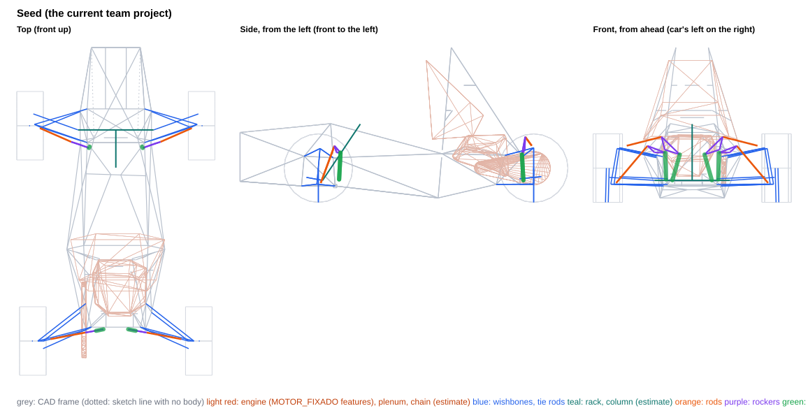
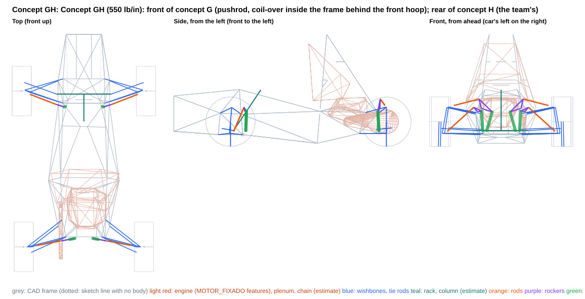
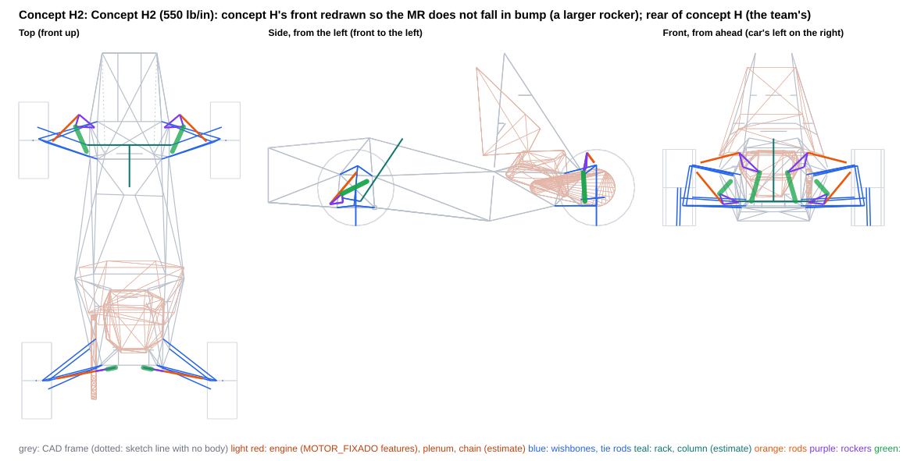
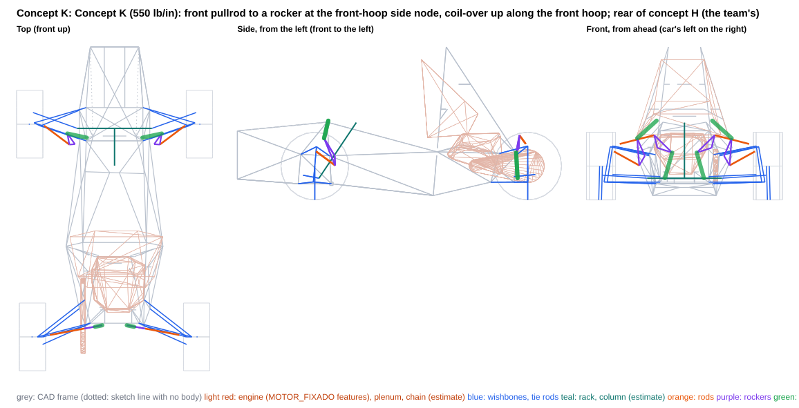

# Front rocker layouts for 550 lb/in springs at MR 0.506 with a non-falling MR (rear: concept H)

Generated by `scripts/rocker_concepts.py build` from the `concept_*.json` files in this folder. Each concept is also saved as a project variant, `projects/FSAE_2027_rocker_concept_<id>.vdproj.json`, to open in VD Studio (Rocker page). The team project is unchanged.

**What this is:** the consequences of these layouts, side by side. **What it is not:** a choice -- the report recommends nothing. The axles are independent: a front from one concept and a rear from another combine without changing either.

- Frame: ISO 8855 (X forward, Y LEFT, Z up), mm, chassis-fixed; LEFT corner points (the right is the Y-mirror). Kinematics: `DWSolver` + `vdcore.analysis.rocker`.
- Motion ratio 0.506 at ride on every concept axle is a **query argument** so the concepts compare like for like (the MR target is still an open decision; the Seed column keeps its own layout). The coil-over is placed for equal droop/bump margins at ±25 mm; the rocker arms are tangential at ride unless the concept clocks them.
- Springs fitted (front / rear, lb/in): 220 / 550 (seed); 550 / 550 (GH, H2, K). Wheel rate = k·MR² at ride.
- MR and damper usage are over the ±25 mm design travel. Packaging, transmission angles and rocker rotation are over the **physical** range, to the damper's end stops (no bump rubber in the project) or to the concept's travel limit (a bump stop and droop limiter the concept adds) when it sets one, and for the front over the full rack travel (±38 mm).
- **Gaps are air gaps**: centreline distance minus both estimated radii. Both corners are checked against the CAD as built (the frame is not symmetric at the engine mounts).
- Engine: `MOTOR_FIXADO` placed on the car by a fit of its four mounts to the chassis tabs (worst residual 0.004 mm), modelled as convex hulls of its features (crankcase features, intake plenum); its scanned mesh is not in the survey, so parts of the engine outside those features are not represented.
- Chassis: CAD survey `Xasis 33.3`. 155 members, of which 4 are 3D-sketch lines with no weldment body (dotted in the views; they may not be real tubes, and are kept in the checks); 43 2D layout-sketch lines with no body (templates, ground and profile lines) are references, left out of the checks; 8 solid bodies without a centreline are kept as bounding boxes (a box overstates a diagonal tube, so ⚠ means 'look in CAD', not a clash). Bracket lengths are to bodied members only.
- **Estimates** (no CAD): coil-over OD 60 mm (full OD from 30 mm off each eye), eyes OD 40 mm; rod 16×1 mm steel; rocker envelope ±10 mm, pickup bolts ±20 mm; wishbone OD 20, tie rod OD 16, rack housing OD 40 mm, inner tie-rod joint and boot 50 mm OD from 60 mm inboard of the joint to 20 mm past it at full rack travel; steering column (-30, 0, 157) → (-300, 0, 560), OD 40; damper stroke 57 mm (estimate); drive shaft from the wheel centre to a joint at |y| = 120 mm on the axle line, OD 60; chain and sprockets on the engine's chain line (radii 45 / 120 mm); coil-over 1.3 kg and rocker 0.3 kg per corner (CG effect only).

## Thresholds behind the ✗ flags

Information, not requirements.

| check | limit |
|---|---|
| rod vs frame | ≥ 5 mm |
| rocker (plates, pickup bolts) vs frame | ≥ 5 mm |
| coil-over body vs frame | ≥ 5 mm |
| coil-over eyes vs frame | ≥ 5 mm |
| rod vs wishbones / tie rod / toe link (with steer) | ≥ 5 mm |
| rod vs rim (13", steered) | ≥ 15 mm |
| left vs right linkage (heave and roll) | ≥ 5 mm |
| linkage vs steering rack (housing, inner tie-rod joint and boot) (front) | ≥ 5 mm |
| linkage vs steering column (estimate) (front) | ≥ 5 mm |
| linkage vs drive shaft (estimate) (rear) | ≥ 10 mm |
| linkage vs engine (MOTOR_FIXADO features, placed) (rear) | ≥ 10 mm |
| linkage vs chain and sprockets (estimate) (rear) | ≥ 10 mm |
| rocker / coil-over vs wishbones, tie rod / toe link (with steer) | ≥ 5 mm |
| rod vs its own rocker (away from its pickup) and coil-over | ≥ 5 mm |
| rocker pivot to nearest bodied tube | ≤ 60 mm |
| coil-over chassis end to nearest bodied tube | ≤ 60 mm |
| rocker pivot to the nearest frame node (3+ tubes) | ≤ 60 mm |
| coil-over chassis end to the nearest frame node (3+ tubes) | ≤ 60 mm |
| rod transmission angle (over the packaging range) | ≤ 30 deg |
| coil-over transmission angle (over the packaging range) | ≤ 30 deg |
| rocker rotation (over the packaging range) | ≤ 35 deg |

## Front axle

| | Seed | Concept GH | Concept H2 | Concept K |
|---|---|---|---|---|
| Rod type / mounted on | pushrod / LCA | pushrod / LCA | pullrod / UCA | pullrod / UCA |
| Rod in | compression | compression | tension | tension |
| MR droop / ride / bump (±25 mm) | 0.785 / 0.800 / 0.795 | 0.487 / 0.506 / 0.512 | 0.503 / 0.506 / 0.512 | 0.486 / 0.506 / 0.522 |
| MR progression, droop to bump [%] | +1.2 | +4.9 | +1.8 | +7.1 |
| Damper stroke used in ±25 mm [mm] (of 57, estimate) | 39.8 | 25.2 | 25.3 | 25.3 |
| Spring [lb/in] / wheel rate at ride [N/mm] / ride frequency [Hz] | 220.0 / 24.7 / 3.2 | 550.0 / 24.7 / 3.2 | 550.0 / 24.7 / 3.2 | 550.0 / 24.7 / 3.2 |
| Damper end stops, wheel travel [mm] | -36.0 .. +35.9 | -58.7 .. +57.0 | -56.4 .. +55.5 | -58.7 .. +55.1 |
| Packaging range, wheel travel [mm] (end stops, or the concept's travel limit) | -36.0 .. +35.9 | -36.0 .. +36.0 | -36.0 .. +36.0 | -36.0 .. +36.0 |
| Spring unseats at wheel travel [mm] (fitted spring, no preload) | -23.7 | -23.7 | -23.7 | -23.7 |
| Rocker rotation over the packaging range [deg] | -20.5 .. +20.1 | -23.7 .. +23.1 | -8.0 .. +7.9 | -6.4 .. +7.0 |
| Rocker arms rod / damper [mm] | 70 / 82 | 55 / 45 | 130 / 135 | 80 / 160 |
| Transmission angle max, rod / damper [deg] | 17.4 / 24.1 | 20.3 / 23.8 | 8.0 / 18.6 | 2.3 / 20.4 |
| Rod length [mm] | 361 | 369 | 319 | 251 |
| Rod inclination from horizontal / plan sweep [deg] | 47 / 24 | 40 / 21 | 40 / 45 | 24 / 37 |
| Rod force / wheel load | 1.47 | 1.64 | 2.00 | 3.86 |
| Rod force at ride [N] | 858 | 959 | 1170 | 2260 |
| Wheel load to buckle the rod [N] (16×1 steel) | 14046 | 12037 | n/a | n/a |
| Rocker pivot reaction at ride [N] | 1480 | 1902 | 1140 | 2880 |
| Bracket couple at ride, pivot / coil-over end [N·m] (upper bound: force × stand-off) | 57 / 31 | 60 / 51 | 42 / 47 | 88 / 51 |
| Gap: rod vs frame [mm] | 62.0 | 26.7 | 89.1 | 67.0 |
| Gap: rocker vs frame [mm] | 5.3 | 6.7 | 9.3 | 7.8 |
| Gap: coil-over body vs frame [mm] | 5.5 | 8.5 | 15.8 | 15.2 |
| Gap: coil-over eyes vs frame [mm] | 9.0 | 7.5 | 8.4 | 11.8 |
| Gap: rod vs wishbones / tie rod / toe link, with steer [mm] | 5.5 | 9.9 | 28.2 | 15.7 |
| Gap: rod vs rim, with steer [mm] (to the 13" bead-seat radius) | 46.3 | 34.8 | — | 41.7 |
| Gap: left vs right, heave and roll [mm] | 316.3 | 309.3 | 426.3 | 385.5 |
| Gap: linkage vs rack, inner tie-rod joint and boot [mm] | 72.2 | 73.5 | 40.1 | 96.4 |
| Gap: linkage vs steering column [mm] (estimate) | 141.8 | 142.5 | 219.6 | 227.3 |
| Gap: linkage vs solid bodies' bounding boxes [mm] | 2.5 | 3.6 | 38.2 | 10.3 |
| Rocker pivot to nearest bodied tube [mm] | 38.2 | 31.4 | 36.8 | 30.5 |
| Coil-over chassis end to nearest bodied tube [mm] | 42.1 | 43.8 | 41.1 | 44.5 |
| Rocker pivot to the nearest frame node (3+ tubes) [mm] | 49.0 | 47.4 | 54.3 | 52.7 |
| Coil-over chassis end to the nearest frame node (3+ tubes) [mm] | 57.5 | 55.6 | 57.2 | 47.0 |
| Gap: rocker / coil-over vs wishbones, tie rod / toe link, with steer [mm] | 22.0 | 25.6 | 5.9 | 7.1 |
| Gap: rod vs its own rocker (away from its pickup) and coil-over [mm] | 11.8 | 10.5 | 7.4 | 17.3 |
| Damper length change over the rack travel at fixed wheel-centre height [mm] (steering jacking + any mount coupling; information) | 4.19 | 2.70 | 2.77 | 2.82 |
| Rocker / coil-over centreline height range z [mm] | 164 .. 420 | 158 .. 398 | 127 .. 285 | 246 .. 574 |
| Coil-over + rocker mass height z [mm] | 278 | 271 | 228 | 474 |

## Rear axle

| | Seed | Concept GH | Concept H2 | Concept K |
|---|---|---|---|---|
| Rod type / mounted on | pushrod / UCA | pushrod / UCA | pushrod / UCA | pushrod / UCA |
| Rod in | compression | compression | compression | compression |
| MR droop / ride / bump (±25 mm) | 0.496 / 0.506 / 0.512 | 0.496 / 0.506 / 0.512 | 0.496 / 0.506 / 0.512 | 0.496 / 0.506 / 0.512 |
| MR progression, droop to bump [%] | +3.1 | +3.1 | +3.1 | +3.1 |
| Damper stroke used in ±25 mm [mm] (of 57, estimate) | 25.3 | 25.3 | 25.3 | 25.3 |
| Spring [lb/in] / wheel rate at ride [N/mm] / ride frequency [Hz] | 550.0 / 24.7 / 2.9 | 550.0 / 24.7 / 2.9 | 550.0 / 24.7 / 2.9 | 550.0 / 24.7 / 2.9 |
| Damper end stops, wheel travel [mm] | -57.5 .. +56.0 | -57.5 .. +56.0 | -57.5 .. +56.0 | -57.5 .. +56.0 |
| Packaging range, wheel travel [mm] (end stops, or the concept's travel limit) | -36.0 .. +36.0 | -36.0 .. +36.0 | -36.0 .. +36.0 | -36.0 .. +36.0 |
| Spring unseats at wheel travel [mm] (fitted spring, no preload) | -30.0 | -30.0 | -30.0 | -30.0 |
| Rocker rotation over the packaging range [deg] | -9.2 .. +9.0 | -9.2 .. +9.0 | -9.2 .. +9.0 | -9.2 .. +9.0 |
| Rocker arms rod / damper [mm] | 94 / 115 | 94 / 115 | 94 / 115 | 94 / 115 |
| Transmission angle max, rod / damper [deg] | 3.5 / 11.3 | 3.5 / 11.3 | 3.5 / 11.3 | 3.5 / 11.3 |
| Rod length [mm] | 261 | 261 | 261 | 261 |
| Rod inclination from horizontal / plan sweep [deg] | 14 / 11 | 14 / 11 | 14 / 11 | 14 / 11 |
| Rod force / wheel load | 2.41 | 2.41 | 2.41 | 2.41 |
| Rod force at ride [N] | 1780 | 1780 | 1780 | 1780 |
| Wheel load to buckle the rod [N] (16×1 steel) | 16398 | 16398 | 16398 | 16398 |
| Rocker pivot reaction at ride [N] | 2818 | 2818 | 2818 | 2818 |
| Bracket couple at ride, pivot / coil-over end [N·m] (upper bound: force × stand-off) | 116 / 58 | 116 / 58 | 116 / 58 | 116 / 58 |
| Gap: rod vs frame [mm] | 71.5 | 71.5 | 71.5 | 71.5 |
| Gap: rocker vs frame [mm] | 16.2 | 16.2 | 16.2 | 16.2 |
| Gap: coil-over body vs frame [mm] | 11.6 | 11.6 | 11.6 | 11.6 |
| Gap: coil-over eyes vs frame [mm] | 6.9 | 6.9 | 6.9 | 6.9 |
| Gap: rod vs wishbones / tie rod / toe link, with steer [mm] | 19.4 | 19.4 | 19.4 | 19.4 |
| Gap: rod vs rim, with steer [mm] (to the 13" bead-seat radius) | — | — | — | — |
| Gap: left vs right, heave and roll [mm] | 125.0 | 125.0 | 125.0 | 125.0 |
| Gap: linkage vs drive shaft [mm] (estimate) | 18.0 | 18.0 | 18.0 | 18.0 |
| Gap: linkage vs engine (MOTOR_FIXADO features, on its mounts) [mm] | 73.0 | 73.0 | 73.0 | 73.0 |
| Gap: linkage vs solid bodies' bounding boxes [mm] | 542.6 | 542.6 | 542.6 | 542.6 |
| Rocker pivot to nearest bodied tube [mm] | 41.1 | 41.1 | 41.1 | 41.1 |
| Coil-over chassis end to nearest bodied tube [mm] | 39.6 | 39.6 | 39.6 | 39.6 |
| Rocker pivot to the nearest frame node (3+ tubes) [mm] | 53.5 | 53.5 | 53.5 | 53.5 |
| Coil-over chassis end to the nearest frame node (3+ tubes) [mm] | 52.1 | 52.1 | 52.1 | 52.1 |
| Gap: rocker / coil-over vs wishbones, tie rod / toe link, with steer [mm] | 14.1 | 14.1 | 14.1 | 14.1 |
| Gap: rod vs its own rocker (away from its pickup) and coil-over [mm] | 16.3 | 16.3 | 16.3 | 16.3 |
| Gap: linkage vs chain and sprockets [mm] (estimate) | 11.4 | 11.4 | 11.4 | 11.4 |
| Rocker / coil-over centreline height range z [mm] | 158 .. 471 | 158 .. 471 | 158 .. 471 | 158 .. 471 |
| Coil-over + rocker mass height z [mm] | 274 | 274 | 274 | 274 |

## Car level

| | Seed | GH | H2 | K |
|---|---|---|---|---|
| Springs-only roll gradient [deg/g] (each column's springs) | 1.21 | 1.21 | 1.21 | 1.21 |
| ARB needed for 1.0 deg/g at 50/50, F / R [N·m/deg] | 57 / 78 | 57 / 78 | 57 / 78 | 57 / 78 |
| CG height change vs seed [mm] (estimate) | +0.0 | -0.1 | -0.5 | +2.0 |
| Tilt-table tip angle [deg] (seed 62.13) | 62.13 | 62.14 | 62.17 | 61.98 |

Wheel rates, frequencies and the roll budget follow from each column's springs and ride MR; where those match, they only move with the MR progression and are listed to show that, not as a difference between the layouts. The spring unseating row is the same story: with no preload the spring comes off its seat at its static compression divided by the MR, whatever the layout.

## Seed: the current team project

| point (LEFT corner) | front | rear |
|---|---|---|
| rod outer end (on the mount body) | (-17.0, 543.4, 138.6) | (-1526.2, 467.7, 405.2) |
| rocker pivot | (-130.5, 269.6, 357.1) | (-1475.8, 196.0, 377.4) |
| rocker axis (unit) | (-0.9376, 0.3430, -0.0573) | (-0.9831, -0.1827, 0.0051) |
| rocker rod pickup | (-115.3, 319.0, 404.5) | (-1479.6, 218.7, 468.9) |
| rocker damper pickup | (-158.7, 192.2, 355.4) | (-1456.0, 88.4, 342.3) |
| coil-over chassis end | (-148.8, 187.4, 164.2) | (-1466.8, 141.2, 158.5) |
| rod type / mount body | pushrod / lca | pushrod / uca |

**Where the tightest numbers are:**

- front gap rod frame: 62.0 mm — FRONTO HO (-104, 245, 344)->(-89, 159, 556), L at +36 mm
- front gap rocker frame: 5.3 mm — Tri_Meio (-106, 251, 319)->(-884, 350, 348), L at +36 mm
- front gap coilover frame: 5.5 mm — PSD (-106, 255, 320)->(-120, 205, 117), L at +36 mm
- front gap rod members: 5.5 mm — UCA rear leg at -36 mm, rack -38
- front gap rod linkage: 11.8 mm — rocker arm to the rod pickup at +36 mm
- front gap rod rim: 46.3 mm — at +36 mm, rack +38
- front gap solid bodies: 2.5 mm — rocker vs 'Ressalto-extrusão1' box, L at -21 mm
- front pivot bracket: 38.2 mm — FRONTO HO (-104, 245, 344)->(-89, 159, 556) (L), foot 2 mm from its nearer end
- front damper bracket: 42.1 mm — FRONTO HO (-108, -249, 295)->(-120, -205, 117) (R), foot 39 mm from its nearer end
- front pivot node: 49.0 mm — node (-106, -250, 319) (R), 5 tube ends: FRONTO HO, PSD, Tri_Meio
- front damper node: 57.5 mm — node (-120, 205, 117) (L), 7 tube ends: 3DSketch3, PSD, Tri_Frente, Tri_Meio, assoalho frontal
- rear gap rod frame: 71.5 mm — Tri_Tras (-951, -116, 1108)->(-1461, -210, 328), R at +36 mm
- rear gap rocker frame: 16.2 mm — 3DSketch7 (-1461, 210, 328)->(-1326, 73, 467), L at +36 mm
- rear gap coilover frame: 11.6 mm — PST (-1441, 175, 129)->(-1464, 209, 328), L at +36 mm
- rear gap rod members: 19.4 mm — UCA rear leg at -36 mm, rack +0
- rear gap rod linkage: 16.3 mm — rocker arm to the rod pickup at +36 mm
- rear gap engine: 73.0 mm — coil-over vs engine (features), R at -5 mm
- rear gap solid bodies: 542.6 mm — rocker vs 'Ressalto-extrusão3' box, L at +36 mm
- rear pivot bracket: 41.1 mm — Tri_Tras (-1461, 210, 328)->(-951, 116, 1108) (L), foot 34 mm from its nearer end
- rear damper bracket: 39.6 mm — PST (-1441, 175, 129)->(-1441, -175, 129) (L), foot 34 mm from its nearer end
- rear pivot node: 53.5 mm — node (-1461, 210, 328) (L), 6 tube ends: 3DSketch7, PST, Tri_Tras
- rear damper node: 52.1 mm — node (-1441, 175, 129) (L), 5 tube ends: 3DSketch6, PST

**Outside the thresholds:** none

## Concept GH: Concept GH (550 lb/in): front of concept G (pushrod, coil-over inside the frame behind the front hoop); rear of concept H (the team's)

The front of concept G with the team's rear (concept H), for comparison with H2 and K. Front: pushrod on the LCA to a small rocker (arms 55 / 45 mm) 47.4 mm from the front-hoop side node, the coil-over nearly vertical behind the hoop's lower leg, inside the frame, to an eye 55.6 mm from the front-hoop bottom node: the team's current DF front arrangement redrawn for MR 0.506. MR 0.487 / 0.506 / 0.512 (+4.9 %, rising, then back to the ride value at +36 mm). Zero evaluator fails; no interference between the suspension solids, but the rocker hub overlaps the Tri_Meio rail by 1.1 mm. The coil-over is 3.6 mm from the driver template boxes, and a search for this layout family with 10 mm or more to the boxes found none (at best about 5 mm).

| point (LEFT corner) | front | rear |
|---|---|---|
| rod outer end (on the mount body) | (-31.7, 533.6, 148.6) | (-1526.2, 467.7, 405.2) |
| rocker pivot | (-143.0, 236.4, 345.7) | (-1475.8, 196.0, 377.4) |
| rocker axis (unit) | (-0.9455, 0.3222, -0.0480) | (-0.9831, -0.1827, 0.0051) |
| rocker rod pickup | (-133.4, 270.6, 387.4) | (-1479.6, 218.7, 468.9) |
| rocker damper pickup | (-157.7, 193.6, 349.0) | (-1456.0, 88.4, 342.3) |
| coil-over chassis end | (-151.7, 183.0, 157.8) | (-1466.8, 141.2, 158.5) |
| rod type / mount body | pushrod / lca | pushrod / uca |

**Where the tightest numbers are:**

- front gap rod frame: 26.7 mm — FRONTO HO (-104, 245, 344)->(-89, 159, 556), L at +36 mm
- front gap rocker frame: 6.7 mm — FRONTO HO (-104, 245, 344)->(-89, 159, 556), L at +36 mm
- front gap coilover frame: 8.5 mm — PSD (-106, 255, 320)->(-120, 205, 117), L at -36 mm
- front gap rod members: 9.9 mm — UCA rear leg at +36 mm, rack +38
- front gap rod linkage: 10.5 mm — rocker arm to the rod pickup at +36 mm
- front gap rod rim: 34.8 mm — at -26 mm, rack +38
- front gap solid bodies: 3.6 mm — coil-over vs 'Ressalto-extrusão1' box, L at -5 mm
- front pivot bracket: 31.4 mm — Tri_Meio (-106, 251, 319)->(-884, 350, 348) (L), foot 36 mm from its nearer end
- front damper bracket: 43.8 mm — 3DSketch3 (-120, -205, 117)->(-352, -35, 91) (R), foot 34 mm from its nearer end
- front pivot node: 47.4 mm — node (-106, -250, 319) (R), 5 tube ends: FRONTO HO, PSD, Tri_Meio
- front damper node: 55.6 mm — node (-120, 205, 117) (L), 7 tube ends: 3DSketch3, PSD, Tri_Frente, Tri_Meio, assoalho frontal
- rear gap rod frame: 71.5 mm — Tri_Tras (-951, -116, 1108)->(-1461, -210, 328), R at +36 mm
- rear gap rocker frame: 16.2 mm — 3DSketch7 (-1461, 210, 328)->(-1326, 73, 467), L at +36 mm
- rear gap coilover frame: 11.6 mm — PST (-1441, 175, 129)->(-1464, 209, 328), L at +36 mm
- rear gap rod members: 19.4 mm — UCA rear leg at -36 mm, rack +0
- rear gap rod linkage: 16.3 mm — rocker arm to the rod pickup at +36 mm
- rear gap engine: 73.0 mm — coil-over vs engine (features), R at -5 mm
- rear gap solid bodies: 542.6 mm — rocker vs 'Ressalto-extrusão3' box, L at +36 mm
- rear pivot bracket: 41.1 mm — Tri_Tras (-1461, 210, 328)->(-951, 116, 1108) (L), foot 34 mm from its nearer end
- rear damper bracket: 39.6 mm — PST (-1441, 175, 129)->(-1441, -175, 129) (L), foot 34 mm from its nearer end
- rear pivot node: 53.5 mm — node (-1461, 210, 328) (L), 6 tube ends: 3DSketch7, PST, Tri_Tras
- rear damper node: 52.1 mm — node (-1441, 175, 129) (L), 5 tube ends: 3DSketch6, PST

**Outside the thresholds:** none

**Pros**

- Front MR rises in bump: 0.487 / 0.506 / 0.512 over +-25 mm (+4.9 %); the wheel rate is 2.4 % above ride at +15 to +25 mm and back to ride at +36 mm.
- Inside the frame like the team's DF front, on the same two nodes and bracket arrangement; the coil-over's outer surface stays within |y| = 229 mm, so no bodywork depends on it.
- Smallest front rocker of the set (arms 55 / 45 mm, 89 mm between pickups) and the lowest front rod force (959 N of rod force at ride, 1.64x the wheel load); pushrod buckling at 12.0 kN of wheel load (19.7 kN in the rod). With the H rear, all four corners are pushrods.
- Far from the steering: rack, inner joint and boot 73.5 mm, steering column 142.5 mm (estimate), rod to rim 34.8 mm; coil-over / rocker to the wishbones 25.6 mm. Moving the pivot 5 mm broke a threshold in 3 of 6 directions, the eye in 1 of 6, the rod mount in none.
- Rear (concept H, the team project's rear since 2026-10-22): pushrod from a clevis on the UCA rear leg up to a rocker 53.5 mm from the UCA rear pivot node, coil-over down to an eye 52.1 mm from the LCA rear pivot node; zero evaluator fails, see concept_550_lbin.md.

**Cons**

- Next to the driver: the coil-over is 3.6 mm from both template boxes, beside the knee, where the team's DF coil-over is today (2.5 mm); with a coil-over OD above about 67 mm (the 60 mm is an estimate) it reaches them. Its adjusters are reached from inside the cockpit.
- Thin frame fits: rocker 6.7 mm from the front hoop's upper leg, coil-over 8.5 mm from its lower leg, eyes 7.5 mm from the short Esboço144 member at the bottom node, against 5 mm limits. The pivot bolt (+-20 mm) clears the frame by 1.5 mm and the solids' rocker hub (32x44 mm) overlaps the Tri_Meio rail by 1.1 mm: a symmetric +-20 mm through-bolt and that hub do not fit as drawn.
- Pivot reaction 1902 N at ride (DF front today 1480 N; H2 1140 N, K 2880 N); bracket couples up to 60 / 51 N·m (upper bound). Rocker rotation -23.7 / +23.1 deg, the largest of the set; the short arms make the wheel rate more sensitive to pickup tolerances.

**Not checked**

- The +-36 mm travel limit is a design input (design_intent): a bump stop and a droop limiter that are not in the project. With them the damper keeps about 10 mm at each end (it uses about 36 of its 57 mm, an estimate); without them the wheel could reach the damper's own end stops (about -56..-59 / +55..+57 mm at this front), a range not checked.
- Damping: the damper moves 0.506 mm per mm of wheel instead of 0.80, so the same valving gives (0.506/0.80)^2 = 40 % of today's damping at the wheel. Damping is outside this tool.
- The 550 lb/in spring's free length, OD and coil-bind length are not in the project (the coil-over is a 60 mm OD envelope, an estimate). With no preload the front spring comes off its seat at -23.7 mm of wheel travel, inside the +-36 mm range.
- Structure: no load cases, stress, fatigue or sizing of rockers, brackets, clevises, rods or wishbones; the front spring force at ride is 1156 N (731 N today at 220 lb/in and MR 0.80); leg-bending figures are hand estimates (simply supported leg, rod force at ride).
- Real part envelopes are estimates (rod 16, coil-over 60, eyes 40, rocker +-10 mm plates and +-20 mm bolts, frame 25.4, wishbones 20, rack boot 50 mm). Bodywork, the steering wheel and dash, and the driver beyond the template boxes are not modelled.

## Concept H2: Concept H2 (550 lb/in): concept H's front redrawn so the MR does not fall in bump (a larger rocker); rear of concept H (the team's)

Concept H's front, redrawn so its MR no longer falls in bump. Front: pullrod in tension from a clevis on the UCA front leg down to a low rocker 54.3 mm from the LCA front pivot node, ahead of the front hoop; the coil-over runs rearward and up along the OUTSIDE of the frame's side to an eye 57.2 mm from the front-hoop side node. MR 0.503 / 0.506 / 0.512 (+1.8 %, against H's -8.4 %). The price is a large rocker (arms 130 / 135 mm) and a coil-over further outboard than H's (outer surface to |y| = 378 mm against 339). Zero evaluator fails; no interference between the suspension solids, but the rocker hub overlaps the PSD tube by 2.7 mm. Lowest front pivot reaction and lowest front linkage of the set; CG -0.5 mm.

| point (LEFT corner) | front | rear |
|---|---|---|
| rod outer end (on the mount body) | (-7.0, 492.9, 345.7) | (-1526.2, 467.7, 405.2) |
| rocker pivot | (81.6, 223.2, 150.7) | (-1475.8, 196.0, 377.4) |
| rocker axis (unit) | (0.5421, -0.3679, 0.7555) | (-0.9831, -0.1827, 0.0051) |
| rocker rod pickup | (165.3, 321.9, 138.8) | (-1479.6, 218.7, 468.9) |
| rocker damper pickup | (88.2, 345.7, 205.7) | (-1456.0, 88.4, 342.3) |
| coil-over chassis end | (-70.9, 274.8, 285.4) | (-1466.8, 141.2, 158.5) |
| rod type / mount body | pullrod / uca | pushrod / uca |

**Where the tightest numbers are:**

- front gap rod frame: 89.1 mm — Tri_Frente (120, 205, 117)->(560, 175, 150), L at -36 mm
- front gap rocker frame: 9.3 mm — PSD (120, 205, 117)->(101, 255, 330), L at -36 mm
- front gap coilover frame: 15.8 mm — PSD (101, 255, 330)->(-106, 255, 320), L at -36 mm
- front gap rod members: 28.2 mm — UCA front leg at +36 mm, rack +38
- front gap rod linkage: 7.4 mm — damper pickup bolt at -36 mm
- front gap solid bodies: 38.2 mm — rocker vs 'Ressalto-extrusão2' box, L at -36 mm
- front pivot bracket: 36.8 mm — PSD (120, 205, 117)->(101, 255, 330) (L), foot 40 mm from its nearer end
- front damper bracket: 41.1 mm — PSD (101, 255, 330)->(-106, 255, 320) (L), foot 33 mm from its nearer end
- front pivot node: 54.3 mm — node (120, 205, 117) (L), 5 tube ends: PSD, Tri_Frente, assoalho frontal
- front damper node: 57.2 mm — node (-106, 251, 324) (L), 5 tube ends: FRONTO HO, PSD, Tri_Meio
- rear gap rod frame: 71.5 mm — Tri_Tras (-951, -116, 1108)->(-1461, -210, 328), R at +36 mm
- rear gap rocker frame: 16.2 mm — 3DSketch7 (-1461, 210, 328)->(-1326, 73, 467), L at +36 mm
- rear gap coilover frame: 11.6 mm — PST (-1441, 175, 129)->(-1464, 209, 328), L at +36 mm
- rear gap rod members: 19.4 mm — UCA rear leg at -36 mm, rack +0
- rear gap rod linkage: 16.3 mm — rocker arm to the rod pickup at +36 mm
- rear gap engine: 73.0 mm — coil-over vs engine (features), R at -5 mm
- rear gap solid bodies: 542.6 mm — rocker vs 'Ressalto-extrusão3' box, L at +36 mm
- rear pivot bracket: 41.1 mm — Tri_Tras (-1461, 210, 328)->(-951, 116, 1108) (L), foot 34 mm from its nearer end
- rear damper bracket: 39.6 mm — PST (-1441, 175, 129)->(-1441, -175, 129) (L), foot 34 mm from its nearer end
- rear pivot node: 53.5 mm — node (-1461, 210, 328) (L), 6 tube ends: 3DSketch7, PST, Tri_Tras
- rear damper node: 52.1 mm — node (-1441, 175, 129) (L), 5 tube ends: 3DSketch6, PST

**Outside the thresholds:** none

**Pros**

- Front MR does not fall: 0.503 / 0.506 / 0.512 over +-25 mm (+1.8 %), and stays at or above the ride value through +36 mm (the search required it).
- Lowest front loads of the set at the pivot: reaction 1140 N at ride (DF front today 1480 N, G 1902 N), bracket couples 42 / 47 N·m (upper bound). Pullrod in tension (no buckling), 1170 N of rod force at ride (2.00x the wheel load). Clevis 33.4 mm off the UCA front leg, 49 mm from the ball joint along it (29 N·m of leg bending at ride, 55 MPa on 25.4x1.2, hand estimate).
- Low and clear of the driver: coil-over + rocker mass height 228 mm (team DF front 278 mm), CG -0.5 mm; rocker 38.2 mm from the template boxes; small rocker rotation (-8.0 / +7.9 deg) and transmission angles (8.0 / 18.6 deg). Moving the pivot 5 mm broke a threshold in 3 of 6 directions, the eye and the rod mount in none.
- Clearances: rod to wishbones 28.2 mm, coil-over to frame 15.8 mm, rocker 9.3 mm, rack and boot 40.1 mm, steering column 219.6 mm (estimate).
- Rear (concept H, the team project's rear since 2026-10-22): pushrod from a clevis on the UCA rear leg up to a rocker 53.5 mm from the UCA rear pivot node, coil-over down to an eye 52.1 mm from the LCA rear pivot node; zero evaluator fails, see concept_550_lbin.md.

**Cons**

- Large rocker: arms 130 / 135 mm, 47 deg apart (105 mm between pickups), against 86 / 94 mm on H; it hangs outside the frame side (plates to |y| = 358 mm) low at the front box, hardware down to z = 107-117 mm (chassis-referenced), about level with the underside of the lower frame tubes.
- Coil-over outside the frame side: its outer surface reaches |y| = 378 mm between x = -71 and +174 mm (H: 339 mm), where bodywork has to cover it; bodywork is not modelled. Pullrod in tension at the front, pushrod in compression at the rear (two rod types).
- Thin spots: rocker 5.9 mm from the LCA front leg (bump, full steer), rod 7.4 mm from its own damper pickup bolt (droop), eyes 8.4 mm from the frame, against 5 mm limits. The pivot bolt clears the frame by 0.8 mm and the solids' rocker hub (32x44 mm) overlaps the PSD tube by 2.7 mm: a symmetric +-20 mm through-bolt and that hub do not fit as drawn.

**Not checked**

- The +-36 mm travel limit is a design input (design_intent): a bump stop and a droop limiter that are not in the project. With them the damper keeps about 10 mm at each end (it uses about 36 of its 57 mm, an estimate); without them the wheel could reach the damper's own end stops (about -56..-59 / +55..+57 mm at this front), a range not checked.
- Damping: the damper moves 0.506 mm per mm of wheel instead of 0.80, so the same valving gives (0.506/0.80)^2 = 40 % of today's damping at the wheel. Damping is outside this tool.
- The 550 lb/in spring's free length, OD and coil-bind length are not in the project (the coil-over is a 60 mm OD envelope, an estimate). With no preload the front spring comes off its seat at -23.7 mm of wheel travel, inside the +-36 mm range.
- Structure: no load cases, stress, fatigue or sizing of rockers, brackets, clevises, rods or wishbones; the front spring force at ride is 1156 N (731 N today at 220 lb/in and MR 0.80); leg-bending figures are hand estimates (simply supported leg, rod force at ride).
- Real part envelopes are estimates (rod 16, coil-over 60, eyes 40, rocker +-10 mm plates and +-20 mm bolts, frame 25.4, wishbones 20, rack boot 50 mm). Bodywork, the steering wheel and dash, and the driver beyond the template boxes are not modelled.

## Concept K: Concept K (550 lb/in): front pullrod to a rocker at the front-hoop side node, coil-over up along the front hoop; rear of concept H (the team's)

Front: a pullrod in tension from a clevis on the UCA front leg (31 mm from the ball joint along it) to a rocker 52.7 mm from the front-hoop side node, outside the frame side; the coil-over runs up and inboard along the front hoop to an eye 47.0 mm from the hoop's upper node (-89, 157, 561). MR 0.486 / 0.506 / 0.522 (+7.1 %, the most progressive front of the set). Zero evaluator fails; no interference between the suspension solids, but the rocker hub overlaps the Tri_Meio rail by up to 3.9 mm. The costs are a long damper arm (160 mm), the highest front loads (pivot reaction 2880 N, rod force 2260 N) and a high coil-over (hardware to z = 594 mm, CG +2.0 mm), at the top of the front hoop where the steering wheel and dash sit (not modelled).

| point (LEFT corner) | front | rear |
|---|---|---|
| rod outer end (on the mount body) | (-9.8, 510.3, 351.3) | (-1526.2, 467.7, 405.2) |
| rocker pivot | (-144.2, 286.4, 318.5) | (-1475.8, 196.0, 377.4) |
| rocker axis (unit) | (0.8357, -0.4568, -0.3048) | (-0.9831, -0.1827, 0.0051) |
| rocker rod pickup | (-147.2, 326.8, 249.7) | (-1479.6, 218.7, 468.9) |
| rocker damper pickup | (-67.2, 341.6, 446.9) | (-1456.0, 88.4, 342.3) |
| coil-over chassis end | (-97.6, 201.2, 573.9) | (-1466.8, 141.2, 158.5) |
| rod type / mount body | pullrod / uca | pushrod / uca |

**Where the tightest numbers are:**

- front gap rod frame: 67.0 mm — Tri_Meio (-106, 251, 319)->(-857, 230, 32), L at -36 mm
- front gap rocker frame: 7.8 mm — Tri_Meio (-106, 251, 319)->(-884, 350, 348), L at -36 mm
- front gap coilover frame: 15.2 mm — FRONTO HO (-104, 245, 344)->(-89, 159, 556), L at +36 mm
- front gap rod members: 15.7 mm — UCA rear leg at -36 mm, rack -38
- front gap rod linkage: 17.3 mm — rocker arm to the rod pickup at -26 mm
- front gap rod rim: 41.7 mm — at -36 mm, rack +38
- front gap solid bodies: 10.3 mm — eyes vs 'Size_a_1pol_2,65mm SIZE_A_1POL-2,65MM(16)[4]' box, L at -36 mm
- front pivot bracket: 30.5 mm — Tri_Meio (-106, 251, 319)->(-884, 350, 348) (L), foot 42 mm from its nearer end
- front damper bracket: 44.5 mm — Tri_Meio (-88, 156, 563)->(-884, 350, 348) (L), foot 16 mm from its nearer end
- front pivot node: 52.7 mm — node (-106, -250, 319) (R), 5 tube ends: FRONTO HO, PSD, Tri_Meio
- front damper node: 47.0 mm — node (-89, 157, 561) (L), 4 tube ends: FRONTO HO, Tri_Frente, Tri_Meio
- rear gap rod frame: 71.5 mm — Tri_Tras (-951, -116, 1108)->(-1461, -210, 328), R at +36 mm
- rear gap rocker frame: 16.2 mm — 3DSketch7 (-1461, 210, 328)->(-1326, 73, 467), L at +36 mm
- rear gap coilover frame: 11.6 mm — PST (-1441, 175, 129)->(-1464, 209, 328), L at +36 mm
- rear gap rod members: 19.4 mm — UCA rear leg at -36 mm, rack +0
- rear gap rod linkage: 16.3 mm — rocker arm to the rod pickup at +36 mm
- rear gap engine: 73.0 mm — coil-over vs engine (features), R at -5 mm
- rear gap solid bodies: 542.6 mm — rocker vs 'Ressalto-extrusão3' box, L at +36 mm
- rear pivot bracket: 41.1 mm — Tri_Tras (-1461, 210, 328)->(-951, 116, 1108) (L), foot 34 mm from its nearer end
- rear damper bracket: 39.6 mm — PST (-1441, 175, 129)->(-1441, -175, 129) (L), foot 34 mm from its nearer end
- rear pivot node: 53.5 mm — node (-1461, 210, 328) (L), 6 tube ends: 3DSketch7, PST, Tri_Tras
- rear damper node: 52.1 mm — node (-1441, 175, 129) (L), 5 tube ends: 3DSketch6, PST

**Outside the thresholds:** none

**Pros**

- Front MR clearly rising: 0.486 / 0.506 / 0.522 over +-25 mm (+7.1 %).
- Small rocker rotation (-6.4 / +7.0 deg) and the smallest rod transmission angle of the set (2.3 deg); rack and boot 96.4 mm away, rod to rim 41.7 mm, rod to its own rocker and coil-over 17.3 mm, coil-over to frame 15.2 mm. Moving the pivot 5 mm broke a threshold in 2 of 6 directions, the eye and the rod mount in none.
- The coil-over's chassis eye lands 47.0 mm from the front hoop's upper node (4 tube ends: FRONTO HO, Tri_Frente, Tri_Meio), the shortest eye-to-node distance of the set (GH 55.6 mm, H2 57.2 mm).
- Rear (concept H, the team project's rear since 2026-10-22): pushrod from a clevis on the UCA rear leg up to a rocker 53.5 mm from the UCA rear pivot node, coil-over down to an eye 52.1 mm from the LCA rear pivot node; zero evaluator fails, see concept_550_lbin.md.

**Cons**

- Highest front loads of the set: pullrod 2260 N of rod force at ride (3.86x the wheel load), pivot reaction 2880 N (DF front today 1480 N), bracket couples up to 88 / 51 N·m (upper bound); the clevis is 31 mm from the ball joint and bends the UCA front leg about 54 N·m at ride (102 MPa on 25.4x1.2, hand estimate).
- Long lever: damper arm 160 mm, rod arm 80 mm (213 mm between pickups).
- High coil-over at the top of the front hoop: hardware from z = 226 to 594 mm, coil-over + rocker mass height 474 mm (DF front today 278 mm), CG +2.0 mm, tilt-table angle 61.98 deg (team project 62.13). Its eye sits near the hoop's upper node, 10.3 mm from a frame tube's bounding box, in the zone of the steering wheel, dash and the driver's hands, none of which is modelled. The rocker and the lower coil-over are outside the frame side (outer surface to |y| = 386 mm) at the front hoop.
- Thin spots: rocker 7.1 mm from the UCA rear leg (bump, full steer), rocker 7.8 mm from the Tri_Meio rail; the pivot bolt clears the moving wishbones by 8.8 mm and the frame by 2.0 mm, and the solids' rocker hub (32x44 mm) overlaps the Tri_Meio rail by 3.9 mm: a symmetric +-20 mm through-bolt and that hub do not fit as drawn. Pullrod at the front, pushrod at the rear (two rod types).

**Not checked**

- The +-36 mm travel limit is a design input (design_intent): a bump stop and a droop limiter that are not in the project. With them the damper keeps about 10 mm at each end (it uses about 36 of its 57 mm, an estimate); without them the wheel could reach the damper's own end stops (about -56..-59 / +55..+57 mm at this front), a range not checked.
- Damping: the damper moves 0.506 mm per mm of wheel instead of 0.80, so the same valving gives (0.506/0.80)^2 = 40 % of today's damping at the wheel. Damping is outside this tool.
- The 550 lb/in spring's free length, OD and coil-bind length are not in the project (the coil-over is a 60 mm OD envelope, an estimate). With no preload the front spring comes off its seat at -23.7 mm of wheel travel, inside the +-36 mm range.
- Structure: no load cases, stress, fatigue or sizing of rockers, brackets, clevises, rods or wishbones; the front spring force at ride is 1156 N (731 N today at 220 lb/in and MR 0.80); leg-bending figures are hand estimates (simply supported leg, rod force at ride).
- Real part envelopes are estimates (rod 16, coil-over 60, eyes 40, rocker +-10 mm plates and +-20 mm bolts, frame 25.4, wishbones 20, rack boot 50 mm). Bodywork, the steering wheel and dash, and the driver beyond the template boxes are not modelled.
