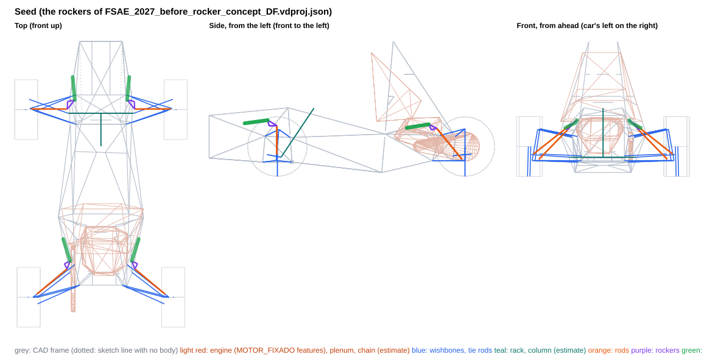
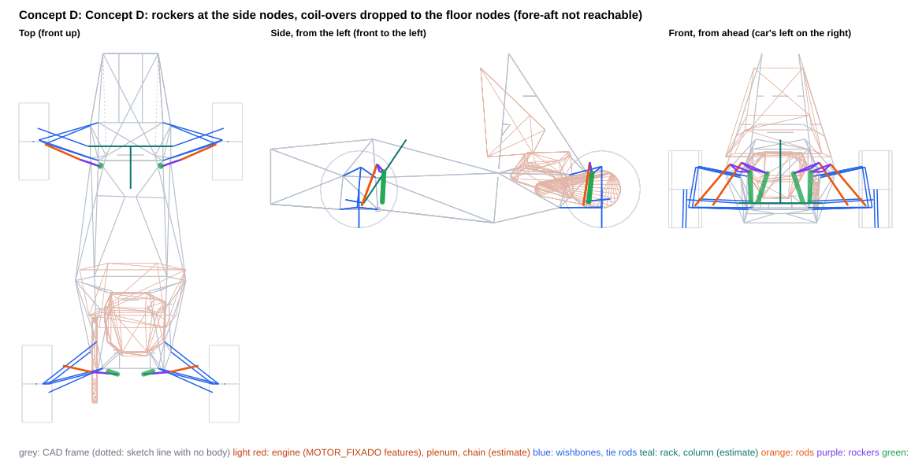
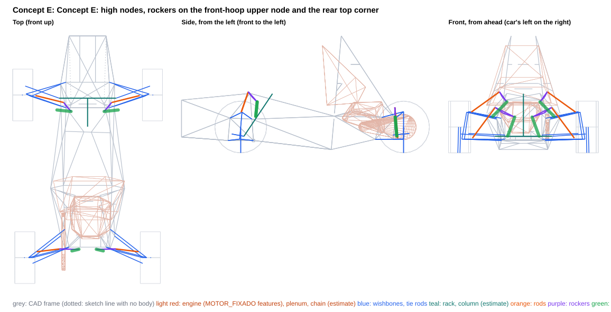
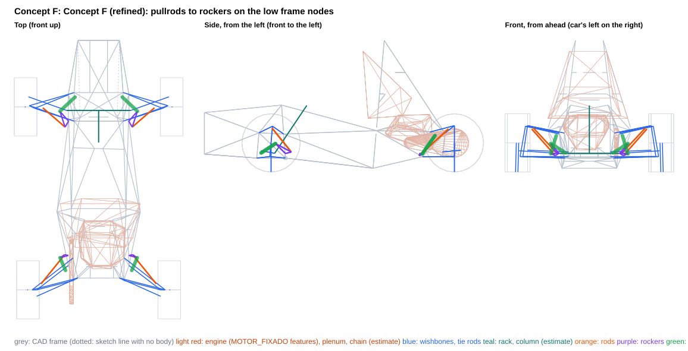
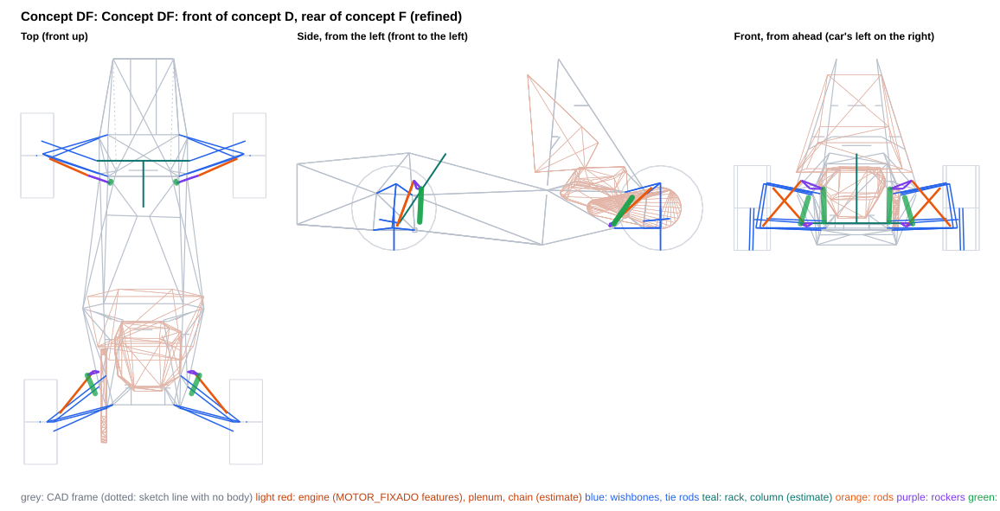

# Rocker concepts mounted at frame nodes: D, E, F, DF (Seed = concept A refined, the team project until 2026-10-18)

Generated by `scripts/rocker_concepts.py build` from the `concept_*.json` files in this folder. Each concept is also saved as a project variant, `projects/FSAE_2027_rocker_concept_<id>.vdproj.json`, to open in VD Studio (Rocker page). The team project is unchanged.

**What this is:** the consequences of these layouts, side by side. **What it is not:** a choice -- the report recommends nothing. The axles are independent: a front from one concept and a rear from another combine without changing either.

- Frame: ISO 8855 (X forward, Y LEFT, Z up), mm, chassis-fixed; LEFT corner points (the right is the Y-mirror). Kinematics: `DWSolver` + `vdcore.analysis.rocker`.
- Motion ratio 0.8 at ride on every concept axle is a **query argument** so the concepts compare like for like (the MR target is still an open decision; the Seed column keeps its own layout). The coil-over is placed for equal droop/bump margins at ±25 mm; the rocker arms are tangential at ride unless the concept clocks them.
- Springs fitted (front / rear, lb/in): 220 / 220. Wheel rate = k·MR² at ride.
- MR and damper usage are over the ±25 mm design travel. Packaging, transmission angles and rocker rotation are over the **physical** range, to the damper's end stops (no bump rubber in the project) or to the concept's travel limit (a bump stop and droop limiter the concept adds) when it sets one, and for the front over the full rack travel (±38 mm).
- **Gaps are air gaps**: centreline distance minus both estimated radii. Both corners are checked against the CAD as built (the frame is not symmetric at the engine mounts).
- Engine: `MOTOR_FIXADO` placed on the car by a fit of its four mounts to the chassis tabs (worst residual 0.004 mm), modelled as convex hulls of its features (crankcase features, intake plenum); its scanned mesh is not in the survey, so parts of the engine outside those features are not represented.
- Chassis: CAD survey `Xasis 33.3`. 155 members, of which 4 are 3D-sketch lines with no weldment body (dotted in the views; they may not be real tubes, and are kept in the checks); 43 2D layout-sketch lines with no body (templates, ground and profile lines) are references, left out of the checks; 8 solid bodies without a centreline are kept as bounding boxes (a box overstates a diagonal tube, so ⚠ means 'look in CAD', not a clash). Bracket lengths are to bodied members only.
- **Estimates** (no CAD): coil-over OD 60 mm (full OD from 30 mm off each eye), eyes OD 40 mm; rod 16×1 mm steel; rocker envelope ±10 mm, pickup bolts ±20 mm; wishbone OD 20, tie rod OD 16, rack housing OD 40 mm, inner tie-rod joint and boot 50 mm OD from 60 mm inboard of the joint to 20 mm past it at full rack travel; steering column (-30, 0, 157) → (-300, 0, 560), OD 40; damper stroke 57 mm (estimate); drive shaft from the wheel centre to a joint at |y| = 120 mm on the axle line, OD 60; chain and sprockets on the engine's chain line (radii 45 / 120 mm); coil-over 1.3 kg and rocker 0.3 kg per corner (CG effect only).

## Thresholds behind the ✗ flags

Information, not requirements.

| check | limit |
|---|---|
| rod vs frame | ≥ 5 mm |
| rocker (plates, pickup bolts) vs frame | ≥ 5 mm |
| coil-over body vs frame | ≥ 5 mm |
| coil-over eyes vs frame | ≥ 5 mm |
| rod vs wishbones / tie rod / toe link (with steer) | ≥ 5 mm |
| rod vs rim (13", steered) | ≥ 15 mm |
| left vs right linkage (heave and roll) | ≥ 5 mm |
| linkage vs steering rack (housing, inner tie-rod joint and boot) (front) | ≥ 5 mm |
| linkage vs steering column (estimate) (front) | ≥ 5 mm |
| linkage vs drive shaft (estimate) (rear) | ≥ 10 mm |
| linkage vs engine (MOTOR_FIXADO features, placed) (rear) | ≥ 10 mm |
| linkage vs chain and sprockets (estimate) (rear) | ≥ 10 mm |
| rocker / coil-over vs wishbones, tie rod / toe link (with steer) | ≥ 5 mm |
| rod vs its own rocker (away from its pickup) and coil-over | ≥ 5 mm |
| rocker pivot to nearest bodied tube | ≤ 60 mm |
| coil-over chassis end to nearest bodied tube | ≤ 60 mm |
| rocker pivot to the nearest frame node (3+ tubes) | ≤ 60 mm |
| coil-over chassis end to the nearest frame node (3+ tubes) | ≤ 60 mm |
| rod transmission angle (over the packaging range) | ≤ 30 deg |
| coil-over transmission angle (over the packaging range) | ≤ 30 deg |
| rocker rotation (over the packaging range) | ≤ 35 deg |

## Front axle

| | Seed | Concept D | Concept E | Concept F | Concept DF |
|---|---|---|---|---|---|
| Rod type / mounted on | pushrod / UPRIGHT | pushrod / LCA | pushrod / UCA | pullrod / UCA | pushrod / LCA |
| Rod in | compression | compression | compression | tension | compression |
| MR droop / ride / bump (±25 mm) | 0.786 / 0.800 / 0.819 | 0.785 / 0.800 / 0.795 | 0.761 / 0.800 / 0.824 | 0.801 / 0.800 / 0.815 | 0.785 / 0.800 / 0.795 |
| MR progression, droop to bump [%] | +4.0 | +1.2 | +7.8 | +1.7 | +1.2 |
| Damper stroke used in ±25 mm [mm] (of 57, estimate) | 40.0 | 39.8 | 39.9 | 40.1 | 39.8 |
| Spring [lb/in] / wheel rate at ride [N/mm] / ride frequency [Hz] | 220.0 / 24.7 / 3.2 | 220.0 / 24.7 / 3.2 | 220.0 / 24.7 / 3.2 | 220.0 / 24.7 / 3.2 | 220.0 / 24.7 / 3.2 |
| Damper end stops, wheel travel [mm] | -35.8 .. +35.3 | -36.0 .. +35.9 | -36.4 .. +35.4 | -35.5 .. +35.3 | -36.0 .. +35.9 |
| Packaging range, wheel travel [mm] (end stops, or the concept's travel limit) | -35.8 .. +35.3 | -36.0 .. +35.9 | -36.4 .. +35.4 | -35.5 .. +35.3 | -36.0 .. +35.9 |
| Spring unseats at wheel travel [mm] (fitted spring, no preload) | -23.7 | -23.7 | -23.7 | -23.7 | -23.7 |
| Rocker rotation over the packaging range [deg] | -22.2 .. +21.7 | -20.5 .. +20.1 | -20.9 .. +20.1 | -12.3 .. +11.9 | -20.5 .. +20.1 |
| Rocker arms rod / damper [mm] | 63 / 76 | 70 / 82 | 64 / 82 | 59 / 139 | 70 / 82 |
| Transmission angle max, rod / damper [deg] | 22.5 / 24.1 | 17.4 / 24.1 | 17.7 / 23.0 | 13.5 / 22.6 | 17.4 / 24.1 |
| Rod length [mm] | 378 | 361 | 336 | 318 | 361 |
| Rod inclination from horizontal / plan sweep [deg] | 38 / 0 | 47 / 24 | 35 / 14 | 39 / 41 | 47 / 24 |
| Rod force / wheel load | 1.52 | 1.47 | 1.59 | 2.87 | 1.47 |
| Rod force at ride [N] | 890 | 858 | 930 | 1681 | 858 |
| Wheel load to buckle the rod [N] (16×1 steel) | 12391 | 14046 | 15034 | n/a | 14046 |
| Rocker pivot reaction at ride [N] | 1238 | 1480 | 1652 | 2044 | 1480 |
| Bracket couple at ride, pivot / coil-over end [N·m] (upper bound: force × stand-off) | 66 / 31 | 57 / 31 | 55 / 31 | 76 / 28 | 57 / 31 |
| Gap: rod vs frame [mm] | 25.1 | 62.0 | 35.3 | 60.8 | 62.0 |
| Gap: rocker vs frame [mm] | 11.8 | 5.3 | 5.2 | 14.7 | 5.3 |
| Gap: coil-over body vs frame [mm] | 12.3 | 5.5 | 5.2 | 5.3 | 5.5 |
| Gap: coil-over eyes vs frame [mm] | 9.8 | 9.0 | 9.4 | 5.1 | 9.0 |
| Gap: rod vs wishbones / tie rod / toe link, with steer [mm] | 15.7 | 5.5 | 18.9 | **5.0** ✗ | 5.5 |
| Gap: rod vs rim, with steer [mm] (to the 13" bead-seat radius) | 95.4 | 46.3 | — | — | 46.3 |
| Gap: left vs right, heave and roll [mm] | 374.1 | 316.3 | 240.8 | 375.4 | 316.3 |
| Gap: linkage vs rack, inner tie-rod joint and boot [mm] | 129.6 | 72.2 | 174.0 | **5.0** ✗ | 72.2 |
| Gap: linkage vs steering column [mm] (estimate) | 271.6 | 141.8 | 126.4 | 187.2 | 141.8 |
| Gap: linkage vs solid bodies' bounding boxes [mm] | 12.1 | 2.5 | 1.3 | 1.6 | 2.5 |
| Rocker pivot to nearest bodied tube [mm] | 53.3 | 38.2 | 33.4 | 37.4 | 38.2 |
| Coil-over chassis end to nearest bodied tube [mm] | 42.5 | 42.1 | 42.1 | 37.8 | 42.1 |
| Rocker pivot to the nearest frame node (3+ tubes) [mm] | **93.8** ✗ | 49.0 | 56.7 | **61.2** ✗ | 49.0 |
| Coil-over chassis end to the nearest frame node (3+ tubes) [mm] | **199.4** ✗ | 57.5 | 59.7 | 57.8 | 57.5 |
| Gap: rocker / coil-over vs wishbones, tie rod / toe link, with steer [mm] | 55.6 | 22.0 | 18.4 | 12.0 | 22.0 |
| Gap: rod vs its own rocker (away from its pickup) and coil-over [mm] | 10.2 | 11.8 | 11.6 | 13.2 | 11.8 |
| Damper length change over the rack travel at fixed wheel-centre height [mm] (steering jacking + any mount coupling; information) | 4.36 | 4.19 | 4.38 | 4.43 | 4.19 |
| Rocker / coil-over centreline height range z [mm] | 402 .. 462 | 164 .. 420 | 346 .. 588 | 156 .. 246 | 164 .. 420 |
| Coil-over + rocker mass height z [mm] | 442 | 278 | 436 | 192 | 278 |

## Rear axle

| | Seed | Concept D | Concept E | Concept F | Concept DF |
|---|---|---|---|---|---|
| Rod type / mounted on | pushrod / LCA | pushrod / LCA | pushrod / LCA | pullrod / UCA | pullrod / UCA |
| Rod in | compression | compression | compression | tension | tension |
| MR droop / ride / bump (±25 mm) | 0.788 / 0.800 / 0.805 | 0.776 / 0.800 / 0.819 | 0.776 / 0.800 / 0.817 | 0.789 / 0.800 / 0.800 | 0.789 / 0.800 / 0.800 |
| MR progression, droop to bump [%] | +2.0 | +5.4 | +5.0 | +1.3 | +1.3 |
| Damper stroke used in ±25 mm [mm] (of 57, estimate) | 39.9 | 40.0 | 39.9 | 39.9 | 39.9 |
| Spring [lb/in] / wheel rate at ride [N/mm] / ride frequency [Hz] | 220.0 / 24.7 / 2.9 | 220.0 / 24.7 / 2.9 | 220.0 / 24.7 / 2.9 | 220.0 / 24.7 / 2.9 | 220.0 / 24.7 / 2.9 |
| Damper end stops, wheel travel [mm] | -35.8 .. +35.7 | -36.1 .. +35.4 | -36.1 .. +35.4 | -35.9 .. +35.7 | -35.9 .. +35.7 |
| Packaging range, wheel travel [mm] (end stops, or the concept's travel limit) | -35.8 .. +35.7 | -36.1 .. +35.4 | -36.1 .. +35.4 | -35.9 .. +35.7 | -35.9 .. +35.7 |
| Spring unseats at wheel travel [mm] (fitted spring, no preload) | -30.0 | -30.0 | -30.0 | -30.0 | -30.0 |
| Rocker rotation over the packaging range [deg] | -24.1 .. +23.7 | -15.0 .. +14.9 | -14.2 .. +14.0 | -23.7 .. +22.6 | -23.7 .. +22.6 |
| Rocker arms rod / damper [mm] | 50 / 70 | 70 / 110 | 91 / 117 | 38 / 73 | 38 / 73 |
| Transmission angle max, rod / damper [deg] | 23.2 / 26.2 | 13.3 / 16.8 | 11.8 / 14.6 | 20.7 / 28.8 | 20.7 / 28.8 |
| Rod length [mm] | 412 | 330 | 362 | 388 | 388 |
| Rod inclination from horizontal / plan sweep [deg] | 38 / 40 | 55 / 13 | 53 / 7 | 35 / 51 | 35 / 51 |
| Rod force / wheel load | 1.76 | 1.96 | 1.60 | 2.36 | 2.36 |
| Rod force at ride [N] | 1302 | 1447 | 1183 | 1748 | 1748 |
| Wheel load to buckle the rod [N] (16×1 steel) | 9017 | 12636 | 12812 | n/a | n/a |
| Rocker pivot reaction at ride [N] | 1441 | 2350 | 2087 | 1296 | 1296 |
| Bracket couple at ride, pivot / coil-over end [N·m] (upper bound: force × stand-off) | 74 / 50 | 87 / 37 | 61 / 42 | 41 / 42 | 41 / 42 |
| Gap: rod vs frame [mm] | 33.3 | 43.4 | 59.2 | 30.3 | 30.3 |
| Gap: rocker vs frame [mm] | 12.1 | 11.5 | 5.6 | 9.1 | 9.1 |
| Gap: coil-over body vs frame [mm] | 15.7 | 11.1 | 10.8 | 10.9 | 10.9 |
| Gap: coil-over eyes vs frame [mm] | 20.4 | 7.5 | 12.6 | 13.2 | 13.2 |
| Gap: rod vs wishbones / tie rod / toe link, with steer [mm] | 10.3 | 7.5 | 5.6 | 20.3 | 20.3 |
| Gap: rod vs rim, with steer [mm] (to the 13" bead-seat radius) | 48.6 | — | — | — | — |
| Gap: left vs right, heave and roll [mm] | 449.0 | 114.5 | 112.4 | 488.7 | 488.7 |
| Gap: linkage vs drive shaft [mm] (estimate) | 46.9 | 12.5 | 10.6 | 80.9 | 80.9 |
| Gap: linkage vs engine (MOTOR_FIXADO features, on its mounts) [mm] | 33.3 | 70.0 | 79.4 | 84.2 | 84.2 |
| Gap: linkage vs solid bodies' bounding boxes [mm] | 253.6 | 563.2 | 552.4 | 419.6 | 419.6 |
| Rocker pivot to nearest bodied tube [mm] | 51.5 | 37.1 | 29.2 | 31.8 | 31.8 |
| Coil-over chassis end to nearest bodied tube [mm] | 54.4 | 40.2 | 45.3 | 45.9 | 45.9 |
| Rocker pivot to the nearest frame node (3+ tubes) [mm] | **94.6** ✗ | 52.5 | 51.2 | 53.7 | 53.7 |
| Coil-over chassis end to the nearest frame node (3+ tubes) [mm] | **188.4** ✗ | 52.0 | 54.4 | 56.4 | 56.4 |
| Gap: rocker / coil-over vs wishbones, tie rod / toe link, with steer [mm] | 24.3 | 10.0 | 15.4 | 8.4 | 8.4 |
| Gap: rod vs its own rocker (away from its pickup) and coil-over [mm] | 8.6 | 13.2 | 13.6 | **-37.2** ✗ | **-37.2** ✗ |
| Gap: linkage vs chain and sprockets [mm] (estimate) | 33.5 | 12.5 | 12.8 | 11.2 | 11.2 |
| Rocker / coil-over centreline height range z [mm] | 381 .. 429 | 165 .. 429 | 160 .. 447 | 130 .. 306 | 130 .. 306 |
| Coil-over + rocker mass height z [mm] | 407 | 278 | 273 | 216 | 216 |

## Car level

| | Seed | D | E | F | DF |
|---|---|---|---|---|---|
| Springs-only roll gradient [deg/g] (each column's springs) | 1.21 | 1.21 | 1.21 | 1.21 | 1.21 |
| ARB needed for 1.0 deg/g at 50/50, F / R [N·m/deg] | 57 / 78 | 57 / 78 | 57 / 78 | 57 / 78 | 57 / 78 |
| CG height change vs seed [mm] (estimate) | +0.0 | -3.0 | -1.4 | -4.5 | -3.6 |
| Tilt-table tip angle [deg] (seed 62.13) | 62.13 | 62.35 | 62.24 | 62.47 | 62.40 |

Wheel rates, frequencies and the roll budget follow from each column's springs and ride MR; where those match, they only move with the MR progression and are listed to show that, not as a difference between the layouts. The spring unseating row is the same story: with no preload the spring comes off its seat at its static compression divided by the MR, whatever the layout.

## Seed: the rockers of FSAE_2027_before_rocker_concept_DF.vdproj.json

| point (LEFT corner) | front | rear |
|---|---|---|
| rod outer end (on the mount body) | (5.5, 572.8, 182.5) | (-1515.0, 527.0, 140.0) |
| rocker pivot | (67.2, 274.3, 414.8) | (-1265.0, 300.0, 381.0) |
| rocker axis (unit) | (-0.0459, -0.6195, -0.7837) | (0.0940, -0.6742, -0.7325) |
| rocker rod pickup | (4.5, 276.2, 417.0) | (-1308.0, 278.7, 395.1) |
| rocker damper pickup | (79.0, 214.7, 461.2) | (-1242.2, 252.4, 427.7) |
| coil-over chassis end | (268.2, 232.7, 435.9) | (-1061.8, 309.8, 398.1) |
| rod type / mount body | pushrod / upright | pushrod / lca |

**Where the tightest numbers are:**

- front gap rod frame: 25.1 mm — Tri_Frente (101, 255, 330)->(-88, 156, 563), L at +35 mm
- front gap rocker frame: 11.8 mm — Tri_Frente (101, 255, 330)->(-88, 156, 563), L at -36 mm
- front gap coilover frame: 12.3 mm — Tri_Frente (101, 255, 330)->(560, 175, 500), L at +35 mm
- front gap rod members: 15.7 mm — tie rod at -36 mm, rack +38
- front gap rod linkage: 10.2 mm — rocker arm to the rod pickup at +35 mm
- front gap rod rim: 95.4 mm — at -26 mm, rack +38
- front gap solid bodies: 12.1 mm — coil-over vs 'Ressalto-extrusão2' box, L at -15 mm
- front pivot bracket: 53.3 mm — Tri_Frente (101, 255, 330)->(-88, 156, 563) (L), foot 77 mm from its nearer end
- front damper bracket: 42.5 mm — Tri_Frente (101, 255, 330)->(560, 175, 500) (L), foot 195 mm from its nearer end
- front pivot node: 93.8 mm — node (101, 255, 330) (L), 6 tube ends: PSD, Tri_Frente
- front damper node: 199.4 mm — node (101, 255, 330) (L), 6 tube ends: PSD, Tri_Frente
- rear gap rod frame: 33.3 mm — Tri_Tras (-1336, 255, 337)->(-884, 350, 348), L at -31 mm
- rear gap rocker frame: 12.1 mm — Tri_Tras (-1336, 255, 337)->(-884, 350, 348), L at -36 mm
- rear gap coilover frame: 15.7 mm — 3DSketch8 (-1034, -243, 382)->(-1336, -255, 337), R at +36 mm
- rear gap rod members: 10.3 mm — LCA front leg at -36 mm, rack +0
- rear gap rod linkage: 8.6 mm — rocker arm to the rod pickup at +36 mm
- rear gap rod rim: 48.6 mm — at +36 mm, rack +0
- rear gap engine: 33.3 mm — coil-over vs intake plenum, L at -0 mm
- rear gap solid bodies: 253.6 mm — eyes vs 'Ressalto-extrusão1' box, L at -36 mm
- rear pivot bracket: 51.5 mm — Tri_Tras (-1336, 255, 337)->(-884, 350, 348) (L), foot 79 mm from its nearer end
- rear damper bracket: 54.4 mm — Tri_Tras (-1336, 255, 337)->(-884, 350, 348) (L), foot 181 mm from its nearer end
- rear pivot node: 94.6 mm — node (-1336, 255, 337) (L), 4 tube ends: 3DSketch8, PST, Tri_Tras
- rear damper node: 188.4 mm — node (-884, 349, 348) (L), 7 tube ends: 3DSketch8, MH esb, Tri_Meio, Tri_Tras

**Outside the thresholds:** front rocker pivot to the nearest frame node (3+ tubes) 93.8 (limit ≤ 60); front coil-over chassis end to the nearest frame node (3+ tubes) 199.4 (limit ≤ 60); rear rocker pivot to the nearest frame node (3+ tubes) 94.6 (limit ≤ 60); rear coil-over chassis end to the nearest frame node (3+ tubes) 188.4 (limit ≤ 60)

## Concept D: Concept D: rockers at the side nodes, coil-overs dropped to the floor nodes (fore-aft not reachable)

Concept D puts each rocker pivot on a bracket at a side node of the frame and the coil-over's chassis eye at a second node, so neither bracket loads a tube at mid-span. The fore-aft coil-over this family was meant to have could not be reached, and the search explains why. The evaluator builds the rocker with the rod pickup on the far side of the pivot from the coil-over. The damper pickup sits perpendicular to the coil-over, on the side the rod drives toward, which here is inboard and up. Between the two side nodes that pickup lands on the front hoop's upper leg or on the diagonal to the front-hoop top node. At the rear the two upper nodes are 134 mm apart (node coordinates), shorter than the pivot-to-eye distance a 191.6 mm coil-over needs. The main-hoop side node is 461 mm from the rear upper node and 594 mm from the rear top corner. The best fore-aft layout found (a scratch evaluation, not this run) still missed five thresholds on each axle, among them a front pivot 73.5 mm from its node and a rear coil-over end 66.5 mm from its node. What does reach zero fails is a vertical coil-over. Front: the rocker hangs 49 mm above, behind and outboard of the front-hoop side node, on the same node as the UCA rear pivot. The coil-over drops straight down behind the front hoop's lower leg to the front-hoop bottom node, which has 7 tube ends. The rod comes from the LCA rear leg, 45 mm from the ball joint. Rear: the rocker sits 52.5 mm above and inboard of the rear top corner, on the same node as the UCA rear pivot. The coil-over drops down and outboard to the rear bottom corner, with 5 tube ends. The rod comes from mid-span of the LCA front leg. The trade-off has three parts. Both rocker brackets and both eyes now sit at welded joints. The front coil-over moves into the cockpit beside the driver's knee, with thin margins. The rear needs a rod mount that bends the lower wishbone, and puts the two coil-overs near the centreline in the differential's space. No evaluator threshold is missed on either axle. MR 0.80 at ride is the comparison query, not a choice.

| point (LEFT corner) | front | rear |
|---|---|---|
| rod outer end (on the mount body) | (-17.0, 543.4, 138.6) | (-1423.8, 428.9, 143.0) |
| rocker pivot | (-130.5, 269.6, 357.1) | (-1468.4, 188.2, 375.2) |
| rocker axis (unit) | (-0.9376, 0.3430, -0.0573) | (-0.9908, 0.1146, -0.0717) |
| rocker rod pickup | (-115.3, 319.0, 404.5) | (-1464.6, 246.3, 414.8) |
| rocker damper pickup | (-158.7, 192.2, 355.4) | (-1478.5, 82.3, 345.8) |
| coil-over chassis end | (-148.8, 187.4, 164.2) | (-1458.5, 142.1, 164.7) |
| rod type / mount body | pushrod / lca | pushrod / lca |

**Where the tightest numbers are:**

- front gap rod frame: 62.0 mm — FRONTO HO (-104, 245, 344)->(-89, 159, 556), L at +36 mm
- front gap rocker frame: 5.3 mm — Tri_Meio (-106, 251, 319)->(-884, 350, 348), L at +36 mm
- front gap coilover frame: 5.5 mm — PSD (-106, 255, 320)->(-120, 205, 117), L at +36 mm
- front gap rod members: 5.5 mm — UCA rear leg at -36 mm, rack -38
- front gap rod linkage: 11.8 mm — rocker arm to the rod pickup at +36 mm
- front gap rod rim: 46.3 mm — at +36 mm, rack +38
- front gap solid bodies: 2.5 mm — rocker vs 'Ressalto-extrusão1' box, L at -21 mm
- front pivot bracket: 38.2 mm — FRONTO HO (-104, 245, 344)->(-89, 159, 556) (L), foot 2 mm from its nearer end
- front damper bracket: 42.1 mm — FRONTO HO (-108, -249, 295)->(-120, -205, 117) (R), foot 39 mm from its nearer end
- front pivot node: 49.0 mm — node (-106, -250, 319) (R), 5 tube ends: FRONTO HO, PSD, Tri_Meio
- front damper node: 57.5 mm — node (-120, 205, 117) (L), 7 tube ends: 3DSketch3, PSD, Tri_Frente, Tri_Meio, assoalho frontal
- rear gap rod frame: 43.4 mm — Tri_Tras (-1461, 210, 328)->(-951, 116, 1108), L at -36 mm
- rear gap rocker frame: 11.5 mm — Tri_Tras (-951, -116, 1108)->(-1461, -210, 328), R at -36 mm
- rear gap coilover frame: 11.1 mm — PST (-1441, 175, 129)->(-1464, 209, 328), L at -36 mm
- rear gap rod members: 7.5 mm — UCA rear leg at +35 mm, rack +0
- rear gap rod linkage: 13.2 mm — rocker arm to the rod pickup at +35 mm
- rear gap engine: 70.0 mm — coil-over vs engine (features), R at -36 mm
- rear gap solid bodies: 563.2 mm — rocker vs 'Ressalto-extrusão3' box, L at +35 mm
- rear pivot bracket: 37.1 mm — Tri_Tras (-1461, 210, 328)->(-951, 116, 1108) (L), foot 37 mm from its nearer end
- rear damper bracket: 40.2 mm — PST (-1441, 175, 129)->(-1441, -175, 129) (L), foot 33 mm from its nearer end
- rear pivot node: 52.5 mm — node (-1461, 210, 328) (L), 6 tube ends: 3DSketch7, PST, Tri_Tras
- rear damper node: 52.0 mm — node (-1441, 175, 129) (L), 5 tube ends: 3DSketch6, PST

**Outside the thresholds:** none

**Pros**

- Zero evaluator fails on both axles and both corners, including the two node checks. The run covers the asymmetric CAD and the engine on its mounts, swept to the damper end stops (front -36.0 / +35.9 mm, rear -36.1 / +35.4 mm) and, at the front, over the full rack travel of +-38 mm.
- Brackets at welded joints. Front rocker pivot to the nearest node: 49.0 mm, the worse corner (the right front-hoop side node, 5 tube ends). The front coil-over eye is 57.5 mm from the front-hoop bottom node (7 tube ends). Rear pivot: 52.5 mm from the rear top corner (6 tube ends). Rear eye: 52.0 mm from the rear bottom corner (5 tube ends). Distances to the nearest bodied tube are 38.2 / 42.1 mm front and 37.1 / 40.2 mm rear. The front pivot bracket leaves the node up, back and outboard, into the gap between the front hoop's upper leg and the Tri_Meio upper rail; the rear one leaves up and inboard.
- Steep, short rods in compression. Front: 361.5 mm long, 47.3 deg from horizontal and 23.7 deg in plan, 858 N at ride (1.47x the wheel load); it takes 14.0 kN of wheel load to buckle the 16x1 steel reference tube. Rear: 330.0 mm long, 55.5 deg from horizontal and 12.6 deg in plan, 1447 N at ride (1.96x); it buckles at 12.6 kN of wheel load. Rod to rim: 46.3 mm front.
- Kinematics over +-25 mm: MR 0.785 / 0.800 / 0.795 front (+1.2 %) and 0.776 / 0.800 / 0.819 rear (+5.4 %), with equal damper margins of 8.6 / 8.5 mm. To the end stops, the largest transmission angles are 17.4 deg (rod) and 24.1 deg (coil-over) front, 13.3 / 16.8 deg rear. Rocker rotation stays within -20.5 / +20.1 deg front and -15.0 / +14.9 deg rear.
- Low coil-overs and rockers: moving-mass height 278 mm front and rear. CG -2.98 mm against the seed and tilt-table angle 62.35 deg (seed 62.13), with the estimated masses (1.3 kg coil-over + 0.3 kg rocker per corner).
- Rear packaging against the estimated driveline: chain 12.5 mm (rocker, left at the droop stop), drive shaft 12.5 mm, engine features 70.0 mm. The rocker plates, the rod and the coil-overs stay clear of the cockpit and leg templates at the rear.
- Front steering drives the damper only by the steering jacking of the LCA: 4.19 mm of damper change over the full rack travel. The front rod mount is 45 mm from the LCA ball joint: the rod-force component perpendicular to the leg (0.76 x 858 N), on the leg simply supported between its inner pivot and the ball joint (45 / 354 mm, 399 mm span), gives about 26 N·m of bending at ride (about 78 N·m at 3x static), hand estimate.

**Cons**

- Not the fore-aft layout asked for. Both coil-overs run near vertically from a side node down to a floor node. The front is 3.3 deg off vertical, with its top 9.9 mm rearward and 4.9 mm outboard of the eye. The rear is 19.2 deg off vertical, with its top 59.7 mm inboard and 20.0 mm rearward of the eye. Each rocker turns in a near-transverse plane: its axis is (-0.94, 0.34, -0.06) front and (-0.99, 0.11, -0.07) rear. No fore-aft coil-over with its rocker pivot and eye both at nodes was found that meets the thresholds (see the summary).
- Front coil-over in the cockpit. It hangs just behind the front hoop's lower leg, at about y = 187-192 mm, beside the driver's knee, in the 70 mm slot between two CAD solid boxes: 'Ressalto-extrusão2' (x -120..438, believed to be the leg template) and 'Ressalto-extrusão1' (x -790..-190, taken here to be the cockpit template). The rocker is 2.5 mm from 'Ressalto-extrusão1' (left at -21 mm) and the coil-over 2.7 mm from 'Ressalto-extrusão2' (left at -5 mm, scratch evaluation against that box alone): about 3 mm on each side. It needs leg protection, and occupant clearance was not checked.
- Thin front margins. Rocker to frame is 5.3 mm (Tri_Meio upper rail, at the bump stop). Coil-over body to frame is 5.5 mm (the front hoop's lower leg, at the bump stop). The eyes are 9.0 mm from the small Esboço144 profile at the front-hoop bottom node. Rod to wishbones is 5.5 mm (UCA rear leg, droop stop, rack -38). All of these are against 5 mm limits, so a few millimetres of CAD change or bracket tolerance at these tubes can bring one of them below its limit. A scratch sweep moving the front pivot 5 mm along each axis broke a threshold in 5 of 6 directions (z-5: rocker 0.7 mm from the frame; x+5: rod 1.4 mm from the UCA rear leg; z+5: coil-over end 61.8 mm from its node); the clean direction (x-5) puts the rocker 3.0 mm into 'Ressalto-extrusão1'. The front pushrod also passes outside the UCA, 5.9 mm from its rear leg at ride; with a 25.4 mm wishbone instead of the 20 mm estimate that would be about 2.8 mm.
- Rear rod mount at mid-span of the LCA front leg: 262 mm from the inner pivot and 174 mm from the ball joint, on an 18 mm bracket. A mount nearer the ball joint brings the rod onto the UCA rear leg (40 mm closer: 0.2 mm; 80 mm: -6.4 mm, scratch runs), so this rocker position forces the mid-span mount. Hand estimate: the rod-force component perpendicular to the leg (0.93 x 1447 N), on the leg simply supported between its inner pivot and the ball joint (436 mm span), gives about 141 N·m of bending at ride and about 420 N·m at 3x static. On the 25.4 x 1.2 mm reference section used for concept A refined that is about 270 MPa at ride and 800 MPa at 3x, which a steel wishbone leg does not carry; the LCA would have to be redesigned (the evaluator's wishbone envelope is a 20 mm OD estimate).
- Rear coil-overs near the centreline. The damper pickups sit at |y| = 82 mm and the two coil-overs are 114.5 mm apart, 60-80 mm ahead of the rear axle line and from 165 to 346 mm high. That is where the differential, its sprocket carrier and the bearing-carrier plates usually sit, and none of them is modelled. The rear rocker is large (damper arm 110.4 mm). The pivot reaction is 2350 N at ride, with a bracket couple of 87.1 N·m (upper bound, force x stand-off); the front values are 1480 N and 56.5 N·m.
- Shared nodes. The front rocker bracket shares the front-hoop side node with the UCA rear pivot, and the rear rocker bracket shares the rear top corner with the UCA rear pivot and the engine's upper mount tube. The coil-over eyes share the front-hoop bottom node with the LCA rear pivot (whose small Esboço144 tab lies on the line from the node to the eye, so in practice the eye hangs off the hoop's lower leg, 39 mm up from the node) and the rear bottom corner with the LCA rear pivot and the toe link's inner pivot (the eye is 38 mm from it). On the right rear the nearest node is a 3-tube engine-tab node, 43.8 mm away. Bracket and clevis room at these joints is not modelled. A pivot bolt the size of the evaluator's pickup bolts (+-20 mm along the axis, not modelled by the evaluator) would clear the front hoop's upper leg by 0.3 mm at the front and Tri_Tras / 3DSketch7 by 2.6 mm at the rear (scratch check), so the pivots need a one-sided stub or a shaped yoke.
- No anti-roll-bar provision. With 220 lb/in springs the roll budget asks about 56.7 N·m/deg front and 77.7 N·m/deg rear for 1.0 deg/g. The rear rockers sit beside the differential space and the front ones beside the cockpit, so the drop links would have to find room there.

**Not checked**

- The differential, the sprocket carrier and its bearing-carrier plates at the rear frame nodes; the engine is modelled only by its features and the plenum outline; the chain and sprockets (14/46 520 assumed) and the drive shafts are estimates.
- The driver: knee and shin clearance and the FSAE leg-protection shielding for the front coil-over and rocker behind the front hoop; only the template boxes are checked.
- Real part envelopes: all gaps use estimated diameters (rod 16, coil-over 60, eyes 40, rocker +-10 mm plates and +-20 mm pickup bolts, frame 25.4); the brackets, the clevises of the wishbones that share the nodes, the rocker plates and the rod ends are not modelled.
- Structure: no load cases, stress, fatigue or sizing of brackets, nodes, rockers, rods, wishbones or uprights. The LCA bending figures are hand estimates (this run's rod force on a simply supported leg). The 3x figures are hand estimates. Bracket compliance, which changes the effective MR, is not modelled.
- Travel limits: the damper stroke (57 mm) is an estimate and there are no bump rubbers, so the linkage runs to the damper's end stops. With 220 lb/in springs and no preload the springs unseat at -23.7 mm (front, inside the +-25 mm travel) and -30.0 mm (rear), as with any layout at MR 0.80.
- FSAE rules: leg protection for moving suspension parts in the cockpit; attachments to the frame nodes used by the brackets.
- The MR 0.80 target, the 1.0 deg/g roll gradient and the 50 % front roll share are design-intent query arguments, not derived targets. The 220 lb/in springs are a fixed input (measured; one of the two available rates).

## Concept E: Concept E: high nodes, rockers on the front-hoop upper node and the rear top corner

Every rocker pivot and coil-over chassis end is bracketed off a welded frame node. Front: the rocker sits behind the front hoop's upper node, on the outboard-rear side of the hoop leg, with its rod pickup above the hoop corner; the coil-over runs diagonally down behind the hoop leg to an eye beside the front-hoop side node (the UCA rear-pivot node), and the pushrod is mounted on the UCA, close to its outer ball joint. Rear: a transverse bell crank sits above the rear top corner (the UCA rear-pivot node), between the main-hoop brace and the engine-mount diagonal; its inboard arm drives a coil-over inclined about 21 deg from vertical, inboard of the PST rail, down to an eye beside the rear bottom corner (the LCA rear-pivot node). The rod comes from the LCA. The run shows zero evaluator fails on both axles and both corners, but the front only gets there at the edge of the limits: pivot 56.7 mm and coil-over end 59.7 mm from their nodes, which misses the 50 mm aim, and rocker and coil-over 5.2 mm from the tubes. In the designer's search (not shown by this run) the front reached zero fails at these nodes only with the pushrod on the UCA, so the UCA takes the spring load in bending, and it puts the coil-over's upper end inside the front-hoop opening. In return, the brackets load welded joints, not mid-span tubes. At these nodes (the front-hoop upper node and the rear top corner) the rod and coil-over force lines come out nearly parallel, 12.4 deg apart at the front and 16.2 deg at the rear, so the rocker pivots react almost the sum of the two forces: 1652 N front and 2087 N rear at ride. The rear has thin but positive margins and keeps the coil-overs low. MR 0.80 at ride is the comparison query, not a choice.

| point (LEFT corner) | front | rear |
|---|---|---|
| rod outer end (on the mount body) | (-5.2, 493.0, 386.2) | (-1484.6, 481.6, 139.7) |
| rocker pivot | (-107.5, 201.0, 531.3) | (-1460.5, 193.1, 376.3) |
| rocker axis (unit) | (-0.8026, 0.4661, 0.3724) | (-0.9968, -0.0203, 0.0767) |
| rocker rod pickup | (-71.4, 225.7, 578.1) | (-1457.9, 266.8, 430.4) |
| rocker damper pickup | (-155.7, 156.6, 482.8) | (-1461.1, 82.1, 339.2) |
| coil-over chassis end | (-142.0, 289.9, 345.5) | (-1476.3, 148.2, 159.8) |
| rod type / mount body | pushrod / uca | pushrod / lca |

**Where the tightest numbers are:**

- front gap rod frame: 35.3 mm — Tri_Frente (560, 175, 500)->(-88, 156, 563) (sketch only), L at +35 mm
- front gap rocker frame: 5.2 mm — Tri_Meio (-88, 156, 563)->(-884, 350, 348), L at -36 mm
- front gap coilover frame: 5.2 mm — Tri_Meio (-106, 251, 319)->(-884, 350, 348), L at -0 mm
- front gap rod members: 18.9 mm — UCA front leg at -36 mm, rack -38
- front gap rod linkage: 11.6 mm — rocker arm to the rod pickup at +35 mm
- front gap solid bodies: 1.3 mm — coil-over vs 'Ressalto-extrusão2' box, L at -36 mm
- front pivot bracket: 33.4 mm — FRONTO HO (-104, 245, 344)->(-89, 159, 556) (L), foot 40 mm from its nearer end
- front damper bracket: 42.1 mm — Tri_Meio (-106, 251, 319)->(-884, 350, 348) (L), foot 42 mm from its nearer end
- front pivot node: 56.7 mm — node (-89, 157, 561) (L), 4 tube ends: FRONTO HO, Tri_Frente, Tri_Meio
- front damper node: 59.7 mm — node (-106, -250, 319) (R), 5 tube ends: FRONTO HO, PSD, Tri_Meio
- rear gap rod frame: 59.2 mm — Tri_Tras (-1461, 210, 328)->(-951, 116, 1108), L at +35 mm
- rear gap rocker frame: 5.6 mm — Tri_Tras (-1461, 210, 328)->(-951, 116, 1108), L at -36 mm
- rear gap coilover frame: 10.8 mm — PST (-1441, 175, 129)->(-1464, 209, 328), L at -36 mm
- rear gap rod members: 5.6 mm — UCA rear leg at -36 mm, rack +0
- rear gap rod linkage: 13.6 mm — rocker arm to the rod pickup at +35 mm
- rear gap engine: 79.4 mm — rocker vs engine (features), L at -36 mm
- rear gap solid bodies: 552.4 mm — rocker vs 'Ressalto-extrusão3' box, L at +35 mm
- rear pivot bracket: 29.2 mm — Tri_Tras (-1461, 210, 328)->(-951, 116, 1108) (L), foot 42 mm from its nearer end
- rear damper bracket: 45.3 mm — PST (-1441, 175, 129)->(-1464, 209, 328) (L), foot 30 mm from its nearer end
- rear pivot node: 51.2 mm — node (-1461, 210, 328) (L), 6 tube ends: 3DSketch7, PST, Tri_Tras
- rear damper node: 54.4 mm — node (-1441, 175, 129) (L), 5 tube ends: 3DSketch6, PST

**Outside the thresholds:** none

**Pros**

- Zero evaluator fails on both axles and both corners against the chassis as updated and the engine on its mounts. The linkage was swept to the damper end stops (front -36.4 / +35.4 mm, rear -36.1 / +35.4 mm) and, at the front, over the full rack travel of +-38 mm.
- Rear brackets at welded joints. The rocker pivot is 51.2 mm from the six-tube rear top corner node (-1461, 210, 328; 3DSketch7, PST, Tri_Tras), with its bracket foot 29.2 mm away on the Tri_Tras main-hoop brace, 42 mm from that tube's end at the node. The coil-over chassis eye is 54.4 mm from the five-tube rear bottom corner node (-1441, 175, 129; 3DSketch6, PST), with its bracket foot 45.3 mm away on the PST rail, 30 mm from its end.
- Front brackets at welded joints. The rocker pivot is 56.7 mm from the four-tube front-hoop upper node (-89, 157, 561; FRONTO HO, Tri_Frente, Tri_Meio), with its bracket foot 33.4 mm away on the hoop leg, 40 mm from its upper end. The coil-over chassis eye is 59.7 mm from the five-tube front-hoop side node (worse corner: the right one, node (-106, -250, 319)), with its bracket foot 42.1 mm away on the rearward Tri_Meio tube, 42 mm from the node.
- Rear kinematics: MR 0.7765 / 0.8000 / 0.8168 over +-25 mm (+5.0 %), equal 8.53 mm damper margins, rocker rotation -14.2 / +14.0 deg to the end stops, transmission angles at most 11.8 deg (rod) and 14.6 deg (coil-over). The rod is transverse in plan (7.1 deg) but steep (53.3 deg from horizontal), and 362.5 mm long, at 1.60x the wheel load (1183 N at ride). It takes 12.8 kN of wheel load to buckle the 16x1 steel reference tube.
- Rear clearances to the engine and drive train: chain and sprockets 12.8 mm (estimate), engine features 79.4 mm, drive shaft 10.6 mm (estimate). Coil-over body 10.8 mm and eyes 12.6 mm from the PST rail, left-to-right 112.4 mm.
- Front kinematics: MR 0.7611 / 0.8000 / 0.8235 (+7.8 %), equal 8.56 mm damper margins, rocker rotation -20.9 / +20.1 deg, transmission angles at most 17.7 deg (rod) and 23.0 deg (coil-over). The UCA-mounted rod is short, at 335.6 mm and 1.59x the wheel load (930 N at ride). It takes 15.0 kN of wheel load to buckle the reference tube. Rod to wishbones and tie rod 18.9 mm, rim not reached by the rod, rack 179.9 mm, steering column 126.4 mm (estimate), left-to-right 240.8 mm.
- The rear coil-overs sit low, with a moving-mass height of 273 mm (front 436 mm). The CG moves -1.42 mm against the project's seed layout and the tilt-table angle is 62.238 deg (reference 62.132 deg), with the estimated 1.3 kg coil-over + 0.3 kg rocker per corner.

**Cons**

- The front only just passes. The rocker is 5.19 mm from the Tri_Meio tube leaving the front-hoop upper node (at the droop stop) and the coil-over body is 5.18 mm from the Tri_Meio leaving the side node (at ride), against a 5 mm limit. The coil-over end is 59.7 mm from its node (limit 60) and the coil-over is 1.34 mm from the 'Ressalto-extrusão2' box (believed to be the leg template) at the droop stop. The coil-over body is also 5.20 mm from the front hoop leg (FRONTO HO) at the bump stop: it runs along the leg at about 23 deg, most of its full-diameter body within 10 mm of it over the whole travel. The rocker is 3.40 mm from the 'Ressalto-extrusão2' box at +9.8 mm. (Measured with the evaluator's geometry; the CLI prints only the minimum of each key.) A millimetre of CAD change at the front hoop can turn any of these into a fail. The front pivot misses the 50 mm aim (56.7 mm).
- The front pushrod is mounted on the UCA at (-5.24, 492.96, 386.17), not on the upright or the LCA. The UCA carries the rod force (930 N compression at ride, about 2.8 kN at 3x) near its ball joint, in bending, and so does its ball joint. In the designer's search (not from this evaluation), the only zero-fail fronts with the rod on the upright put the rocker low at the side node and the coil-over up inside the front-hoop opening. Those fronts also needed a very large damper arm.
- The front damper pickup sits at (-155.7, 156.6, 482.8), behind the hoop and inboard of the hoop leg. From there the coil-over crosses the cockpit side diagonally behind the hoop leg, down to the side node, at roughly the driver's knee height. That space and the driver's knee and hand clearance are not modelled, and an FSAE leg-protection shield for moving suspension parts would have to fit there. The front rocker pickups reach z = 588 mm, above the hoop corner (z range 345.5-588.1 mm including the coil-over end). The coil-over crosses the frame's upper side bay: its upper pickup is 39.6 mm inboard of the line between the Tri_Meio top rail and the upper side tube, and its chassis eye 43.8 mm outboard of it, in the side-pod zone, so a side panel or bodywork there must leave room.
- At these nodes the rod and coil-over lines are close to parallel: about 12 deg (front) and 16 deg (rear) apart, from the run's spec points. The rocker reacts nearly the sum of both forces. Pivot reaction at ride is 1652 N front and 2087 N rear. Bracket couples at ride (upper bound, force x stand-off) are 55.2 / 30.8 N·m front (pivot / coil-over end) and 60.9 / 41.9 N·m rear, about three times that at 3x. A rocker plane this close to degenerate is also sensitive: small input changes turn the rocker axis.
- The rear rocker is large. Its arms are 91.4 mm (rod) and 117.1 mm (coil-over), and the pickups span y = 82 to 267 mm, from the inboard damper pickup to the outboard rod pickup. It sits behind the engine, near where a differential and its mounts would go (not modelled). The rear rod passes 5.61 mm from its own UCA rear leg at the droop stop, and the rocker is 5.65 mm from the Tri_Tras main-hoop brace at the droop stop. The rear pushrod passes through the UCA's A-frame opening (5.61 mm from its rear leg at droop): a cross-brace or gusset between the UCA legs would block it.
- The rear coil-over runs inboard of the PST rail toward the rear axle line. It is 10.6 mm from the estimated drive shaft (limit 10) and 15.4 mm from the toe link at the droop stop. The drive-shaft and CV envelope is an estimate, so this margin is not secured. The coil-over eye (-1476, 148, 160) is 35.6 mm behind the rear bottom corner; its bracket root on the PST rail is 12.7 mm from the toe-link inboard pickup (-1440, 175, 169), and the LCA rear pivot is at the same node. Its centreline passes 70.7 mm from the rear axle line at (-1470, 119, 239), where the estimated drive shaft joins the differential (|y| = 120): a differential housing or output flange more than about 80 mm in diameter there would reach it (not modelled).
- Steering moves the front damper by 4.38 mm over the full rack travel. Concept A refined quotes 4.36 mm with the rod on the upright, so this is the steering jacking, not the UCA mount.
- Springs (220 lb/in, no preload) unseat at -23.7 mm front, inside the +-25 mm travel, and -30.0 mm rear, as with any layout at MR 0.80. No anti-roll-bar provision was designed. The roll budget asks about 56.7 N·m/deg front and 77.7 N·m/deg rear for the 1.0 deg/g query target (springs alone 1.21 deg/g).

**Not checked**

- The engine's scanned mesh. MOTOR_FIXADO is placed by its four mounts but modelled only by its features and the plenum outline. The chain and sprockets (14/46 520 assumed) and the drive shafts are estimates. Differential, exhaust, intake runners, radiator and fuel tank are not modelled, and the large rear rocker reaches toward that region.
- The UCA with the pushrod clevis on it: tube bending, the ball joint load and the clevis are not sized. The upright, hub and brakes are not checked, and only the 13-inch rim is checked against the rods.
- Real part envelopes. All gaps use estimated diameters: rod 16, coil-over 60, eyes 40, rocker +-10 mm plates and +-20 mm pickup bolts, frame 25.4. Rocker plates, bosses, yokes and rod ends are not modelled. With 5.2 mm front gaps, any real part that is larger than its estimate decides the front layout.
- Node brackets. The pivots sit 51-57 mm and the coil-over ends 54-60 mm from the node centres. The plates or gussets that carry them back into each joint between the tubes meeting there were not designed. Their stiffness, which changes the effective MR, is not modelled.
- Structure: no load cases, stress, fatigue or sizing of brackets, rails, rockers, rods, wishbones or uprights. The 3x figures are hand estimates.
- Travel limits: the damper stroke (57 mm) is an estimate and there are no bump rubbers, so the linkage runs to the damper's end stops.
- FSAE rules and the driver: leg protection for the front coil-over and rocker behind the front hoop, and driver knee and hand clearance at the hoop. What the 'Ressalto-extrusão1' and 'Ressalto-extrusão2' solids are is not confirmed; only their bounding boxes are checked.
- The MR 0.80 target, the 1.0 deg/g roll gradient and the 50 % front roll share are design-intent query arguments, not derived targets. The 220 lb/in springs are a fixed input (measured; one of the two available rates).

## Concept F: Concept F (refined): pullrods to rockers on the low frame nodes

Pullrods from real clevises on the UCAs (the rod end 22-26 mm off the leg's centreline, 67-70 mm from the upper ball joint) to rockers bracketed off the lowest frame nodes, checked against the inner tie-rod joint and boot (a 50 mm envelope, estimate) and with a +-20 mm double-shear pivot bolt clear of the moving wishbones. The REAR passed every check of the time but its rod runs through its own coil-over next to the rocker (-37.2 mm; found in SolidWorks, check added 2026-10-21); rocker 53.7 mm from the rear lower node outboard of the chain, coil-over up to an eye 56.4 mm from the rear upper node, rod 20.3 mm from the wishbones. The FRONT does not quite: with the clevis stand-off, the boot and the pivot bolt all taken into account, the best layout found puts the rocker pivot 61.2 mm from the front-hoop bottom node (limit 60) and leaves the rod-to-UCA-rear-leg and coil-over-to-boot gaps at the 5.0 mm limit. The cause is geometric: both low front nodes are also LCA pivots, and a coil-over between them crosses the rack line where the inner joint and boot travel. Its rod also carries 2.87x the wheel load and the clevis bends the UCA (about 78 N·m at ride). Concept DF combines this rear with the front of concept D. MR 0.80 at ride is the comparison query, not a choice.

| point (LEFT corner) | front | rear |
|---|---|---|
| rod outer end (on the mount body) | (-8.1, 469.1, 369.1) | (-1490.5, 484.2, 362.2) |
| rocker pivot | (-120.3, 252.8, 155.7) | (-1250.5, 254.4, 158.2) |
| rocker axis (unit) | (0.1897, 0.6380, -0.7463) | (0.7556, 0.2523, 0.6045) |
| rocker rod pickup | (-169.7, 282.1, 168.2) | (-1244.3, 285.8, 137.3) |
| rocker damper pickup | (-36.9, 325.7, 239.2) | (-1270.1, 324.5, 153.4) |
| coil-over chassis end | (82.7, 198.3, 160.6) | (-1376.6, 278.2, 305.8) |
| rod type / mount body | pullrod / uca | pullrod / uca |

**Where the tightest numbers are:**

- front gap rod frame: 60.8 mm — PSD (-106, 255, 320)->(-120, 205, 117), L at -35 mm
- front gap rocker frame: 14.7 mm — PSD (-106, 255, 320)->(-120, 205, 117), L at -35 mm
- front gap coilover frame: 5.3 mm — Tri_Frente (101, 255, 330)->(-120, 205, 117), L at -35 mm
- front gap rod members: 5.0 mm — UCA rear leg at -35 mm, rack +19
- front gap rod linkage: 13.2 mm — rocker arm to the rod pickup at -35 mm
- front gap solid bodies: 1.6 mm — rocker vs 'Ressalto-extrusão1' box, L at -35 mm
- front pivot bracket: 37.4 mm — FRONTO HO (-108, -249, 295)->(-120, -205, 117) (R), foot 49 mm from its nearer end
- front damper bracket: 37.8 mm — PSD (120, 205, 117)->(101, 255, 330) (L), foot 44 mm from its nearer end
- front pivot node: 61.2 mm — node (-120, 205, 117) (L), 7 tube ends: 3DSketch3, PSD, Tri_Frente, Tri_Meio, assoalho frontal
- front damper node: 57.8 mm — node (120, 205, 117) (L), 5 tube ends: PSD, Tri_Frente, assoalho frontal
- rear gap rod frame: 30.3 mm — Tri_Tras (-884, 350, 348)->(-1272, 215, 129), L at -36 mm
- rear gap rocker frame: 9.1 mm — Tri_Tras (-884, 350, 348)->(-1272, 215, 129), L at -36 mm
- rear gap coilover frame: 10.9 mm — PST (-1336, 255, 337)->(-1272, 215, 129), L at -36 mm
- rear gap rod members: 20.3 mm — UCA front leg at +36 mm, rack +0
- rear gap rod linkage: -37.2 mm — coil-over body at -10 mm
- rear gap engine: 84.2 mm — coil-over vs engine (features), R at -36 mm
- rear gap solid bodies: 419.6 mm — rocker vs 'Ressalto-extrusão1' box, L at -36 mm
- rear pivot bracket: 31.8 mm — Tri_Tras (-884, 350, 348)->(-1272, 215, 129) (L), foot 43 mm from its nearer end
- rear damper bracket: 45.9 mm — PST (-1336, 255, 337)->(-1461, 210, 328) (L), foot 33 mm from its nearer end
- rear pivot node: 53.7 mm — node (-1272, 215, 129) (L), 5 tube ends: PST, Tri_Tras
- rear damper node: 56.4 mm — node (-1336, 255, 337) (L), 4 tube ends: 3DSketch8, PST, Tri_Tras

**Outside the thresholds:** front rod vs wishbones / tie rod / toe link (with steer) 5.0 (limit ≥ 5); front linkage vs steering rack (housing, inner tie-rod joint and boot) 5.0 (limit ≥ 5); front rocker pivot to the nearest frame node (3+ tubes) 61.2 (limit ≤ 60); rear rod vs its own rocker (away from its pickup) and coil-over -37.2 (limit ≥ 5)

**Pros**

- Rear: a real pullrod clevis: the rod end stands 25.5 mm off the UCA front leg's centreline, 62 mm from the upper ball joint along it, its tab pointing along the rod. Rocker pivot 53.7 mm from the rear lower node (-1272, 215, 129; 5 tube ends), bracket 31.8 mm; coil-over eye 56.4 mm from the rear upper node (-1336, 255, 337; 4 tube ends), bracket 45.9 mm.
- Rear clearances: rod to wishbones 20.3 mm, coil-over / rocker to wishbones 8.4 mm, rocker to frame 9.1 mm, coil-over 10.9 mm, eyes 13.2 mm, chain 11.2 mm (estimate), drive shaft 80.9 mm, engine features 84.2 mm. The linkage sits on the PST / Tri_Tras side structure, outboard of the chain and away from the differential's space. The +-20 mm pivot bolt clears the frame by 8.5 mm and the moving wishbones by 10.4 mm, so a double-shear yoke fits.
- Rear kinematics: MR 0.789 / 0.800 / 0.800 over +-25 mm (+1.3 %), equal damper margins 8.5 mm; rocker rotation -23.7 / +22.6 deg; transmission angles at most 20.7 deg (rod) and 28.8 deg (coil-over). Rod 388 mm in tension (no buckling), 1748 N at ride (2.36x the wheel load); pivot reaction 1296 N. Hand estimate of the UCA front-leg bending from the clevis: 43 N·m at ride (82 MPa on a 25.4x1.2 tube, 137 MPa on 20x1.2; about 3x that at 3 g).
- Lowest linkage of the node concepts: coil-over + rocker mass height 192 mm front and 216 mm rear; CG -4.48 mm against the seed, tilt-table angle 62.47 deg (seed 62.13).

**Cons**

- Rear rod through its own coil-over: the pullrod reaches the rocker from the coil-over's side, crossing the damper arm and running through the coil-over body next to the rocker (gap -37.2 mm to the 60 mm envelope at -10 mm of travel, the worst state). Seen in SolidWorks on 2026-10-21 (rod against eye, shaft and spring), after which the check 'rod vs its own rocker and coil-over' was added; this rear fails it.
- Front misses the node check by 1.2 mm and sits on two limits: rocker pivot 61.2 mm from the front-hoop bottom node (limit 60; bracket 37.4 mm to the hoop's lower leg, foot 49 mm from the node), rod 5.0 mm from the UCA rear leg (droop, rack +19) and coil-over 5.0 mm from the inner tie-rod joint / boot envelope (droop), against 5 mm limits. Coil-over to frame 5.3 mm, eyes 5.1 mm. A single-shear stub pivot (the hub alone clearing the wishbones) was tried and lands farther from the node (about 64 mm).
- Front rod: 318 mm, 1681 N at ride (2.87x the wheel load), swept 40.9 deg in plan. Its clevis sits 66 mm from the upper ball joint along the UCA front leg: hand estimate 78 N·m of leg bending at ride (147 MPa on 25.4x1.2, 247 MPa on 20x1.2; about 3x at 3 g). The front pivot bolt clears the moving wishbones by 3.0 mm and the frame by -0.1 mm (it touches the hoop's lower leg at its bracket).
- Front coil-over crosses the front box's lower side bay into the footwell to its eye at the floor/side node (the LCA front pivot's node): leg protection and a side-panel opening are needed. The rocker is 1.6 mm from the bounding box of 'Ressalto-extrusão1' (box gaps overstate: to the template profiles the previous F measured 23-54 mm).
- Rear rod swept strongly in plan (51.1 deg from transverse, 35.4 deg from horizontal): its fore-aft component loads the UCA in its plane at the clevis and goes into the UCA front pivot at the rear upper node, the node that also carries the coil-over eye. The rocker hangs low: its lowest hardware reaches z = 110.6 mm (chassis-referenced), about 5 mm below the underside of the rear lower rails (115.9 mm); it is still well above the frame's floor under the main hoop.
- Rear shared nodes: the pivot is at the rear LCA front pivot's node and the eye at the rear UCA front pivot's node; bracket and clevis room there is not modelled. The chain (14/46 520 assumed) and the drive shafts are estimates; the differential is not modelled, but the linkage is outboard of it.

**Not checked**

- Real part envelopes: the inner tie-rod joint and boot (50 mm OD, 60 mm inboard of the joint to 20 mm past it at full travel), the rod 16, coil-over 60, eyes 40, rocker +-10 mm plates and +-20 mm bolts, frame 25.4 and wishbones 20 mm are estimates; with 25.4 mm wishbones the 5.0 mm front rod gap would close.
- Structure: no load cases, stress, fatigue or sizing of clevises, brackets, nodes, rockers, rods or wishbones; the UCA bending figures are hand estimates; bracket compliance, which changes the effective MR, is not modelled.
- The differential and its sprocket carrier, the engine's mesh (features and plenum only), ground clearance and the rear jacking zone.
- Travel limits: the damper stroke (57 mm) is an estimate and there are no bump rubbers; with 220 lb/in springs and no preload the springs unseat at -23.7 mm front and -30.0 mm rear, as with any layout at MR 0.80.
- The MR 0.80 target, the 1.0 deg/g roll gradient and the 50 % front roll share are design-intent query arguments, not derived targets. The 220 lb/in springs are a fixed input (measured; one of the two available rates).

## Concept DF: Concept DF: front of concept D, rear of concept F (refined)

The two axles are independent, so this pairs the front of concept D with the refined rear of concept F. Front (D): a pushrod from the LCA rear leg, 45 mm from the ball joint, to a rocker 49.0 mm from the front-hoop side node; the coil-over drops almost vertically behind the hoop's lower leg to an eye 57.5 mm from the front-hoop bottom node; it stays 72.2 mm from the inner tie-rod joint and boot. Rear (F): a pullrod from a real clevis on the UCA to a rocker 53.7 mm from the rear lower node, outboard of the chain, with the coil-over up to an eye 56.4 mm from the rear upper node. The front passes every check; the rear fails one, added after SolidWorks showed it: its pullrod runs through its own coil-over next to the rocker (-37.2 mm); CG -3.60 mm against the seed. The trade-off: D's front is a conventional pushrod with a thin, CAD-sensitive fit behind the front hoop; F's rear rod crosses its own coil-over and sweeps strongly in plan and its rocker hangs below the rear rails. MR 0.80 at ride is the comparison query, not a choice.

| point (LEFT corner) | front | rear |
|---|---|---|
| rod outer end (on the mount body) | (-17.0, 543.4, 138.6) | (-1490.5, 484.2, 362.2) |
| rocker pivot | (-130.5, 269.6, 357.1) | (-1250.5, 254.4, 158.2) |
| rocker axis (unit) | (-0.9376, 0.3430, -0.0573) | (0.7556, 0.2523, 0.6045) |
| rocker rod pickup | (-115.3, 319.0, 404.5) | (-1244.3, 285.8, 137.3) |
| rocker damper pickup | (-158.7, 192.2, 355.4) | (-1270.1, 324.5, 153.4) |
| coil-over chassis end | (-148.8, 187.4, 164.2) | (-1376.6, 278.2, 305.8) |
| rod type / mount body | pushrod / lca | pullrod / uca |

**Where the tightest numbers are:**

- front gap rod frame: 62.0 mm — FRONTO HO (-104, 245, 344)->(-89, 159, 556), L at +36 mm
- front gap rocker frame: 5.3 mm — Tri_Meio (-106, 251, 319)->(-884, 350, 348), L at +36 mm
- front gap coilover frame: 5.5 mm — PSD (-106, 255, 320)->(-120, 205, 117), L at +36 mm
- front gap rod members: 5.5 mm — UCA rear leg at -36 mm, rack -38
- front gap rod linkage: 11.8 mm — rocker arm to the rod pickup at +36 mm
- front gap rod rim: 46.3 mm — at +36 mm, rack +38
- front gap solid bodies: 2.5 mm — rocker vs 'Ressalto-extrusão1' box, L at -21 mm
- front pivot bracket: 38.2 mm — FRONTO HO (-104, 245, 344)->(-89, 159, 556) (L), foot 2 mm from its nearer end
- front damper bracket: 42.1 mm — FRONTO HO (-108, -249, 295)->(-120, -205, 117) (R), foot 39 mm from its nearer end
- front pivot node: 49.0 mm — node (-106, -250, 319) (R), 5 tube ends: FRONTO HO, PSD, Tri_Meio
- front damper node: 57.5 mm — node (-120, 205, 117) (L), 7 tube ends: 3DSketch3, PSD, Tri_Frente, Tri_Meio, assoalho frontal
- rear gap rod frame: 30.3 mm — Tri_Tras (-884, 350, 348)->(-1272, 215, 129), L at -36 mm
- rear gap rocker frame: 9.1 mm — Tri_Tras (-884, 350, 348)->(-1272, 215, 129), L at -36 mm
- rear gap coilover frame: 10.9 mm — PST (-1336, 255, 337)->(-1272, 215, 129), L at -36 mm
- rear gap rod members: 20.3 mm — UCA front leg at +36 mm, rack +0
- rear gap rod linkage: -37.2 mm — coil-over body at -10 mm
- rear gap engine: 84.2 mm — coil-over vs engine (features), R at -36 mm
- rear gap solid bodies: 419.6 mm — rocker vs 'Ressalto-extrusão1' box, L at -36 mm
- rear pivot bracket: 31.8 mm — Tri_Tras (-884, 350, 348)->(-1272, 215, 129) (L), foot 43 mm from its nearer end
- rear damper bracket: 45.9 mm — PST (-1336, 255, 337)->(-1461, 210, 328) (L), foot 33 mm from its nearer end
- rear pivot node: 53.7 mm — node (-1272, 215, 129) (L), 5 tube ends: PST, Tri_Tras
- rear damper node: 56.4 mm — node (-1336, 255, 337) (L), 4 tube ends: 3DSketch8, PST, Tri_Tras

**Outside the thresholds:** rear rod vs its own rocker (away from its pickup) and coil-over -37.2 (limit ≥ 5)

**Pros**

- Front (concept D): zero fails; rocker pivot 49.0 mm from the front-hoop side node, coil-over eye 57.5 mm from the front-hoop bottom node; pushrod 361 mm at 1.47x the wheel load, buckling at 14.0 kN of wheel load; MR 0.785 / 0.800 / 0.795 (+1.2 %); rack, inner joint and boot 72.2 mm away. The rod mount is 45 mm from the LCA ball joint (about 26 N·m of leg bending at ride, hand estimate).
- Rear: a real pullrod clevis: the rod end stands 25.5 mm off the UCA front leg's centreline, 62 mm from the upper ball joint along it, its tab pointing along the rod. Rocker pivot 53.7 mm from the rear lower node (-1272, 215, 129; 5 tube ends), bracket 31.8 mm; coil-over eye 56.4 mm from the rear upper node (-1336, 255, 337; 4 tube ends), bracket 45.9 mm.
- Rear clearances: rod to wishbones 20.3 mm, coil-over / rocker to wishbones 8.4 mm, rocker to frame 9.1 mm, coil-over 10.9 mm, eyes 13.2 mm, chain 11.2 mm (estimate), drive shaft 80.9 mm, engine features 84.2 mm. The linkage sits on the PST / Tri_Tras side structure, outboard of the chain and away from the differential's space. The +-20 mm pivot bolt clears the frame by 8.5 mm and the moving wishbones by 10.4 mm, so a double-shear yoke fits.
- Rear kinematics: MR 0.789 / 0.800 / 0.800 over +-25 mm (+1.3 %), equal damper margins 8.5 mm; rocker rotation -23.7 / +22.6 deg; transmission angles at most 20.7 deg (rod) and 28.8 deg (coil-over). Rod 388 mm in tension (no buckling), 1748 N at ride (2.36x the wheel load); pivot reaction 1296 N. Hand estimate of the UCA front-leg bending from the clevis: 43 N·m at ride (82 MPa on a 25.4x1.2 tube, 137 MPa on 20x1.2; about 3x that at 3 g).
- CG -3.60 mm against the seed, tilt-table angle 62.40 deg (seed 62.13).

**Cons**

- Rear rod through its own coil-over: the pullrod reaches the rocker from the coil-over's side, crossing the damper arm and running through the coil-over body next to the rocker (gap -37.2 mm to the 60 mm envelope at -10 mm of travel, the worst state). Seen in SolidWorks on 2026-10-21 (rod against eye, shaft and spring), after which the check 'rod vs its own rocker and coil-over' was added; this rear fails it.
- Front (concept D) fits thinly behind the front hoop: rocker 5.3 mm to the Tri_Meio rail, coil-over 5.5 mm to the hoop's lower leg, rod 5.5 mm to the UCA rear leg (the rod passes outside the UCA), against 5 mm limits; moving the pivot 5 mm broke a threshold in 5 of 6 directions (concept D's check). The front coil-over hangs beside the driver's knee between the two template boxes (2.5 / 2.7 mm to the boxes); its pivot bolt clears the hoop's upper leg by 0.3 mm, so it needs a one-sided stub or a shaped yoke.
- Rear rod swept strongly in plan (51.1 deg from transverse, 35.4 deg from horizontal): its fore-aft component loads the UCA in its plane at the clevis and goes into the UCA front pivot at the rear upper node, the node that also carries the coil-over eye. The rocker hangs low: its lowest hardware reaches z = 110.6 mm (chassis-referenced), about 5 mm below the underside of the rear lower rails (115.9 mm); it is still well above the frame's floor under the main hoop.
- Rear shared nodes: the pivot is at the rear LCA front pivot's node and the eye at the rear UCA front pivot's node; bracket and clevis room there is not modelled. The chain (14/46 520 assumed) and the drive shafts are estimates; the differential is not modelled, but the linkage is outboard of it.
- Mixed rod types: a pushrod in compression at the front, a pullrod in tension at the rear (different rod tubes, ends and clevises).

**Not checked**

- Real part envelopes: the inner tie-rod joint and boot (50 mm OD, 60 mm inboard of the joint to 20 mm past it at full travel), the rod 16, coil-over 60, eyes 40, rocker +-10 mm plates and +-20 mm bolts, frame 25.4 and wishbones 20 mm are estimates; with 25.4 mm wishbones the 5.0 mm front rod gap would close.
- Structure: no load cases, stress, fatigue or sizing of clevises, brackets, nodes, rockers, rods or wishbones; the UCA bending figures are hand estimates; bracket compliance, which changes the effective MR, is not modelled.
- The differential and its sprocket carrier, the engine's mesh (features and plenum only), ground clearance and the rear jacking zone.
- Travel limits: the damper stroke (57 mm) is an estimate and there are no bump rubbers; with 220 lb/in springs and no preload the springs unseat at -23.7 mm front and -30.0 mm rear, as with any layout at MR 0.80.
- The MR 0.80 target, the 1.0 deg/g roll gradient and the 50 % front roll share are design-intent query arguments, not derived targets. The 220 lb/in springs are a fixed input (measured; one of the two available rates).
