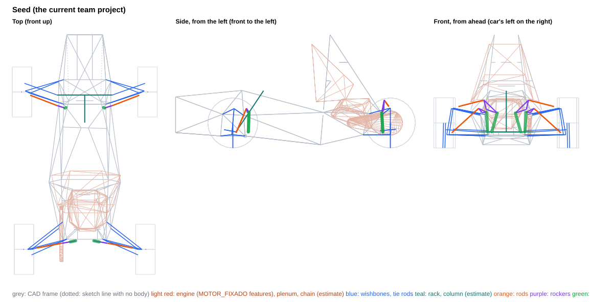
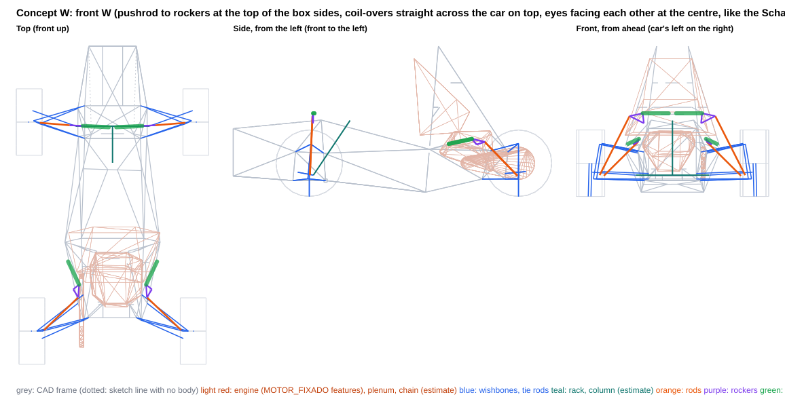

# Front W: coil-overs across the top of the front box (550 lb/in, MR 0.506)

Generated by `scripts/rocker_concepts.py build` from the `concept_*.json` files in this folder. Each concept is also saved as a project variant, `projects/FSAE_2027_rocker_concept_<id>.vdproj.json`, to open in VD Studio (Rocker page). The team project is unchanged.

**What this is:** the consequences of these layouts, side by side. **What it is not:** a choice -- the report recommends nothing. The axles are independent: a front from one concept and a rear from another combine without changing either.

- Frame: ISO 8855 (X forward, Y LEFT, Z up), mm, chassis-fixed; LEFT corner points (the right is the Y-mirror). Kinematics: `DWSolver` + `vdcore.analysis.rocker`.
- Motion ratio 0.506 at ride on every concept axle is a **query argument** so the concepts compare like for like (the MR target is still an open decision; the Seed column keeps its own layout). The coil-over is placed for equal droop/bump margins at ±25 mm; the rocker arms are tangential at ride unless the concept clocks them.
- Springs fitted (front / rear, lb/in): 550 / 550. Wheel rate = k·MR² at ride.
- MR and damper usage are over the ±25 mm design travel. Packaging, transmission angles and rocker rotation are over the **physical** range, to the damper's end stops (no bump rubber in the project) or to the concept's travel limit (a bump stop and droop limiter the concept adds) when it sets one, and for the front over the full rack travel (±38 mm).
- **Gaps are air gaps**: centreline distance minus both estimated radii. Both corners are checked against the CAD as built (the frame is not symmetric at the engine mounts).
- Engine: `MOTOR_FIXADO` placed on the car by a fit of its four mounts to the chassis tabs (worst residual 0.004 mm), modelled as convex hulls of its features (crankcase features, intake plenum); its scanned mesh is not in the survey, so parts of the engine outside those features are not represented.
- Chassis: CAD survey `Xasis 33.3`. 155 members, of which 4 are 3D-sketch lines with no weldment body (dotted in the views; they may not be real tubes, and are kept in the checks); 43 2D layout-sketch lines with no body (templates, ground and profile lines) are references, left out of the checks; 8 solid bodies without a centreline are kept as bounding boxes (a box overstates a diagonal tube, so ⚠ means 'look in CAD', not a clash). Bracket lengths are to bodied members only.
- **Estimates** (no CAD): coil-over OD 55 mm (full OD from 20 mm off each eye), eyes OD 40 mm; rod 16×1 mm steel; rocker envelope ±10 mm, pickup bolts ±20 mm; wishbone OD 20, tie rod OD 16, rack housing OD 40 mm, inner tie-rod joint and boot 50 mm OD from 60 mm inboard of the joint to 20 mm past it at full rack travel; steering column (-30, 0, 157) → (-300, 0, 560), OD 40; damper stroke 57 mm (estimate); drive shaft from the wheel centre to a joint at |y| = 120 mm on the axle line, OD 60; chain and sprockets on the engine's chain line (radii 45 / 120 mm); coil-over 1.3 kg and rocker 0.3 kg per corner (CG effect only).

## Thresholds behind the ✗ flags

Information, not requirements.

| check | limit |
|---|---|
| rod vs frame | ≥ 5 mm |
| rocker (plates, pickup bolts) vs frame | ≥ 5 mm |
| coil-over body vs frame | ≥ 5 mm |
| coil-over eyes vs frame | ≥ 5 mm |
| rod vs wishbones / tie rod / toe link (with steer) | ≥ 5 mm |
| rod vs rim (13", steered) | ≥ 15 mm |
| left vs right linkage (heave and roll) | ≥ 5 mm |
| linkage vs steering rack (housing, inner tie-rod joint and boot) (front) | ≥ 5 mm |
| linkage vs steering column (estimate) (front) | ≥ 5 mm |
| linkage vs drive shaft (estimate) (rear) | ≥ 10 mm |
| linkage vs engine (MOTOR_FIXADO features, placed) (rear) | ≥ 10 mm |
| linkage vs chain and sprockets (estimate) (rear) | ≥ 10 mm |
| rocker / coil-over vs wishbones, tie rod / toe link (with steer) | ≥ 5 mm |
| rod vs its own rocker (away from its pickup) and coil-over | ≥ 5 mm |
| linkage and reservoir vs driver space (leg template octagon, cockpit template) (front) | ≥ 5 mm |
| linkage and reservoir vs drivetrain keep-out (estimate) (rear) | ≥ 10 mm |
| damper reservoir (the best mounting) vs frame, wishbones, rod, the other corner | ≥ 5 mm |
| rocker hub vs frame and moving wishbones | ≥ 2 mm |
| chassis eye misalignment over the packaging range (spherical bearing, estimate) | ≤ 5 mm |
| rocker pivot to nearest bodied tube | ≤ 60 mm |
| coil-over chassis end to nearest bodied tube | ≤ 60 mm |
| rocker pivot to the nearest frame node (3+ tubes) | ≤ 60 mm |
| coil-over chassis end to the nearest frame node (3+ tubes) | ≤ 60 mm |
| rod transmission angle (over the packaging range) | ≤ 30 deg |
| coil-over transmission angle (over the packaging range) | ≤ 30 deg |
| rocker rotation (over the packaging range) | ≤ 35 deg |

## Front axle

| | Seed | Concept W |
|---|---|---|
| Rod type / mounted on | pushrod / LCA | pushrod / LCA |
| Rod in | compression | compression |
| MR droop / ride / bump (±25 mm) | 0.487 / 0.506 / 0.512 | 0.487 / 0.506 / 0.524 |
| MR progression, droop to bump [%] | +4.9 | +7.3 |
| Damper stroke used in ±25 mm [mm] (of 57, estimate) | 25.2 | 25.3 |
| Spring [lb/in] / wheel rate at ride [N/mm] / ride frequency [Hz] | 550.0 / 24.7 / 3.2 | 550.0 / 24.7 / 3.2 |
| Damper end stops, wheel travel [mm] | -58.7 .. +57.0 | -58.3 .. +54.7 |
| Packaging range, wheel travel [mm] (end stops, or the concept's travel limit) | -36.0 .. +36.0 | -36.0 .. +36.0 |
| Spring unseats at wheel travel [mm] (fitted spring, no preload) | -23.7 | -23.7 |
| Rocker rotation over the packaging range [deg] | -23.7 .. +23.1 | -14.6 .. +14.2 |
| Rocker arms rod / damper [mm] | 55 / 45 | 118 / 74 |
| Transmission angle max, rod / damper [deg] | 20.3 / 23.8 | 13.2 / 19.5 |
| Rod length [mm] | 369 | 489 |
| Rod inclination from horizontal / plan sweep [deg] | 40 / 21 | 63 / 5 |
| Rod force / wheel load | 1.64 | 1.23 |
| Rod force at ride [N] | 959 | 719 |
| Wheel load to buckle the rod [N] (16×1 steel) | 12037 | 9179 |
| Rocker pivot reaction at ride [N] | 1902 | 1050 |
| Bracket couple at ride, pivot / coil-over end [N·m] (upper bound: force × stand-off) | 60 / 51 | 49 / 55 |
| Gap: rod vs frame [mm] | 26.7 | 132.5 |
| Gap: rocker vs frame [mm] | 6.7 | 24.3 |
| Gap: coil-over body vs frame [mm] | 9.2 | 8.5 |
| Gap: coil-over eyes vs frame [mm] | 7.5 | 15.1 |
| Gap: rod vs wishbones / tie rod / toe link, with steer [mm] | 9.9 | 13.2 |
| Gap: rod vs rim, with steer [mm] (to the 13" bead-seat radius) | 34.8 | 63.6 |
| Gap: left vs right, heave and roll [mm] | 313.2 | 14.7 |
| Gap: linkage vs rack, inner tie-rod joint and boot [mm] | 73.9 | 143.6 |
| Gap: linkage vs steering column [mm] (estimate) | 145.0 | 204.4 |
| Gap: linkage vs solid bodies' bounding boxes [mm] | 3.7 | 9.9 |
| Rocker pivot to nearest bodied tube [mm] | 31.4 | 47.0 |
| Coil-over chassis end to nearest bodied tube [mm] | 43.8 | 47.8 |
| Rocker pivot to the nearest frame node (3+ tubes) [mm] | 47.4 | **84.1** ✗ |
| Coil-over chassis end to the nearest frame node (3+ tubes) [mm] | 55.6 | **148.1** ✗ |
| Gap: rocker / coil-over vs wishbones, tie rod / toe link, with steer [mm] | 25.6 | 209.9 |
| Gap: rod vs its own rocker (away from its pickup) and coil-over [mm] | 10.5 | 13.1 |
| Gap: linkage and reservoir vs driver space (leg / cockpit templates) [mm] | **-17.2** ✗ | 78.5 |
| Gap: damper reservoir, the best mounting [mm] | 10.1 | 45.3 |
| Reservoir clock about the damper axis at the chassis end [deg] | 30 | 0 |
| Chassis eye misalignment over the packaging range [deg] | 0.6 | 0.0 |
| Gap: rocker hub vs frame and wishbones [mm] | **-0.3** ✗ | 14.4 |
| Damper length change over the rack travel at fixed wheel-centre height [mm] (steering jacking + any mount coupling; information) | 2.70 | 2.86 |
| Rocker / coil-over centreline height range z [mm] | 158 .. 398 | 540 .. 617 |
| Coil-over + rocker mass height z [mm] | 271 | 599 |

## Rear axle

| | Seed | Concept W |
|---|---|---|
| Rod type / mounted on | pushrod / UCA | pushrod / LCA |
| Rod in | compression | compression |
| MR droop / ride / bump (±25 mm) | 0.496 / 0.506 / 0.512 | 0.504 / 0.506 / 0.505 |
| MR progression, droop to bump [%] | +3.1 | +0.1 |
| Damper stroke used in ±25 mm [mm] (of 57, estimate) | 25.3 | 25.3 |
| Spring [lb/in] / wheel rate at ride [N/mm] / ride frequency [Hz] | 550.0 / 24.7 / 2.9 | 550.0 / 24.7 / 2.9 |
| Damper end stops, wheel travel [mm] | -57.5 .. +56.0 | -56.4 .. +57.0 |
| Packaging range, wheel travel [mm] (end stops, or the concept's travel limit) | -36.0 .. +36.0 | -36.0 .. +36.0 |
| Spring unseats at wheel travel [mm] (fitted spring, no preload) | -30.0 | -30.0 |
| Rocker rotation over the packaging range [deg] | -9.2 .. +9.0 | -15.6 .. +15.2 |
| Rocker arms rod / damper [mm] | 94 / 115 | 72 / 69 |
| Transmission angle max, rod / damper [deg] | 3.5 / 11.3 | 14.7 / 21.4 |
| Rod length [mm] | 261 | 429 |
| Rod inclination from horizontal / plan sweep [deg] | 14 / 11 | 36 / 44 |
| Rod force / wheel load | 2.41 | 1.88 |
| Rod force at ride [N] | 1780 | 1390 |
| Wheel load to buckle the rod [N] (16×1 steel) | 16398 | 7772 |
| Rocker pivot reaction at ride [N] | 2818 | 1870 |
| Bracket couple at ride, pivot / coil-over end [N·m] (upper bound: force × stand-off) | 116 / 58 | 84 / 64 |
| Gap: rod vs frame [mm] | 71.5 | 20.0 |
| Gap: rocker vs frame [mm] | 16.2 | 7.6 |
| Gap: coil-over body vs frame [mm] | 10.8 | 7.0 |
| Gap: coil-over eyes vs frame [mm] | 6.9 | 11.0 |
| Gap: rod vs wishbones / tie rod / toe link, with steer [mm] | 19.4 | 7.0 |
| Gap: rod vs rim, with steer [mm] (to the 13" bead-seat radius) | — | 63.3 |
| Gap: left vs right, heave and roll [mm] | 124.5 | 434.4 |
| Gap: linkage vs drive shaft [mm] (estimate) | 20.5 | 30.8 |
| Gap: linkage vs engine (MOTOR_FIXADO features, on its mounts) [mm] | 75.2 | 25.9 |
| Gap: linkage vs solid bodies' bounding boxes [mm] | 542.6 | 222.6 |
| Rocker pivot to nearest bodied tube [mm] | 41.1 | 45.1 |
| Coil-over chassis end to nearest bodied tube [mm] | 39.6 | 43.7 |
| Rocker pivot to the nearest frame node (3+ tubes) [mm] | 53.5 | **118.2** ✗ |
| Coil-over chassis end to the nearest frame node (3+ tubes) [mm] | 52.1 | **149.9** ✗ |
| Gap: rocker / coil-over vs wishbones, tie rod / toe link, with steer [mm] | 12.1 | 34.8 |
| Gap: rod vs its own rocker (away from its pickup) and coil-over [mm] | 16.3 | 12.8 |
| Gap: linkage and reservoir vs drivetrain keep-out [mm] (estimate) | **-95.7** ✗ | 111.5 |
| Gap: damper reservoir, the best mounting [mm] | **-18.1** ✗ | 14.2 |
| Reservoir clock about the damper axis at the chassis end [deg] | 0 | 0 |
| Chassis eye misalignment over the packaging range [deg] | 0.0 | 0.0 |
| Gap: rocker hub vs frame and wishbones [mm] | **0.4** ✗ | 4.2 |
| Gap: linkage vs chain and sprockets [mm] (estimate) | 11.4 | 35.4 |
| Rocker / coil-over centreline height range z [mm] | 158 .. 471 | 383 .. 427 |
| Coil-over + rocker mass height z [mm] | 274 | 402 |

## Car level

| | Seed | W |
|---|---|---|
| Springs-only roll gradient [deg/g] (each column's springs) | 1.21 | 1.21 |
| ARB needed for 1.0 deg/g at 50/50, F / R [N·m/deg] | 57 / 78 | 57 / 78 |
| CG height change vs seed [mm] (estimate) | +0.0 | +4.6 |
| Tilt-table tip angle [deg] (seed 62.13) | 62.13 | 61.79 |

Wheel rates, frequencies and the roll budget follow from each column's springs and ride MR; where those match, they only move with the MR progression and are listed to show that, not as a difference between the layouts. The spring unseating row is the same story: with no preload the spring comes off its seat at its static compression divided by the MR, whatever the layout.

## Seed: the current team project

| point (LEFT corner) | front | rear |
|---|---|---|
| rod outer end (on the mount body) | (-31.7, 533.6, 148.6) | (-1526.2, 467.7, 405.2) |
| rocker pivot | (-143.0, 236.4, 345.7) | (-1475.8, 196.0, 377.4) |
| rocker axis (unit) | (-0.9455, 0.3222, -0.0480) | (-0.9831, -0.1827, 0.0051) |
| rocker rod pickup | (-133.4, 270.6, 387.4) | (-1479.6, 218.7, 468.9) |
| rocker damper pickup | (-157.7, 193.6, 349.0) | (-1456.0, 88.4, 342.3) |
| coil-over chassis end | (-151.7, 183.0, 157.8) | (-1466.8, 141.2, 158.5) |
| rod type / mount body | pushrod / lca | pushrod / uca |

**Where the tightest numbers are:**

- front gap rod frame: 26.7 mm — FRONTO HO (-104, 245, 344)->(-89, 159, 556), L at +36 mm
- front gap rocker frame: 6.7 mm — FRONTO HO (-104, 245, 344)->(-89, 159, 556), L at +36 mm
- front gap coilover frame: 9.2 mm — PSD (-106, 255, 320)->(-120, 205, 117), L at -36 mm
- front gap rod members: 9.9 mm — UCA rear leg at +36 mm, rack +38
- front gap rod linkage: 10.5 mm — rocker arm to the rod pickup at +36 mm
- front gap rod rim: 34.8 mm — at -26 mm, rack +38
- front gap solid bodies: 3.7 mm — rocker vs 'Ressalto-extrusão1' box, L at -5 mm
- front gap driver: -17.2 mm — coil-over vs leg template at +5 mm
- front gap reservoir: 10.1 mm — body at the chassis end, side -, clocked 30 deg: Tri_Meio (-106, 251, 319)->(-857, 230, 32), L at +5 mm (unclocked: body at the chassis end, side + -49.9, body at the chassis end, side - -8.3, body at the rocker end, side + -23.3, body at the rocker end, side - -49.2 mm)
- front gap hub: -0.3 mm — FRONTO HO (-104, 245, 344)->(-89, 159, 556) (L)
- front pivot bracket: 31.4 mm — Tri_Meio (-106, 251, 319)->(-884, 350, 348) (L), foot 36 mm from its nearer end
- front damper bracket: 43.8 mm — 3DSketch3 (-120, -205, 117)->(-352, -35, 91) (R), foot 34 mm from its nearer end
- front pivot node: 47.4 mm — node (-106, -250, 319) (R), 5 tube ends: FRONTO HO, PSD, Tri_Meio
- front damper node: 55.6 mm — node (-120, 205, 117) (L), 7 tube ends: 3DSketch3, PSD, Tri_Frente, Tri_Meio, assoalho frontal
- rear gap rod frame: 71.5 mm — Tri_Tras (-951, -116, 1108)->(-1461, -210, 328), R at +36 mm
- rear gap rocker frame: 16.2 mm — 3DSketch7 (-1461, 210, 328)->(-1326, 73, 467), L at +36 mm
- rear gap coilover frame: 10.8 mm — PST (-1441, 175, 129)->(-1464, 209, 328), L at +36 mm
- rear gap rod members: 19.4 mm — UCA rear leg at -36 mm, rack +0
- rear gap rod linkage: 16.3 mm — rocker arm to the rod pickup at +36 mm
- rear gap engine: 75.2 mm — rocker vs engine (features), R at +5 mm
- rear gap solid bodies: 542.6 mm — rocker vs 'Ressalto-extrusão3' box, L at +36 mm
- rear gap drivetrain: -95.7 mm — coil-over at -26 mm
- rear gap reservoir: -18.1 mm — body at the chassis end, side -: drivetrain: reservoir at -5 mm (unclocked: body at the chassis end, side + -94.9, body at the rocker end, side + -36.7, body at the rocker end, side - -93.1 mm)
- rear gap hub: 0.4 mm — Tri_Tras (-1461, 210, 328)->(-951, 116, 1108) (L)
- rear pivot bracket: 41.1 mm — Tri_Tras (-1461, 210, 328)->(-951, 116, 1108) (L), foot 34 mm from its nearer end
- rear damper bracket: 39.6 mm — PST (-1441, 175, 129)->(-1441, -175, 129) (L), foot 34 mm from its nearer end
- rear pivot node: 53.5 mm — node (-1461, 210, 328) (L), 6 tube ends: 3DSketch7, PST, Tri_Tras
- rear damper node: 52.1 mm — node (-1441, 175, 129) (L), 5 tube ends: 3DSketch6, PST

**Outside the thresholds:** front linkage and reservoir vs driver space (leg template octagon, cockpit template) -17.2 (limit ≥ 5); front rocker hub vs frame and moving wishbones -0.3 (limit ≥ 2); rear linkage and reservoir vs drivetrain keep-out (estimate) -95.7 (limit ≥ 10); rear damper reservoir (the best mounting) vs frame, wishbones, rod, the other corner -18.1 (limit ≥ 5); rear rocker hub vs frame and moving wishbones 0.4 (limit ≥ 2)

## Concept W: front W (pushrod to rockers at the top of the box sides, coil-overs straight across the car on top, eyes facing each other at the centre, like the Schanzer SR 26); rear R1 (as concept X)

Front W, as sketched by the team: each pushrod and its coil-over lie in one plane across the car (pushrod 4.9 deg off it in plan view, coil-over 3 deg), just ahead of the front hoop. A steep pushrod (63 deg from horizontal, 489 mm) from a clevis on the LCA rear leg up to a rocker at the top of the box side, on a bracket on the tube from the UCA front node to the hoop's upper corner (47.1 mm from it, 84.1 mm from that corner node); the coil-over runs straight across the top, outside the bodywork, to an eye on a bracket off the hoop's top bar (47.8 mm from it), 27 mm from the centreline: the two eyes face each other 55 mm apart. It is the team's revised concept X front (2026-11-04) refined so both brackets are within 60 mm of a tube (X's eye was 65.8 mm). No physical interference; the evaluator's only flags at the front are the node distances (84.1 / 148.1 mm, limit 60). Rear R1, as concept X.

| point (LEFT corner) | front | rear |
|---|---|---|
| rod outer end (on the mount body) | (-4.8, 535.8, 157.1) | (-1532.4, 504.8, 152.5) |
| rocker pivot | (-27.7, 210.6, 539.6) | (-1232.3, 289.4, 382.9) |
| rocker axis (unit) | (-0.9986, 0.0491, -0.0182) | (0.1345, -0.6303, -0.7646) |
| rocker rod pickup | (-23.5, 315.3, 592.8) | (-1291.3, 252.7, 402.8) |
| rocker damper pickup | (-28.6, 218.8, 612.7) | (-1197.2, 246.8, 424.2) |
| coil-over chassis end | (-38.1, 27.3, 612.5) | (-1027.3, 327.3, 387.8) |
| rod type / mount body | pushrod / lca | pushrod / lca |

**Where the tightest numbers are:**

- front gap rod frame: 132.5 mm — Tri_Frente (560, 175, 500)->(-88, 156, 563) (sketch only), L at +36 mm
- front gap rocker frame: 24.3 mm — Tri_Frente (101, 255, 330)->(-88, 156, 563), L at -36 mm
- front gap coilover frame: 8.5 mm — FRONTO HO (-85, 85, 606)->(-85, -85, 606), L at -36 mm
- front gap rod members: 13.2 mm — UCA rear leg at -36 mm, rack -38
- front gap rod linkage: 13.1 mm — rocker arm to the rod pickup at +36 mm
- front gap rod rim: 63.6 mm — at +36 mm, rack +38
- front gap solid bodies: 9.9 mm — coil-over vs 'Size_a_1pol_2,65mm SIZE_A_1POL-2,65MM(16)[4]' box, L at +15 mm
- front gap driver: 78.5 mm — rocker vs leg template at -36 mm
- front gap reservoir: 45.3 mm — body at the rocker end, side -: FRONTO HO (-85, 85, 606)->(-85, -85, 606), L at +36 mm (unclocked: body at the chassis end, side + 42.0, body at the chassis end, side - -28.3, body at the rocker end, side + -29.2 mm)
- front gap hub: 14.4 mm — Tri_Frente (101, 255, 330)->(-88, 156, 563) (L)
- front pivot bracket: 47.0 mm — Tri_Frente (101, 255, 330)->(-88, 156, 563) (L), foot 71 mm from its nearer end
- front damper bracket: 47.8 mm — FRONTO HO (-85, 85, 606)->(-85, -85, 606) (L), foot 58 mm from its nearer end
- front pivot node: 84.1 mm — node (-89, 157, 561) (L), 4 tube ends: FRONTO HO, Tri_Frente, Tri_Meio
- front damper node: 148.1 mm — node (-89, 157, 561) (L), 4 tube ends: FRONTO HO, Tri_Frente, Tri_Meio
- rear gap rod frame: 20.0 mm — Tri_Tras (-1336, 255, 337)->(-884, 350, 348), L at -36 mm
- rear gap rocker frame: 7.6 mm — 3DSketch8 (-1063, 194, 399)->(-1336, 255, 337), L at -36 mm
- rear gap coilover frame: 7.0 mm — Tri_Tras (-1336, 255, 337)->(-884, 350, 348), L at +36 mm
- rear gap rod members: 7.0 mm — UCA front leg at -5 mm, rack +0
- rear gap rod linkage: 12.8 mm — rocker arm to the rod pickup at +36 mm
- rear gap rod rim: 63.3 mm — at +36 mm, rack +0
- rear gap engine: 25.9 mm — rocker vs engine (features), R at -36 mm
- rear gap solid bodies: 222.6 mm — eyes vs 'Ressalto-extrusão1' box, L at -36 mm
- rear gap drivetrain: 111.5 mm — rocker at -5 mm
- rear gap reservoir: 14.2 mm — body at the chassis end, side +: 3DSketch8 (-1034, -218, 382)->(-1034, -268, 382), R at +36 mm (unclocked: body at the chassis end, side - 7.4, body at the rocker end, side + 7.5, body at the rocker end, side - 10.6 mm)
- rear gap hub: 4.2 mm — Tri_Tras (-1336, 255, 337)->(-884, 350, 348) (L)
- rear pivot bracket: 45.1 mm — Tri_Tras (-1336, 255, 337)->(-884, 350, 348) (L), foot 109 mm from its nearer end
- rear damper bracket: 43.7 mm — Tri_Tras (-1336, 255, 337)->(-884, 350, 348) (L), foot 144 mm from its nearer end
- rear pivot node: 118.2 mm — node (-1336, 255, 337) (L), 4 tube ends: 3DSketch8, PST, Tri_Tras
- rear damper node: 149.9 mm — node (-884, 349, 348) (L), 7 tube ends: 3DSketch8, MH esb, Tri_Meio, Tri_Tras

**Outside the thresholds:** front rocker pivot to the nearest frame node (3+ tubes) 84.1 (limit ≤ 60); front coil-over chassis end to the nearest frame node (3+ tubes) 148.1 (limit ≤ 60); rear rocker pivot to the nearest frame node (3+ tubes) 118.2 (limit ≤ 60); rear coil-over chassis end to the nearest frame node (3+ tubes) 149.9 (limit ≤ 60)

**Pros**

- Front W: the lowest front loads so far: rod 719 N at ride (1.23x the wheel load), pivot reaction 1050 N, bracket couples up to 49 / 55 N·m. MR 0.487 / 0.506 / 0.524 over +-25 mm (+7.3 %, rising in bump). The pushrod buckles at 9.2 kN of wheel load.
- Front W: robust to 5 mm moves: pivot 1 of 6 directions broke a threshold (left vs right), damper end 1 (coil-over vs the hoop's top bar), rod mount 0 (node distances left out). Far from the driver space, the rack and the column.
- Front W: rockers and coil-overs on top of the box, reachable without removing bodywork; the reservoir sits with the body at the chassis end (42.0 mm clear).
- Rear R1: the furthest of the set from the chain estimate (35.4 mm) and the drivetrain keep-out (111.5 mm); engine features 25.9 mm, drive shaft 30.8 mm. MR flat: 0.504 / 0.506 / 0.505 (+0.1 %). Rod 1390 N, pivot 1870 N at ride.
- Rear R1: rocker and coil-over between z 367 and 447 mm and outboard of |y| = 217 mm: above the chain estimate and outboard of the engine.

**Cons**

- Front W: neither bracket is at a node: the rocker pivot is 84.1 mm and the coil-over eye 148.1 mm from the hoop's upper corner node (flagged, limit 60 mm); the eye bracket comes off the hoop's top bar 58 mm from its bend, so the coil-over force goes into the front hoop in bending (up to 55 N·m). The front hoop is primary structure: a bracket there is the chassis team's and the rules' call.
- Front W: mounted high: rockers and coil-overs between z 540 and 617 mm (moving mass at z 599 mm), just ahead of the hoop (x -23 to -38 mm), where the steering wheel, dash and the driver's sight line are (not modelled). Tightest gaps: coil-over vs the hoop's top bar 8.5 mm, rod vs UCA rear leg 13.2 mm, rocker hub 14.4 mm, eyes left vs right 14.7 mm.
- Rear R1: rocker and coil-over eye both on brackets at mid-span of the upper side rail, 118 and 150 mm from nodes (flagged, limit 60 mm), with bracket couples up to 84 / 64 N·m into that rail. The LCA rear leg carries the clevis 58.8 mm from the ball joint: about 46 N·m of bending at ride (87 MPa, hand estimate). Tightest gaps: rocker hub 4.2 mm (limit 2), coil-over vs the rail 7.0 mm, rod vs UCA front leg 7.0 mm. 5 mm moves: pivot 3 of 6 directions broke a threshold, damper end 1, rod mount 0 (node distances left out).

**Not checked**

- The +-36 mm travel limit is a design input (design_intent): a bump stop and a droop limiter that are not in the project. With them each damper keeps about 10 mm at each end (it uses about 36.5 of its 57 mm stroke, an estimate).
- Damping: the damper moves 0.506 mm per mm of wheel instead of 0.80, so the same valving gives (0.506/0.80)^2 = 40 % of today's damping at the wheel. Damping is outside this tool.
- Structure: no load cases, stress, fatigue or sizing of rockers, brackets, clevises, rods or wishbones. Leg-bending figures are hand estimates (simply supported leg, rod force at ride, 25.4x1.2 tube); bracket couples are upper bounds.
- With no preload the springs come off their seats at -23.7 mm (front) and -30.0 mm (rear) of wheel travel, inside the +-36 mm range.
- Envelopes: spring OD 55 mm, 220 mm eye to eye and 260 mm overall are from the coil-over drawing; the piggyback reservoir (OD 38 mm, 50 mm off the axis) is scaled from that drawing (estimate). Rod, rocker plates and bolts, rocker hub, wishbone and frame tube sizes are estimates. Bodywork, the steering wheel and dash, and the driver beyond the template sketches are not modelled.
- Drivetrain: the chain, sprockets, differential and drive shafts are estimates (no CAD). The chain estimate itself passes through four rear-box tubes (front post -27.3 mm, top rail -25.0 mm, diagonal -14.2 mm, rear post -10.3 mm), so the real chain path differs from it; each rear here needs a check against the real drivetrain.
