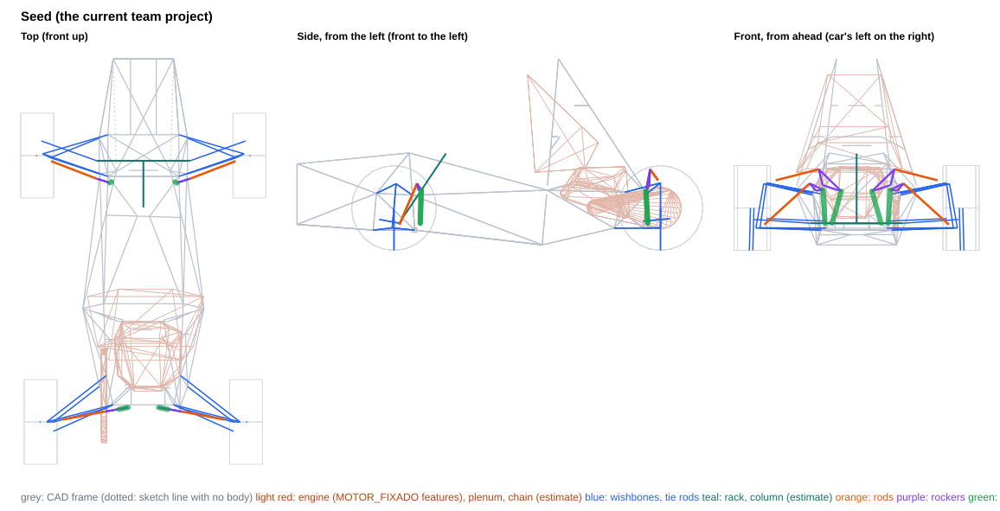
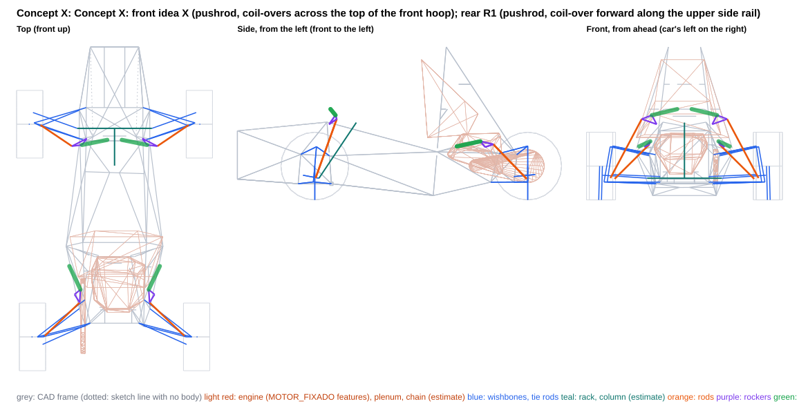
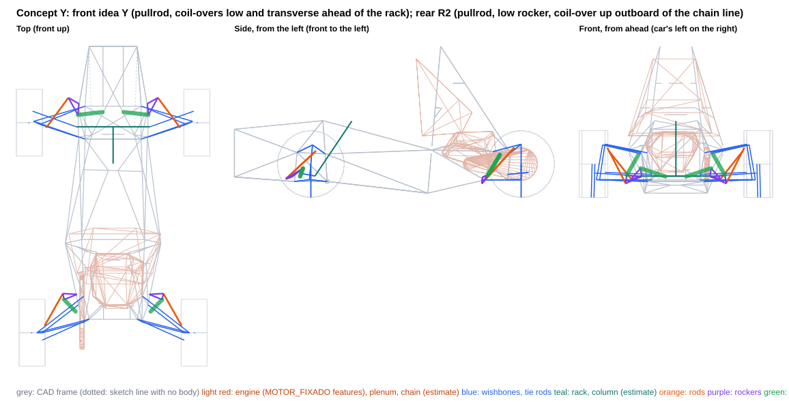
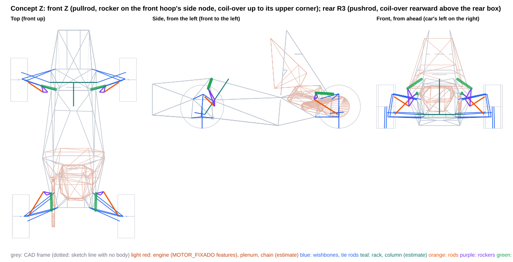

# Front ideas X, Y, Z and three rears (550 lb/in, MR 0.506)

Generated by `scripts/rocker_concepts.py build` from the `concept_*.json` files in this folder. Each concept is also saved as a project variant, `projects/FSAE_2027_rocker_concept_<id>.vdproj.json`, to open in VD Studio (Rocker page). The team project is unchanged.

**What this is:** the consequences of these layouts, side by side. **What it is not:** a choice -- the report recommends nothing. The axles are independent: a front from one concept and a rear from another combine without changing either.

- Frame: ISO 8855 (X forward, Y LEFT, Z up), mm, chassis-fixed; LEFT corner points (the right is the Y-mirror). Kinematics: `DWSolver` + `vdcore.analysis.rocker`.
- Motion ratio 0.506 at ride on every concept axle is a **query argument** so the concepts compare like for like (the MR target is still an open decision; the Seed column keeps its own layout). The coil-over is placed for equal droop/bump margins at ±25 mm; the rocker arms are tangential at ride unless the concept clocks them.
- Springs fitted (front / rear, lb/in): 550 / 550. Wheel rate = k·MR² at ride.
- MR and damper usage are over the ±25 mm design travel. Packaging, transmission angles and rocker rotation are over the **physical** range, to the damper's end stops (no bump rubber in the project) or to the concept's travel limit (a bump stop and droop limiter the concept adds) when it sets one, and for the front over the full rack travel (±38 mm).
- **Gaps are air gaps**: centreline distance minus both estimated radii. Both corners are checked against the CAD as built (the frame is not symmetric at the engine mounts).
- Engine: `MOTOR_FIXADO` placed on the car by a fit of its four mounts to the chassis tabs (worst residual 0.004 mm), modelled as convex hulls of its features (crankcase features, intake plenum); its scanned mesh is not in the survey, so parts of the engine outside those features are not represented.
- Chassis: CAD survey `Xasis 33.3`. 155 members, of which 4 are 3D-sketch lines with no weldment body (dotted in the views; they may not be real tubes, and are kept in the checks); 43 2D layout-sketch lines with no body (templates, ground and profile lines) are references, left out of the checks; 8 solid bodies without a centreline are kept as bounding boxes (a box overstates a diagonal tube, so ⚠ means 'look in CAD', not a clash). Bracket lengths are to bodied members only.
- **Estimates** (no CAD): coil-over OD 55 mm (full OD from 20 mm off each eye), eyes OD 40 mm; rod 16×1 mm steel; rocker envelope ±10 mm, pickup bolts ±20 mm; wishbone OD 20, tie rod OD 16, rack housing OD 40 mm, inner tie-rod joint and boot 50 mm OD from 60 mm inboard of the joint to 20 mm past it at full rack travel; steering column (-30, 0, 157) → (-300, 0, 560), OD 40; damper stroke 57 mm (estimate); drive shaft from the wheel centre to a joint at |y| = 120 mm on the axle line, OD 60; chain and sprockets on the engine's chain line (radii 45 / 120 mm); coil-over 1.3 kg and rocker 0.3 kg per corner (CG effect only).

## Thresholds behind the ✗ flags

Information, not requirements.

| check | limit |
|---|---|
| rod vs frame | ≥ 5 mm |
| rocker (plates, pickup bolts) vs frame | ≥ 5 mm |
| coil-over body vs frame | ≥ 5 mm |
| coil-over eyes vs frame | ≥ 5 mm |
| rod vs wishbones / tie rod / toe link (with steer) | ≥ 5 mm |
| rod vs rim (13", steered) | ≥ 15 mm |
| left vs right linkage (heave and roll) | ≥ 5 mm |
| linkage vs steering rack (housing, inner tie-rod joint and boot) (front) | ≥ 5 mm |
| linkage vs steering column (estimate) (front) | ≥ 5 mm |
| linkage vs drive shaft (estimate) (rear) | ≥ 10 mm |
| linkage vs engine (MOTOR_FIXADO features, placed) (rear) | ≥ 10 mm |
| linkage vs chain and sprockets (estimate) (rear) | ≥ 10 mm |
| rocker / coil-over vs wishbones, tie rod / toe link (with steer) | ≥ 5 mm |
| rod vs its own rocker (away from its pickup) and coil-over | ≥ 5 mm |
| linkage and reservoir vs driver space (leg template octagon, cockpit template) (front) | ≥ 5 mm |
| linkage and reservoir vs drivetrain keep-out (estimate) (rear) | ≥ 10 mm |
| damper reservoir (the better of its two sides) vs frame, wishbones, rod | ≥ 5 mm |
| rocker hub vs frame and moving wishbones | ≥ 2 mm |
| chassis eye misalignment over the packaging range (spherical bearing, estimate) | ≤ 5 mm |
| rocker pivot to nearest bodied tube | ≤ 60 mm |
| coil-over chassis end to nearest bodied tube | ≤ 60 mm |
| rocker pivot to the nearest frame node (3+ tubes) | ≤ 60 mm |
| coil-over chassis end to the nearest frame node (3+ tubes) | ≤ 60 mm |
| rod transmission angle (over the packaging range) | ≤ 30 deg |
| coil-over transmission angle (over the packaging range) | ≤ 30 deg |
| rocker rotation (over the packaging range) | ≤ 35 deg |

## Front axle

| | Seed | Concept X | Concept Y | Concept Z |
|---|---|---|---|---|
| Rod type / mounted on | pushrod / LCA | pushrod / LCA | pullrod / UCA | pullrod / UCA |
| Rod in | compression | compression | tension | tension |
| MR droop / ride / bump (±25 mm) | 0.487 / 0.506 / 0.512 | 0.479 / 0.506 / 0.538 | 0.489 / 0.506 / 0.528 | 0.476 / 0.506 / 0.536 |
| MR progression, droop to bump [%] | +4.9 | +11.5 | +7.7 | +11.8 |
| Damper stroke used in ±25 mm [mm] (of 57, estimate) | 25.2 | 25.3 | 25.3 | 25.3 |
| Spring [lb/in] / wheel rate at ride [N/mm] / ride frequency [Hz] | 550.0 / 24.7 / 3.2 | 550.0 / 24.7 / 3.2 | 550.0 / 24.7 / 3.2 | 550.0 / 24.7 / 3.2 |
| Damper end stops, wheel travel [mm] | -58.7 .. +57.0 | -59.1 .. +53.4 | -58.0 .. +54.2 | -59.8 .. +53.7 |
| Packaging range, wheel travel [mm] (end stops, or the concept's travel limit) | -36.0 .. +36.0 | -36.0 .. +36.0 | -36.0 .. +36.0 | -36.0 .. +36.0 |
| Spring unseats at wheel travel [mm] (fitted spring, no preload) | -23.7 | -23.7 | -23.7 | -23.7 |
| Rocker rotation over the packaging range [deg] | -23.7 .. +23.1 | -12.8 .. +12.5 | -10.8 .. +10.8 | -6.4 .. +6.9 |
| Rocker arms rod / damper [mm] | 55 / 45 | 127 / 87 | 90 / 104 | 94 / 157 |
| Transmission angle max, rod / damper [deg] | 20.3 / 23.8 | 12.1 / 28.1 | 10.3 / 28.7 | 2.3 / 6.8 |
| Rod length [mm] | 369 | 507 | 342 | 228 |
| Rod inclination from horizontal / plan sweep [deg] | 40 / 21 | 57 / 34 | 37 / 54 | 28 / 34 |
| Rod force / wheel load | 1.64 | 1.30 | 2.13 | 3.30 |
| Rod force at ride [N] | 959 | 758 | 1248 | 1928 |
| Wheel load to buckle the rod [N] (16×1 steel) | 12037 | 8076 | n/a | n/a |
| Rocker pivot reaction at ride [N] | 1902 | 959 | 2219 | 2644 |
| Bracket couple at ride, pivot / coil-over end [N·m] (upper bound: force × stand-off) | 60 / 51 | 36 / 68 | 95 / 54 | 97 / 47 |
| Gap: rod vs frame [mm] | 26.7 | 114.7 | 97.5 | 81.4 |
| Gap: rocker vs frame [mm] | 6.7 | 15.2 | 5.4 | 13.9 |
| Gap: coil-over body vs frame [mm] | 9.2 | 14.2 | 6.1 | 12.1 |
| Gap: coil-over eyes vs frame [mm] | 7.5 | 26.3 | 14.1 | 8.1 |
| Gap: rod vs wishbones / tie rod / toe link, with steer [mm] | 9.9 | 8.3 | 31.0 | 14.2 |
| Gap: rod vs rim, with steer [mm] (to the 13" bead-seat radius) | 34.8 | 49.3 | 32.0 | 18.9 |
| Gap: left vs right, heave and roll [mm] | 313.2 | 65.0 | 114.2 | 365.1 |
| Gap: linkage vs rack, inner tie-rod joint and boot [mm] | 73.9 | 141.1 | 46.9 | 91.8 |
| Gap: linkage vs steering column [mm] (estimate) | 145.0 | 168.3 | 92.9 | 216.9 |
| Gap: linkage vs solid bodies' bounding boxes [mm] | 3.7 | 3.8 | **-27.5** ⚠ | 12.1 |
| Rocker pivot to nearest bodied tube [mm] | 31.4 | 37.9 | 42.9 | 36.6 |
| Coil-over chassis end to nearest bodied tube [mm] | 43.8 | 59.0 | 46.8 | 40.8 |
| Rocker pivot to the nearest frame node (3+ tubes) [mm] | 47.4 | 48.4 | 59.2 | 53.4 |
| Coil-over chassis end to the nearest frame node (3+ tubes) [mm] | 55.6 | **144.4** ✗ | 56.4 | 49.6 |
| Gap: rocker / coil-over vs wishbones, tie rod / toe link, with steer [mm] | 25.6 | 212.5 | 20.2 | 8.1 |
| Gap: rod vs its own rocker (away from its pickup) and coil-over [mm] | 10.5 | 13.5 | 14.3 | 17.3 |
| Gap: linkage and reservoir vs driver space (leg / cockpit templates) [mm] | **-17.2** ✗ | 17.8 | 11.7 | 61.5 |
| Gap: damper reservoir, the best mounting [mm] | 10.1 | 13.1 | 12.6 | 84.1 |
| Reservoir clock about the damper axis at the chassis end [deg] | 30 | 0 | 120 | 0 |
| Chassis eye misalignment over the packaging range [deg] | 0.6 | 0.0 | 2.0 | 0.0 |
| Gap: rocker hub vs frame and wishbones [mm] | **-0.3** ✗ | 6.7 | 2.6 | 3.4 |
| Damper length change over the rack travel at fixed wheel-centre height [mm] (steering jacking + any mount coupling; information) | 2.70 | 2.98 | 2.90 | 2.95 |
| Rocker / coil-over centreline height range z [mm] | 158 .. 398 | 548 .. 658 | 126 .. 215 | 245 .. 556 |
| Coil-over + rocker mass height z [mm] | 271 | 619 | 178 | 470 |

## Rear axle

| | Seed | Concept X | Concept Y | Concept Z |
|---|---|---|---|---|
| Rod type / mounted on | pushrod / UCA | pushrod / LCA | pullrod / UCA | pushrod / LCA |
| Rod in | compression | compression | tension | compression |
| MR droop / ride / bump (±25 mm) | 0.496 / 0.506 / 0.512 | 0.504 / 0.506 / 0.505 | 0.505 / 0.506 / 0.506 | 0.496 / 0.506 / 0.532 |
| MR progression, droop to bump [%] | +3.1 | +0.1 | +0.1 | +7.2 |
| Damper stroke used in ±25 mm [mm] (of 57, estimate) | 25.3 | 25.3 | 25.3 | 25.4 |
| Spring [lb/in] / wheel rate at ride [N/mm] / ride frequency [Hz] | 550.0 / 24.7 / 2.9 | 550.0 / 24.7 / 2.9 | 550.0 / 24.7 / 2.9 | 550.0 / 24.7 / 2.9 |
| Damper end stops, wheel travel [mm] | -57.5 .. +56.0 | -56.4 .. +57.0 | -56.4 .. +56.4 | -56.6 .. +53.4 |
| Packaging range, wheel travel [mm] (end stops, or the concept's travel limit) | -36.0 .. +36.0 | -36.0 .. +36.0 | -36.0 .. +36.0 | -36.0 .. +36.0 |
| Spring unseats at wheel travel [mm] (fitted spring, no preload) | -30.0 | -30.0 | -30.0 | -30.0 |
| Rocker rotation over the packaging range [deg] | -9.2 .. +9.0 | -15.6 .. +15.2 | -10.3 .. +10.1 | -15.4 .. +15.7 |
| Rocker arms rod / damper [mm] | 94 / 115 | 72 / 69 | 115 / 104 | 59 / 71 |
| Transmission angle max, rod / damper [deg] | 3.5 / 11.3 | 14.7 / 21.4 | 8.1 / 16.1 | 18.8 / 30.0 |
| Rod length [mm] | 261 | 429 | 379 | 356 |
| Rod inclination from horizontal / plan sweep [deg] | 14 / 11 | 36 / 44 | 44 / 61 | 28 / 58 |
| Rod force / wheel load | 2.41 | 1.88 | 1.78 | 2.27 |
| Rod force at ride [N] | 1780 | 1390 | 1315 | 1680 |
| Wheel load to buckle the rod [N] (16×1 steel) | 16398 | 7772 | n/a | 9339 |
| Rocker pivot reaction at ride [N] | 2818 | 1870 | 1143 | 2952 |
| Bracket couple at ride, pivot / coil-over end [N·m] (upper bound: force × stand-off) | 116 / 58 | 84 / 64 | 48 / 60 | 128 / 88 |
| Gap: rod vs frame [mm] | 71.5 | 20.0 | 124.1 | 35.4 |
| Gap: rocker vs frame [mm] | 16.2 | 7.6 | 19.3 | 5.5 |
| Gap: coil-over body vs frame [mm] | 10.8 | 7.0 | 14.6 | 5.4 |
| Gap: coil-over eyes vs frame [mm] | 6.9 | 11.0 | 8.2 | 14.4 |
| Gap: rod vs wishbones / tie rod / toe link, with steer [mm] | 19.4 | 7.0 | 32.1 | 27.1 |
| Gap: rod vs rim, with steer [mm] (to the 13" bead-seat radius) | — | 63.3 | 20.8 | 68.5 |
| Gap: left vs right, heave and roll [mm] | 124.5 | 434.4 | 507.9 | 440.5 |
| Gap: linkage vs drive shaft [mm] (estimate) | 20.5 | 30.8 | 78.4 | 39.6 |
| Gap: linkage vs engine (MOTOR_FIXADO features, on its mounts) [mm] | 75.2 | 25.9 | 89.9 | 33.5 |
| Gap: linkage vs solid bodies' bounding boxes [mm] | 542.6 | 222.6 | 432.5 | 451.3 |
| Rocker pivot to nearest bodied tube [mm] | 41.1 | 45.1 | 42.0 | 43.2 |
| Coil-over chassis end to nearest bodied tube [mm] | 39.6 | 43.7 | 40.9 | **60.3** ✗ |
| Rocker pivot to the nearest frame node (3+ tubes) [mm] | 53.5 | **118.2** ✗ | 54.9 | **62.1** ✗ |
| Coil-over chassis end to the nearest frame node (3+ tubes) [mm] | 52.1 | **149.9** ✗ | 58.0 | **72.2** ✗ |
| Gap: rocker / coil-over vs wishbones, tie rod / toe link, with steer [mm] | 12.1 | 34.8 | 7.3 | 14.1 |
| Gap: rod vs its own rocker (away from its pickup) and coil-over [mm] | 16.3 | 12.8 | 7.0 | 11.5 |
| Gap: linkage and reservoir vs drivetrain keep-out [mm] (estimate) | **-95.7** ✗ | 111.5 | 94.4 | 60.2 |
| Gap: damper reservoir, the best mounting [mm] | **-18.1** ✗ | 14.2 | 20.3 | 27.9 |
| Reservoir clock about the damper axis at the chassis end [deg] | 0 | 0 | 0 | 60 |
| Chassis eye misalignment over the packaging range [deg] | 0.0 | 0.0 | 0.0 | 1.9 |
| Gap: rocker hub vs frame and wishbones [mm] | **0.4** ✗ | 4.2 | 5.9 | 2.7 |
| Gap: linkage vs chain and sprockets [mm] (estimate) | 11.4 | 35.4 | 12.0 | 10.8 |
| Rocker / coil-over centreline height range z [mm] | 158 .. 471 | 383 .. 427 | 89 .. 313 | 320 .. 401 |
| Coil-over + rocker mass height z [mm] | 274 | 402 | 222 | 387 |

## Car level

| | Seed | X | Y | Z |
|---|---|---|---|---|
| Springs-only roll gradient [deg/g] (each column's springs) | 1.21 | 1.21 | 1.21 | 1.21 |
| ARB needed for 1.0 deg/g at 50/50, F / R [N·m/deg] | 57 / 78 | 57 / 78 | 57 / 78 | 57 / 78 |
| CG height change vs seed [mm] (estimate) | +0.0 | +4.8 | -1.5 | +3.2 |
| Tilt-table tip angle [deg] (seed 62.13) | 62.13 | 61.77 | 62.24 | 61.90 |

Wheel rates, frequencies and the roll budget follow from each column's springs and ride MR; where those match, they only move with the MR progression and are listed to show that, not as a difference between the layouts. The spring unseating row is the same story: with no preload the spring comes off its seat at its static compression divided by the MR, whatever the layout.

## Seed: the current team project

| point (LEFT corner) | front | rear |
|---|---|---|
| rod outer end (on the mount body) | (-31.7, 533.6, 148.6) | (-1526.2, 467.7, 405.2) |
| rocker pivot | (-143.0, 236.4, 345.7) | (-1475.8, 196.0, 377.4) |
| rocker axis (unit) | (-0.9455, 0.3222, -0.0480) | (-0.9831, -0.1827, 0.0051) |
| rocker rod pickup | (-133.4, 270.6, 387.4) | (-1479.6, 218.7, 468.9) |
| rocker damper pickup | (-157.7, 193.6, 349.0) | (-1456.0, 88.4, 342.3) |
| coil-over chassis end | (-151.7, 183.0, 157.8) | (-1466.8, 141.2, 158.5) |
| rod type / mount body | pushrod / lca | pushrod / uca |

**Where the tightest numbers are:**

- front gap rod frame: 26.7 mm — FRONTO HO (-104, 245, 344)->(-89, 159, 556), L at +36 mm
- front gap rocker frame: 6.7 mm — FRONTO HO (-104, 245, 344)->(-89, 159, 556), L at +36 mm
- front gap coilover frame: 9.2 mm — PSD (-106, 255, 320)->(-120, 205, 117), L at -36 mm
- front gap rod members: 9.9 mm — UCA rear leg at +36 mm, rack +38
- front gap rod linkage: 10.5 mm — rocker arm to the rod pickup at +36 mm
- front gap rod rim: 34.8 mm — at -26 mm, rack +38
- front gap solid bodies: 3.7 mm — rocker vs 'Ressalto-extrusão1' box, L at -5 mm
- front gap driver: -17.2 mm — coil-over vs leg template at +5 mm
- front gap reservoir: 10.1 mm — body at the chassis end, side -, clocked 30 deg: Tri_Meio (-106, 251, 319)->(-857, 230, 32), L at +5 mm (unclocked: body at the chassis end, side + -49.9, body at the chassis end, side - -8.3, body at the rocker end, side + -23.3, body at the rocker end, side - -49.2 mm)
- front gap hub: -0.3 mm — FRONTO HO (-104, 245, 344)->(-89, 159, 556) (L)
- front pivot bracket: 31.4 mm — Tri_Meio (-106, 251, 319)->(-884, 350, 348) (L), foot 36 mm from its nearer end
- front damper bracket: 43.8 mm — 3DSketch3 (-120, -205, 117)->(-352, -35, 91) (R), foot 34 mm from its nearer end
- front pivot node: 47.4 mm — node (-106, -250, 319) (R), 5 tube ends: FRONTO HO, PSD, Tri_Meio
- front damper node: 55.6 mm — node (-120, 205, 117) (L), 7 tube ends: 3DSketch3, PSD, Tri_Frente, Tri_Meio, assoalho frontal
- rear gap rod frame: 71.5 mm — Tri_Tras (-951, -116, 1108)->(-1461, -210, 328), R at +36 mm
- rear gap rocker frame: 16.2 mm — 3DSketch7 (-1461, 210, 328)->(-1326, 73, 467), L at +36 mm
- rear gap coilover frame: 10.8 mm — PST (-1441, 175, 129)->(-1464, 209, 328), L at +36 mm
- rear gap rod members: 19.4 mm — UCA rear leg at -36 mm, rack +0
- rear gap rod linkage: 16.3 mm — rocker arm to the rod pickup at +36 mm
- rear gap engine: 75.2 mm — rocker vs engine (features), R at +5 mm
- rear gap solid bodies: 542.6 mm — rocker vs 'Ressalto-extrusão3' box, L at +36 mm
- rear gap drivetrain: -95.7 mm — coil-over at -26 mm
- rear gap reservoir: -18.1 mm — body at the chassis end, side -: drivetrain: reservoir at -5 mm (unclocked: body at the chassis end, side + -94.9, body at the rocker end, side + -36.7, body at the rocker end, side - -93.1 mm)
- rear gap hub: 0.4 mm — Tri_Tras (-1461, 210, 328)->(-951, 116, 1108) (L)
- rear pivot bracket: 41.1 mm — Tri_Tras (-1461, 210, 328)->(-951, 116, 1108) (L), foot 34 mm from its nearer end
- rear damper bracket: 39.6 mm — PST (-1441, 175, 129)->(-1441, -175, 129) (L), foot 34 mm from its nearer end
- rear pivot node: 53.5 mm — node (-1461, 210, 328) (L), 6 tube ends: 3DSketch7, PST, Tri_Tras
- rear damper node: 52.1 mm — node (-1441, 175, 129) (L), 5 tube ends: 3DSketch6, PST

**Outside the thresholds:** front linkage and reservoir vs driver space (leg template octagon, cockpit template) -17.2 (limit ≥ 5); front rocker hub vs frame and moving wishbones -0.3 (limit ≥ 2); rear linkage and reservoir vs drivetrain keep-out (estimate) -95.7 (limit ≥ 10); rear damper reservoir (the better of its two sides) vs frame, wishbones, rod -18.1 (limit ≥ 5); rear rocker hub vs frame and moving wishbones 0.4 (limit ≥ 2)

## Concept X: front idea X (pushrod, coil-overs across the top of the front hoop); rear R1 (pushrod, coil-over forward along the upper side rail)

Front, the team's idea X: a steep pushrod (57 deg from horizontal) from a clevis on the LCA rear leg to a rocker 48.4 mm from the front hoop's upper corner node; each coil-over lies across the top of the hoop toward the centreline, to an eye on a bracket on the hoop's top bar, 32 mm from its bend and 144 mm from the nearest node. Rear R1: pushrod from the LCA rear leg to a rocker on a bracket on the upper side rail (Tri_Tras), 118 mm from the UCA front node; the coil-over runs forward along the top of that rail to a second bracket on it, 150 mm from its front node. No physical interference on either axle; the evaluator's only flags are the node distances (front eye 144 mm; rear pivot 118 mm and eye 150 mm, limit 60 mm).

| point (LEFT corner) | front | rear |
|---|---|---|
| rod outer end (on the mount body) | (-5.9, 535.6, 158.2) | (-1532.4, 504.8, 152.5) |
| rocker pivot | (-103.6, 200.9, 548.0) | (-1232.3, 289.4, 382.9) |
| rocker axis (unit) | (-0.8487, -0.2769, -0.4506) | (0.1345, -0.6303, -0.7646) |
| rocker rod pickup | (-158.8, 308.8, 585.5) | (-1291.3, 252.7, 402.8) |
| rocker damper pickup | (-149.8, 235.6, 613.5) | (-1197.2, 246.8, 424.2) |
| coil-over chassis end | (-113.6, 52.5, 658.0) | (-1027.3, 327.3, 387.8) |
| rod type / mount body | pushrod / lca | pushrod / lca |

**Where the tightest numbers are:**

- front gap rod frame: 114.7 mm — Tri_Meio (-88, 156, 563)->(-884, 350, 348), L at +36 mm
- front gap rocker frame: 15.2 mm — FRONTO HO (-104, 245, 344)->(-89, 159, 556), L at -36 mm
- front gap coilover frame: 14.2 mm — FRONTO HO (-85, 85, 606)->(-85, -85, 606), R at -36 mm
- front gap rod members: 8.3 mm — UCA rear leg at -36 mm, rack -38
- front gap rod linkage: 13.5 mm — rocker arm to the rod pickup at +36 mm
- front gap rod rim: 49.3 mm — at +5 mm, rack +38
- front gap solid bodies: 3.8 mm — coil-over vs 'Size_a_1pol_2,65mm SIZE_A_1POL-2,65MM(16)[4]' box, L at -36 mm
- front gap driver: 17.8 mm — coil-over vs cockpit template at +21 mm
- front gap reservoir: 13.1 mm — body at the chassis end, side +: driver: reservoir vs cockpit template at +36 mm (unclocked: body at the chassis end, side - -21.7, body at the rocker end, side + -7.2, body at the rocker end, side - 4.2 mm)
- front gap hub: 6.7 mm — Tri_Meio (-88, 156, 563)->(-884, 350, 348) (L)
- front pivot bracket: 37.9 mm — FRONTO HO (-104, 245, 344)->(-89, 159, 556) (L), foot 24 mm from its nearer end
- front damper bracket: 59.0 mm — FRONTO HO (-85, 85, 606)->(-85, -85, 606) (L), foot 32 mm from its nearer end
- front pivot node: 48.4 mm — node (-89, 157, 561) (L), 4 tube ends: FRONTO HO, Tri_Frente, Tri_Meio
- front damper node: 144.4 mm — node (-89, 157, 561) (L), 4 tube ends: FRONTO HO, Tri_Frente, Tri_Meio
- rear gap rod frame: 20.0 mm — Tri_Tras (-1336, 255, 337)->(-884, 350, 348), L at -36 mm
- rear gap rocker frame: 7.6 mm — 3DSketch8 (-1063, 194, 399)->(-1336, 255, 337), L at -36 mm
- rear gap coilover frame: 7.0 mm — Tri_Tras (-1336, 255, 337)->(-884, 350, 348), L at +36 mm
- rear gap rod members: 7.0 mm — UCA front leg at -5 mm, rack +0
- rear gap rod linkage: 12.8 mm — rocker arm to the rod pickup at +36 mm
- rear gap rod rim: 63.3 mm — at +36 mm, rack +0
- rear gap engine: 25.9 mm — rocker vs engine (features), R at -36 mm
- rear gap solid bodies: 222.6 mm — eyes vs 'Ressalto-extrusão1' box, L at -36 mm
- rear gap drivetrain: 111.5 mm — rocker at -5 mm
- rear gap reservoir: 14.2 mm — body at the chassis end, side +: 3DSketch8 (-1034, -218, 382)->(-1034, -268, 382), R at +36 mm (unclocked: body at the chassis end, side - 7.4, body at the rocker end, side + 7.5, body at the rocker end, side - 10.6 mm)
- rear gap hub: 4.2 mm — Tri_Tras (-1336, 255, 337)->(-884, 350, 348) (L)
- rear pivot bracket: 45.1 mm — Tri_Tras (-1336, 255, 337)->(-884, 350, 348) (L), foot 109 mm from its nearer end
- rear damper bracket: 43.7 mm — Tri_Tras (-1336, 255, 337)->(-884, 350, 348) (L), foot 144 mm from its nearer end
- rear pivot node: 118.2 mm — node (-1336, 255, 337) (L), 4 tube ends: 3DSketch8, PST, Tri_Tras
- rear damper node: 149.9 mm — node (-884, 349, 348) (L), 7 tube ends: 3DSketch8, MH esb, Tri_Meio, Tri_Tras

**Outside the thresholds:** front coil-over chassis end to the nearest frame node (3+ tubes) 144.4 (limit ≤ 60); rear rocker pivot to the nearest frame node (3+ tubes) 118.2 (limit ≤ 60); rear coil-over chassis end to the nearest frame node (3+ tubes) 149.9 (limit ≤ 60)

**Pros**

- Front: the lowest front loads of the set: rod 758 N at ride (1.30x the wheel load), pivot reaction 959 N. MR 0.479 / 0.506 / 0.538 over +-25 mm (+11.5 %, rising in bump). The pushrod buckles at 8.1 kN of wheel load.
- Front: everything sits high, away from the driver templates (17.8 mm, coil-over vs the cockpit template), the rack (141.1 mm) and the column (168.3 mm). The most robust front of the set to 5 mm moves: pivot 1 of 6 directions broke a threshold (rod vs wishbones), damper end 0, rod mount 0 (node distances left out).
- Rear R1: the furthest of the set from the chain estimate (35.4 mm) and the drivetrain keep-out (111.5 mm); engine features 25.9 mm, drive shaft 30.8 mm. MR flat: 0.504 / 0.506 / 0.505 (+0.1 %). Rod 1390 N, pivot 1870 N at ride.
- Rear R1: rocker and coil-over between z 367 and 447 mm and outboard of |y| = 217 mm: above the chain estimate and outboard of the engine.

**Cons**

- Front: the coil-over chassis eye is on a bracket on the hoop's top bar, 144 mm from the nearest node (flagged, limit 60 mm): the coil-over force goes into the front hoop in bending (bracket couple up to 68 N·m). The front hoop is primary structure; a bracket there is the chassis team's and the rules' call.
- Front: mounted high. Rocker and coil-over between z 532 and 678 mm (moving mass at z 619 mm); the coil-over top is about 60 mm above the hoop's top tube, so the bodywork over the hoop has to clear it. It sits behind the hoop's top bar (x = -85 mm), between x = -104 and -183 mm, on the cockpit side, where the steering wheel, dash and the driver's sight line are (not modelled). Long pushrod (507 mm). The coil-over is 3.8 mm from a CAD box near the hoop's upper corner ('Size_a_1pol_2,65mm (16)').
- Rear R1: rocker and coil-over eye both on brackets at mid-span of the upper side rail, 118 and 150 mm from nodes (flagged, limit 60 mm), with bracket couples up to 84 / 64 N·m into that rail. The LCA rear leg carries the clevis 58.8 mm from the ball joint: about 46 N·m of bending at ride (87 MPa, hand estimate). Tightest gaps: rocker hub 4.2 mm (limit 2), coil-over vs the rail 7.0 mm, rod vs UCA front leg 7.0 mm. 5 mm moves: pivot 3 of 6 directions broke a threshold, damper end 1, rod mount 0 (node distances left out).

**Not checked**

- The +-36 mm travel limit is a design input (design_intent): a bump stop and a droop limiter that are not in the project. With them each damper keeps about 10 mm at each end (it uses about 36.5 of its 57 mm stroke, an estimate).
- Damping: the damper moves 0.506 mm per mm of wheel instead of 0.80, so the same valving gives (0.506/0.80)^2 = 40 % of today's damping at the wheel. Damping is outside this tool.
- Structure: no load cases, stress, fatigue or sizing of rockers, brackets, clevises, rods or wishbones. Leg-bending figures are hand estimates (simply supported leg, rod force at ride, 25.4x1.2 tube); bracket couples are upper bounds.
- With no preload the springs come off their seats at -23.7 mm (front) and -30.0 mm (rear) of wheel travel, inside the +-36 mm range.
- Envelopes: spring OD 55 mm, 220 mm eye to eye and 260 mm overall are from the coil-over drawing; the piggyback reservoir (OD 38 mm, 50 mm off the axis) is scaled from that drawing (estimate). Rod, rocker plates and bolts, rocker hub, wishbone and frame tube sizes are estimates. Bodywork, the steering wheel and dash, and the driver beyond the template sketches are not modelled.
- Drivetrain: the chain, sprockets, differential and drive shafts are estimates (no CAD). The chain estimate itself passes through four rear-box tubes (front post -27.3 mm, top rail -25.0 mm, diagonal -14.2 mm, rear post -10.3 mm), so the real chain path differs from it; each rear here needs a check against the real drivetrain.

## Concept Y: front idea Y (pullrod, coil-overs low and transverse ahead of the rack); rear R2 (pullrod, low rocker, coil-over up outboard of the chain line)

Front, the team's idea Y: a pullrod from a clevis on the UCA rear leg down to a rocker 59.2 mm from the LCA front pivot node; each coil-over runs low and almost transverse (its axis at x = 57 to 78 mm), just ahead of the rack (x = -30 mm), to an eye on the floor X-diagonal 56.5 mm from the floor node at (120, 74, 117). It fits only with the rack cover (the floor of the leg template between x = -120 and +120) at about z = 223 mm or higher (checked at 230 mm), and with the reservoir clocked 120 deg at the chassis end. Rear R2: the team's DF rear redrawn so its pullrod clears its own coil-over (DF at 550 lb/in overlapped it by 32.5 mm): pullrod from the UCA front leg to a low rocker 54.9 mm from the rear box's front lower node, coil-over up and back outboard of the chain line to an eye 58.0 mm from the UCA front node. No evaluator flag on either axle.

| point (LEFT corner) | front | rear |
|---|---|---|
| rod outer end (on the mount body) | (-37.4, 490.8, 341.2) | (-1489.5, 502.3, 365.6) |
| rocker pivot | (139.2, 250.3, 150.5) | (-1258.4, 263.9, 149.5) |
| rocker axis (unit) | (0.5902, -0.1891, 0.7848) | (0.7782, 0.2216, 0.5877) |
| rocker rod pickup | (183.1, 327.8, 136.1) | (-1252.2, 368.1, 102.0) |
| rocker damper pickup | (57.4, 258.3, 213.9) | (-1297.1, 359.1, 164.9) |
| coil-over chassis end | (78.2, 77.1, 154.7) | (-1384.6, 274.4, 312.7) |
| rod type / mount body | pullrod / uca | pullrod / uca |

**Where the tightest numbers are:**

- front gap rod frame: 97.5 mm — Tri_Frente (120, 205, 117)->(560, 175, 150), L at -36 mm
- front gap rocker frame: 5.4 mm — PSD (120, 205, 117)->(101, 255, 330), L at +36 mm
- front gap coilover frame: 6.1 mm — PSD (120, 205, 117)->(101, 255, 330), L at -36 mm
- front gap rod members: 31.0 mm — UCA rear leg at +36 mm, rack +38
- front gap rod linkage: 14.3 mm — rocker arm to the rod pickup at -36 mm
- front gap rod rim: 32.0 mm — at -36 mm, rack +38
- front gap solid bodies: -27.5 mm — coil-over vs 'Ressalto-extrusão2' box, L at -36 mm
- front gap driver: 11.7 mm — coil-over vs leg template at +36 mm
- front gap reservoir: 12.6 mm — body at the chassis end, side +, clocked 120 deg: assoalho frontal (120, 205, 117)->(-120, -205, 117), L at -36 mm (unclocked: body at the chassis end, side + -9.9, body at the chassis end, side - -2.4, body at the rocker end, side + -11.9, body at the rocker end, side - -23.9 mm)
- front gap hub: 2.6 mm — vs LCA front leg at +36 mm, rack +38
- front pivot bracket: 42.9 mm — PSD (120, 205, 117)->(101, 255, 330) (L), foot 41 mm from its nearer end
- front damper bracket: 46.8 mm — assoalho frontal (120, 205, 117)->(-120, -205, 117) (L), foot 132 mm from its nearer end
- front pivot node: 59.2 mm — node (120, 205, 117) (L), 5 tube ends: PSD, Tri_Frente, assoalho frontal
- front damper node: 56.4 mm — node (120, 74, 117) (L), 3 tube ends: assoalho frontal
- rear gap rod frame: 124.1 mm — Tri_Tras (-884, 350, 348)->(-1272, 215, 129), L at -36 mm
- rear gap rocker frame: 19.3 mm — Tri_Tras (-884, 350, 348)->(-1272, 215, 129), L at -36 mm
- rear gap coilover frame: 14.6 mm — PST (-1336, 255, 337)->(-1461, 210, 328), L at -36 mm
- rear gap rod members: 32.1 mm — UCA front leg at +36 mm, rack +0
- rear gap rod linkage: 7.0 mm — coil-over body at -36 mm
- rear gap rod rim: 20.8 mm — at -36 mm, rack +0
- rear gap engine: 89.9 mm — coil-over vs engine (features), R at -36 mm
- rear gap solid bodies: 432.5 mm — rocker vs 'Ressalto-extrusão1' box, L at -36 mm
- rear gap drivetrain: 94.4 mm — eyes at -36 mm
- rear gap reservoir: 20.3 mm — body at the chassis end, side -: UCA front leg at -36 mm, rack +0 (unclocked: body at the chassis end, side + -14.0, body at the rocker end, side + -1.4, body at the rocker end, side - 1.3 mm)
- rear gap hub: 5.9 mm — vs LCA front leg at +36 mm, rack +0
- rear pivot bracket: 42.0 mm — Tri_Tras (-884, 350, 348)->(-1272, 215, 129) (L), foot 35 mm from its nearer end
- rear damper bracket: 40.9 mm — PST (-1336, 255, 337)->(-1461, 210, 328) (L), foot 41 mm from its nearer end
- rear pivot node: 54.9 mm — node (-1272, 215, 129) (L), 5 tube ends: PST, Tri_Tras
- rear damper node: 58.0 mm — node (-1336, 255, 337) (L), 4 tube ends: 3DSketch8, PST, Tri_Tras

**Outside the thresholds:** none

**Pros**

- Front: the lowest-mounted front of the set (rocker and coil-over between z 116 and 235 mm, moving mass at z 178 mm), and the coil-overs are where the team wanted them, under the rack's cover. Pullrod in tension (no buckling). MR 0.489 / 0.506 / 0.528 (+7.7 %, rising). Rod 1248 N, pivot 2219 N at ride.
- Front: nodes on both brackets (pivot 59.2 mm, eye 56.5 mm). Clear of the rack by 46.9 mm and the column by 92.9 mm; leg template 11.7 mm with the cover at 230 mm.
- Rear R2: no evaluator flag; nodes on both brackets (54.9 / 58.0 mm); pullrod in tension; the lowest rear pivot reaction (1143 N at ride); MR flat 0.505 / 0.506 / 0.506 (+0.1 %). Clear of the drivetrain keep-out by 94.4 mm, the engine features by 89.9 mm and the drive shaft by 78.4 mm.

**Cons**

- Front: needs the cover over the rack (the leg template's floor in the rack zone) at about z = 223 mm or higher: at 230 mm the coil-over is 11.7 mm from it, at 220 mm 2.2 mm (limit 5), at 200 mm it overlaps by 16.6 mm. The coil-over is inside the leg template's bounding box ('Ressalto-extrusão2') by 27.5 mm by design.
- Front: the reservoir fits only clocked 120 deg about the damper axis at the chassis end (its bolt turned 120 deg from the rocker axis): the chassis eye's spherical bearing takes 2.0 deg of misalignment over the range. Unclocked, the best of the four mountings overlaps by 2.4 mm.
- Front: the least robust front of the set to 5 mm moves: pivot 6 of 6 directions broke a threshold (coil-over, rocker or hub vs frame), damper end 4 of 6, rod mount 1 of 6. Tightest gaps: rocker hub 2.6 mm vs the LCA front leg (limit 2), rocker vs the front post 5.4 mm, coil-over vs the post 6.1 mm (limit 5). The UCA rear leg carries the clevis 33.3 mm off its centreline, 68.7 mm from the ball joint: about 56 N·m of bending at ride (106 MPa, hand estimate), the highest front figure of the set.
- Rear R2: the rocker hangs below the frame's bottom tubes: its hardware reaches down to z = 79 mm over the +-36 mm range (the bottom tubes' underside is at about z = 116 mm). Chain 12.0 mm (limit 10, estimate). Sensitive to the damper end: 5 mm moves broke a threshold in 5 of 6 directions there (chain, eyes, linkage, rod), pivot 2, rod mount 0. Tightest gaps: rocker hub 5.9 mm (limit 2), rod vs its own coil-over 7.0 mm, coil-over vs UCA front leg 7.3 mm (limit 5).

**Not checked**

- The +-36 mm travel limit is a design input (design_intent): a bump stop and a droop limiter that are not in the project. With them each damper keeps about 10 mm at each end (it uses about 36.5 of its 57 mm stroke, an estimate).
- Damping: the damper moves 0.506 mm per mm of wheel instead of 0.80, so the same valving gives (0.506/0.80)^2 = 40 % of today's damping at the wheel. Damping is outside this tool.
- Structure: no load cases, stress, fatigue or sizing of rockers, brackets, clevises, rods or wishbones. Leg-bending figures are hand estimates (simply supported leg, rod force at ride, 25.4x1.2 tube); bracket couples are upper bounds.
- With no preload the springs come off their seats at -23.7 mm (front) and -30.0 mm (rear) of wheel travel, inside the +-36 mm range.
- Envelopes: spring OD 55 mm, 220 mm eye to eye and 260 mm overall are from the coil-over drawing; the piggyback reservoir (OD 38 mm, 50 mm off the axis) is scaled from that drawing (estimate). Rod, rocker plates and bolts, rocker hub, wishbone and frame tube sizes are estimates. Bodywork, the steering wheel and dash, and the driver beyond the template sketches are not modelled.
- The rack cover's height (230 mm here) is a design input for this concept (driver_floor_z_mm): the cover and the driver's feet and legs above it are not modelled.
- A clocked reservoir assumes the damper shaft can turn in the body and that the chassis eye is a spherical bearing; its misalignment limit (5 deg) is an estimate.
- Drivetrain: the chain, sprockets, differential and drive shafts are estimates (no CAD). The chain estimate itself passes through four rear-box tubes (front post -27.3 mm, top rail -25.0 mm, diagonal -14.2 mm, rear post -10.3 mm), so the real chain path differs from it; each rear here needs a check against the real drivetrain.

## Concept Z: front Z (pullrod, rocker on the front hoop's side node, coil-over up to its upper corner); rear R3 (pushrod, coil-over rearward above the rear box)

Front Z, a third front, in the family of the earlier concept K (whose rocker hub overlaps the frame and wishbones by 2.4 mm under the hub check added since; Z clears it by 3.4 mm): a pullrod from a clevis on the UCA rear leg to a rocker 53.4 mm from the front hoop's side node; the coil-over runs from the rocker, outboard of the hoop, up and inboard to an eye 49.6 mm from the hoop's upper corner node. No evaluator flag; both brackets on nodes; tension rod. Rear R3: pushrod from the LCA rear leg to a rocker 62.1 mm from the UCA front node; the coil-over runs rearward, above the rear box's top rail, to an eye on a bracket on the main-hoop brace 72.2 mm from the UCA rear node. R3 has no physical interference; it is flagged for its node distances (62.1 / 72.2 mm, limit 60) and an eye bracket 60.3 mm from the nearest tube (limit 60).

| point (LEFT corner) | front | rear |
|---|---|---|
| rod outer end (on the mount body) | (-29.1, 510.5, 357.4) | (-1528.9, 503.5, 158.3) |
| rocker pivot | (-138.9, 291.4, 327.7) | (-1300.6, 303.3, 354.1) |
| rocker axis (unit) | (0.8733, -0.4001, -0.2778) | (-0.0645, 0.6591, 0.7492) |
| rocker rod pickup | (-140.2, 343.1, 249.1) | (-1261.5, 338.6, 326.4) |
| rocker damper pickup | (-68.8, 358.6, 451.0) | (-1282.0, 252.5, 400.4) |
| coil-over chassis end | (-107.0, 202.6, 555.9) | (-1473.3, 247.5, 388.3) |
| rod type / mount body | pullrod / uca | pushrod / lca |

**Where the tightest numbers are:**

- front gap rod frame: 81.4 mm — PSD (-106, 255, 320)->(-120, 205, 117), L at -36 mm
- front gap rocker frame: 13.9 mm — Tri_Meio (-106, 251, 319)->(-884, 350, 348), L at -36 mm
- front gap coilover frame: 12.1 mm — FRONTO HO (-104, 245, 344)->(-89, 159, 556), L at +36 mm
- front gap rod members: 14.2 mm — UCA rear leg at -36 mm, rack -38
- front gap rod linkage: 17.3 mm — rocker arm to the rod pickup at +36 mm
- front gap rod rim: 18.9 mm — at -36 mm, rack +38
- front gap solid bodies: 12.1 mm — eyes vs 'Size_a_1pol_2,65mm SIZE_A_1POL-2,65MM(16)[4]' box, L at -36 mm
- front gap driver: 61.5 mm — coil-over vs cockpit template at +36 mm
- front gap reservoir: 84.1 mm — body at the rocker end, side +: Tri_Frente (101, 255, 330)->(-88, 156, 563), L at +36 mm (unclocked: body at the chassis end, side + 6.8, body at the chassis end, side - 64.7, body at the rocker end, side - 17.6 mm)
- front gap hub: 3.4 mm — vs UCA rear leg at -15 mm, rack +0
- front pivot bracket: 36.6 mm — Tri_Meio (-106, 251, 319)->(-884, 350, 348) (L), foot 38 mm from its nearer end
- front damper bracket: 40.8 mm — Tri_Meio (-88, 156, 563)->(-884, 350, 348) (L), foot 30 mm from its nearer end
- front pivot node: 53.4 mm — node (-106, -250, 319) (R), 5 tube ends: FRONTO HO, PSD, Tri_Meio
- front damper node: 49.6 mm — node (-89, 157, 561) (L), 4 tube ends: FRONTO HO, Tri_Frente, Tri_Meio
- rear gap rod frame: 35.4 mm — Tri_Tras (-1336, 255, 337)->(-884, 350, 348), L at +36 mm
- rear gap rocker frame: 5.5 mm — 3DSketch8 (-1063, 194, 399)->(-1336, 255, 337), L at -36 mm
- rear gap coilover frame: 5.4 mm — Tri_Tras (-951, -116, 1108)->(-1461, -210, 328), R at +36 mm
- rear gap rod members: 27.1 mm — LCA front leg at +36 mm, rack +0
- rear gap rod linkage: 11.5 mm — rocker arm to the rod pickup at +36 mm
- rear gap rod rim: 68.5 mm — at +36 mm, rack +0
- rear gap engine: 33.5 mm — rocker vs engine (features), R at -21 mm
- rear gap solid bodies: 451.3 mm — rocker vs 'Ressalto-extrusão1' box, L at +36 mm
- rear gap drivetrain: 60.2 mm — coil-over at +36 mm
- rear gap reservoir: 27.9 mm — body at the chassis end, side -, clocked 60 deg: UCA front leg at +36 mm, rack +0 (unclocked: body at the chassis end, side + -18.9, body at the chassis end, side - -13.3, body at the rocker end, side + -14.2, body at the rocker end, side - -18.9 mm)
- rear gap hub: 2.7 mm — Tri_Tras (-1336, 255, 337)->(-884, 350, 348) (L)
- rear pivot bracket: 43.2 mm — Tri_Tras (-1336, 255, 337)->(-884, 350, 348) (L), foot 45 mm from its nearer end
- rear damper bracket: 60.3 mm — Tri_Tras (-1461, 210, 328)->(-951, 116, 1108) (L), foot 40 mm from its nearer end
- rear pivot node: 62.1 mm — node (-1336, 255, 337) (L), 4 tube ends: 3DSketch8, PST, Tri_Tras
- rear damper node: 72.2 mm — node (-1461, 210, 328) (L), 6 tube ends: 3DSketch7, PST, Tri_Tras

**Outside the thresholds:** rear coil-over chassis end to nearest bodied tube 60.3 (limit ≤ 60); rear rocker pivot to the nearest frame node (3+ tubes) 62.1 (limit ≤ 60); rear coil-over chassis end to the nearest frame node (3+ tubes) 72.2 (limit ≤ 60)

**Pros**

- Front Z: no evaluator flag, nodes on both brackets (pivot 53.4 mm, eye 49.6 mm), pullrod in tension. Far from the driver (61.5 mm from the templates), the rack (91.8 mm) and the column (216.9 mm). MR 0.476 / 0.506 / 0.536 (+11.8 %, rising).
- Front Z: a large rocker (arms 94 / 157 mm) that turns only +-6 to 7 deg; the coil-over transmission angle stays under 7 deg. 5 mm moves: pivot 3 of 6 directions broke a threshold, damper end 2, rod mount 1.
- Rear R3: rocker and coil-over between z 310 and 421 mm, above the chain estimate (10.8 mm), 33.5 mm from the engine features; drivetrain keep-out 60.2 mm. MR 0.496 / 0.506 / 0.532 (+7.2 %, rising). The pushrod buckles at 9.3 kN of wheel load.

**Cons**

- Front Z: the highest front loads of the set: rod 1928 N at ride (3.30x the wheel load), pivot reaction 2644 N, pivot bracket couple up to 97 N·m. The rocker's damper arm reaches outboard of the frame side: rocker and coil-over reach |y| = 392 mm (the side rail is at y = 255), between z 235 and 576 mm, so the bodywork beside the cockpit has to cover them. Tightest gaps: rocker hub 3.4 mm (limit 2), eyes 8.1 mm, rocker vs UCA rear leg 8.1 mm.
- Rear R3: the highest loads of the set: pivot reaction 2952 N at ride, bracket couples up to 128 / 88 N·m; the LCA rear leg carries the clevis 62.9 mm from the ball joint: about 62 N·m of bending at ride (118 MPa, hand estimate). The eye bracket is on the main-hoop brace, 72.2 mm from the node.
- Rear R3: thin margins: rocker hub 2.7 mm (limit 2), coil-over vs the main-hoop brace 5.4 mm, rocker vs the 3DSketch8 engine-mount line 5.5 mm (limit 5), chain 10.8 mm (limit 10), coil-over transmission angle 29.95 deg (limit 30). The least robust rear: 5 mm moves broke a threshold in 6 of 6 pivot directions, 3 of 6 damper end and 3 of 6 rod mount (node distances left out). The reservoir fits clocked 60 deg at the chassis end (1.9 deg of misalignment at the chassis eye).

**Not checked**

- The +-36 mm travel limit is a design input (design_intent): a bump stop and a droop limiter that are not in the project. With them each damper keeps about 10 mm at each end (it uses about 36.5 of its 57 mm stroke, an estimate).
- Damping: the damper moves 0.506 mm per mm of wheel instead of 0.80, so the same valving gives (0.506/0.80)^2 = 40 % of today's damping at the wheel. Damping is outside this tool.
- Structure: no load cases, stress, fatigue or sizing of rockers, brackets, clevises, rods or wishbones. Leg-bending figures are hand estimates (simply supported leg, rod force at ride, 25.4x1.2 tube); bracket couples are upper bounds.
- With no preload the springs come off their seats at -23.7 mm (front) and -30.0 mm (rear) of wheel travel, inside the +-36 mm range.
- Envelopes: spring OD 55 mm, 220 mm eye to eye and 260 mm overall are from the coil-over drawing; the piggyback reservoir (OD 38 mm, 50 mm off the axis) is scaled from that drawing (estimate). Rod, rocker plates and bolts, rocker hub, wishbone and frame tube sizes are estimates. Bodywork, the steering wheel and dash, and the driver beyond the template sketches are not modelled.
- A clocked reservoir assumes the damper shaft can turn in the body and that the chassis eye is a spherical bearing; its misalignment limit (5 deg) is an estimate.
- Drivetrain: the chain, sprockets, differential and drive shafts are estimates (no CAD). The chain estimate itself passes through four rear-box tubes (front post -27.3 mm, top rail -25.0 mm, diagonal -14.2 mm, rear post -10.3 mm), so the real chain path differs from it; each rear here needs a check against the real drivetrain.
